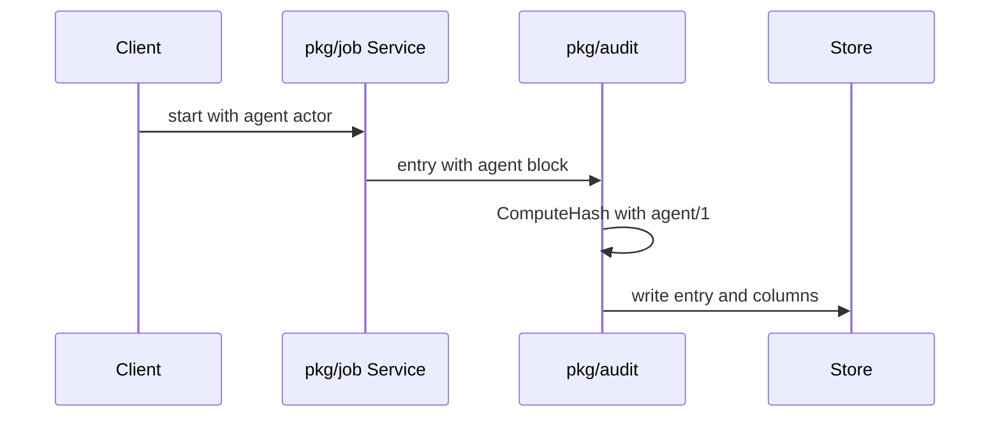
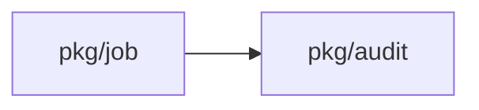
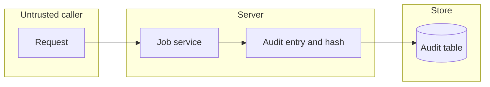

## Context

The audit entry is hashed into a chain per scope. The agent data must enter the hash without a change to old hashes.

## Decisions

1. **One block encoding.** ComputeHash appends the length-prefixed text agent/1 then the six fields in the fixed order agentRun, agentSession, tool, argsDigest, breakGlass as true or false, secretStage, each length-prefixed. No field is optional inside the block. It appends nothing when all six are empty and breakGlass is false.
2. **Job entries use the block.** The conversion from Actor.Agent to job.AgentRef sets agentRun to the run ID for the channel agent, agentSession to the MCP session ID or the run ID, and breakGlass to true for a break-glass credential. tool, argsDigest and secretStage stay empty.
3. **The delegation is not in the block.** No ADR places the delegation of ADR 354 in the agent/1 block. The block keeps its six fields. A later block version, agent/2, needs an owner decision.

## Structure

An unexported agentBlock type in pkg/audit holds the six fields. Its constructor newAgentBlock checks length and character limits. Only ComputeHash encodes it, so no caller can hash a field outside the block. Entry holds the block by a constructor-checked setter.

## Risks

- A wrong encoding order changes hashes of new entries only. The tests of two entries that differ in one field catch it.
- Dialect baselines can drift. The store conformance suite checks both dialects.

## Layers (defense in depth)

| Layer | Guard | Hostile test |
| --- | --- | --- |
| boundary check | The constructor accepts only the allowlisted channel values and refuses control characters and values over 256 bytes. | TestAgentBlockRefusesHostileFields |
| encode or contain | Each field is length-prefixed in the hash, so a joined value cannot mimic two fields. SQL uses placeholders. | TestComputeHashDiffersForEachAgentField |
| limit | A size limit of 256 bytes for each field. | TestAgentBlockRefusesOversizedField |
| authorize at point of use | The read route keeps its existing audit read action. The block shows only to a reader of the entry. | TestAuditEntriesRouteKeepsItsAction |
| fail closed | A write with an invalid block fails and stores nothing. The chain check fails on a changed field. | TestChainCheckFailsOnChangedAgentField |

## Diagrams

After this change:

Modules that the change touches, and their imports on main:

## Quality attributes

| Attribute | Target | Unit | Scope |
| --- | --- | --- | --- |
| hash cost | 5 | percent increase of ComputeHash time | an entry with no agent data |
| storage growth | 6 | columns of at most 256 bytes each | each audit row |

## Threat model

Data flow and trust boundaries:

| Boundary | STRIDE | Threat | Layer | Guard | Hostile test |
| --- | --- | --- | --- | --- | --- |
| Server to store | T | A changed agent field in a stored row hides who acted. | boundary check | The block constructor allowlists the channel and the characters. | TestAgentBlockRefusesHostileFields |
| Server to store | T | A changed agent field in a stored row hides who acted. | encode or contain | Length-prefixed fields in the hash and SQL placeholders. | TestComputeHashDiffersForEachAgentField |
| Server to store | T | A changed agent field in a stored row hides who acted. | limit | 256 bytes for each field. | TestAgentBlockRefusesOversizedField |
| Server to store | T | A changed agent field in a stored row hides who acted. | authorize at point of use | The audit read route keeps its action. | TestAuditEntriesRouteKeepsItsAction |
| Server to store | T | A changed agent field in a stored row hides who acted. | fail closed | The chain check fails on a changed field and the write fails on an invalid block. | TestChainCheckFailsOnChangedAgentField |

## Contracts

**audit.Entry**

- Invariant: An entry with six empty agent fields and breakGlass false has no block in its hash.
- Invariant: Each agent field has at most 256 bytes and no control character.
- `ComputeHash`: pre: The entry fields are set.. Post: The hash has no block when the six fields are empty, else it has the agent/1 block in the fixed order..

## Change impact (computed from main)

Tests:

- `internal/removalalertsvc/fakes_test.go` names `audit.Entry`
- `internal/removalalertsvc/removalalertsvc_test.go` names `audit.Entry`
- `internal/cost/costtest/mem_test.go` names `audit.Entry`

ADRs:

- `docs/adr/0265-a-unit-shows-all-its-states-with-one-fixed-set-of-words.md` names `audit.Entry`
- `docs/adr/0154-history-gaps-found-before-the-implementation.md` names `audit.Entry`
- `docs/adr/0200-profiles-config-secrets-and-credentials-for-every-tool.md` names `audit.Entry`
