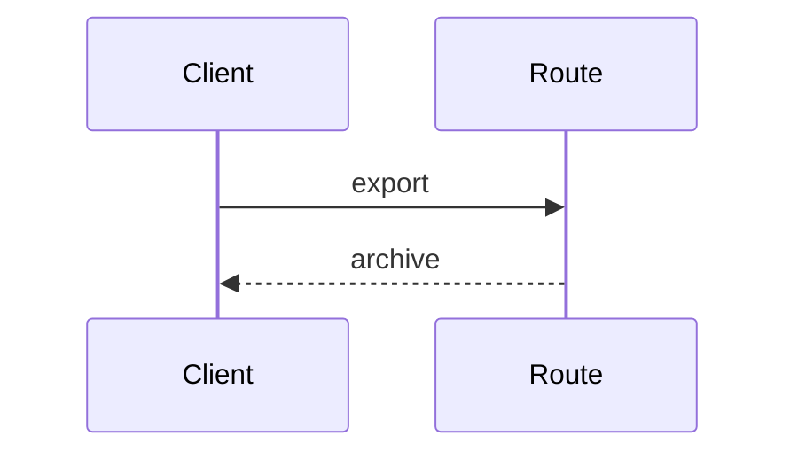
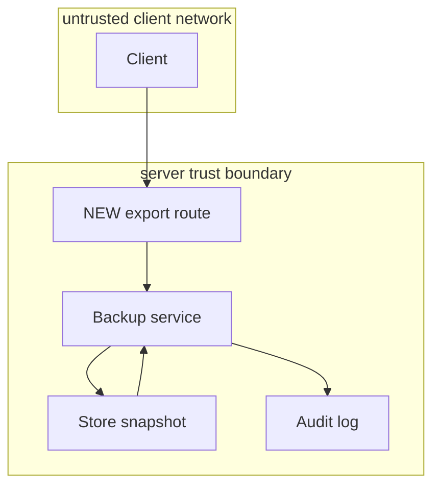

## Context

Installation backup already exports portable format at installation scope. This part adds the same portable writer at namespace scope behind namespace backup actions.

## Decisions

1. **Reuse portable writer.** Reuse the existing portable writer and table list. Add a namespace ID filter at the store boundary, not a new format. Shared control rows come only from the table list allowlist.
2. **Pre-count then stream.** Export is a read over a consistent snapshot. Enforce the 512 MiB limit with a pre-count before the 200 status, then stream the archive. A mid-stream store error aborts the connection, and the audit entry records abort.
3. **Name resolves once to stable ID.** Route takes the namespace name, resolves it once to the stable namespace ID, and authorizes the NEW action namespace-backup:export on that ID at the route and again in the service. Audit uses the ID, so a rename during export does not change scope.

## Structure

Unexported namespaceExporter type in pkg/backup with constructor NewNamespaceExporter that takes the namespace ID and the limit. Only the constructor builds the filter, so no caller can omit the scope.

## Risks

- Export of a large namespace can use much memory without a byte limit and streaming download.

## Layers (defense in depth)

| Layer | Guard | Hostile test |
| --- | --- | --- |
| boundary check | Route rejects unknown namespace names and missing credentials with 404 or 401. | Request export for a hidden namespace name and confirm the answer stays 404. |
| authorize at point of use | Service checks the NEW namespace backup action on the namespace ID at the point of use. | Call the service with a token that lacks the export grant and confirm denial. |
| limit | Export runs under a read-only snapshot transaction with a 512 MiB pre-count limit and a 60 s request timeout. | Export a namespace above the byte limit and confirm refusal before any body byte. |

## Diagrams

After this change:

Modules that the change touches, and their imports on main:

New imports of this change (each one allowed by the module rules):

- `internal/api/server` imports `pkg/backup`

## Quality attributes

| Attribute | Target | Unit | Scope |
| --- | --- | --- | --- |
| storage growth | 512 | MiB max archive | per namespace export |
| latency | 30 | s max for 512 MiB export | export request round trip in internal/servertest |

## Threat model

Data flow and trust boundaries:

| Boundary | STRIDE | Threat | Layer | Guard | Hostile test |
| --- | --- | --- | --- | --- | --- |
| client to NEW export route | I | A caller reads the backup of a namespace they cannot use. | boundary check | Allowlist namespace name shape; reject unknown names with 404 and log no detail. | Send path traversal and hidden namespace names directly to the route. |
| client to NEW export route | I | A caller reads the backup of a namespace they cannot use. | encode or contain | Stream archive with content-disposition attachment and no inline sniffing. | Download the archive and confirm safe headers and no secret in headers. |
| client to NEW export route | I | A caller reads the backup of a namespace they cannot use. | limit | Enforce 512 MiB pre-count limit and 60 s request timeout. | Export an oversize namespace and confirm the server refuses before any body byte. |
| client to NEW export route | I | A caller reads the backup of a namespace they cannot use. | authorize at point of use | Check the NEW action namespace-backup:export on the namespace ID at the route and the service. | Call with a token valid for another namespace and confirm 403. |
| client to NEW export route | I | A caller reads the backup of a namespace they cannot use. | fail closed | Deny on auth or store error and write one audit entry for each allow and deny. | Force a store error mid-export and confirm the connection aborts with an audit abort entry. |

## Contracts

**backup**

- Invariant: A namespace export holds only rows whose namespace ID equals the target plus the shared control rows named by the table list, and no row of another namespace.
- Invariant: An export never changes stored data and never decrypts sealed values.
- `ExportNamespace`: pre: The caller holds the NEW action namespace-backup:export on the namespace ID.. Post: The caller receives one portable-format archive of the named namespace, or the NEW error code namespace-backup.too-large before any body byte when over 512 MiB..
