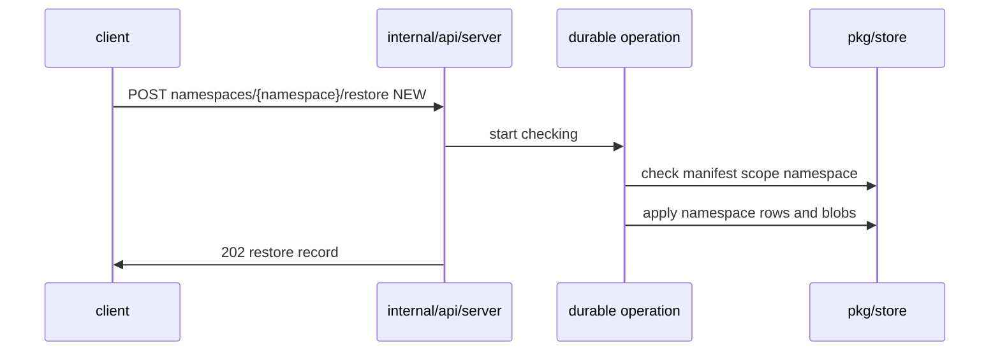
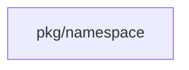
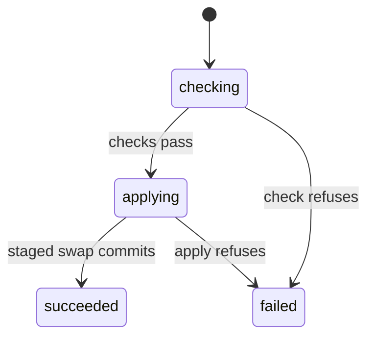
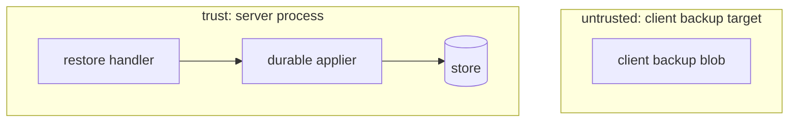

## Context

Namespace restore scoped to one namespace, as a durable operation, using the portable format from part 1.

## Decisions

1. **Writer fence per namespace.** Scope every write with pkg/namespace fence of the target namespace. Restore bumps the failover version once at start of apply; the restore writer carries the new fence and stale writers with the old fence fail the store check in the same transaction.
2. **Tombstone replay before apply.** Replay tombstone and shredded item-key state from the backup before the staged swap so redacted and purged content stays gone after restore; safety backup skips shredded content.
3. **Backup source and scope check.** Request holds backupId from the configured backup target. No upload. Cross-namespace restore of backup A into B is refused. Existing tool-neutral routes stay; cross-dialect and older-schema backups follow the portable import rules.

## Structure

Unexported namespaceRestore applier whose constructor takes the target namespace ID, the backup ID, and the fence, and that constructor alone builds the staged write set.

## Risks

- Restore of the wrong backup into a live namespace.
- Concurrent second restore on the same namespace.

## Layers (defense in depth)

| Layer | Guard | Hostile test |
| --- | --- | --- |
| authorize at point of use | Route checks NEW action namespace:restore on the namespace object before the durable operation starts. | Start restore with a token that has no grant on the namespace and check refusal. |
| fail closed | Writer carries the bumped namespace fence; store checks it in the same transaction. | Replay a restore write with a stale fence version and check refusal. |
| boundary check | Check manifest scope, table coverage, blob presence, and key open before any live write. | Submit a backup of another namespace or with a missing blob and check refusal. |

## Diagrams

After this change:

Modules that the change touches, and their imports on main:

States and transitions after this change:

## Quality attributes

| Attribute | Target | Unit | Scope |
| --- | --- | --- | --- |
| latency | check completes within 60 s for 10000 rows | seconds | namespace restore check path |
| none affected | no storage growth target beyond safety backup of the namespace |  |  |

## Threat model

Data flow and trust boundaries:

| Boundary | STRIDE | Threat | Layer | Guard | Hostile test |
| --- | --- | --- | --- | --- | --- |
| client backup to restore handler | T | Tampered backup replaces another namespace or escalates access. | boundary check | Allowlist manifest scope namespace, table list, and blob key shape; reject unknown format. | Send installation-scope manifest and traversal blob key directly to handler. |
| client backup to restore handler | T | Tampered backup replaces another namespace or escalates access. | encode or contain | Use store placeholders and blob key containment checks; never shell out. | Send traversal blob key and check no read outside target. |
| client backup to restore handler | T | Tampered backup replaces another namespace or escalates access. | limit | Bound blob size at 1 GiB per blob, row count at 1000000 rows, and request timeout at 60 s; least privilege store role. | Send oversize blob manifest and check refusal. |
| client backup to restore handler | T | Tampered backup replaces another namespace or escalates access. | authorize at point of use | Check namespace grant at point of use for the target namespace object. | Call with token lacking namespace grant and check refusal. |
| client backup to restore handler | T | Tampered backup replaces another namespace or escalates access. | fail closed | Fail closed on key open failure or blob mismatch; write audit entry. | Break one blob hash and check refusal with no live write. |

## Contracts

**Namespace restore**

- Invariant: Restore replaces rows and blobs whose namespace ID equals the target namespace.
- Invariant: Other namespaces keep rows, blobs, grants, and keys.
- `StartNamespaceRestore`: pre: Backup manifest scope equals namespace and names the target namespace.. Post: Restore record exists in checking state with backup ID and requester..
- `ApplyNamespaceRestore`: pre: Checks passed and writer holds the new namespace fence.. Post: Target namespace matches the backup and safety backup ID is recorded..

## Failure modes

| Step | Failure | Retry | State after |
| --- | --- | --- | --- |
| Copy namespace blobs | Blob copy fails partway. | Retry the durable operation; staged data is not live. | applying |
| Check namespace key versions | Key for another customer key fails to open. | Refuse before swap; operator fixes key access and retries. | failed |
| Swap staged namespace rows | Instance stops during staged swap. | Retry the durable operation from the staged set; the staged swap commits in one transaction and never auto-restores the safety backup. | applying |
