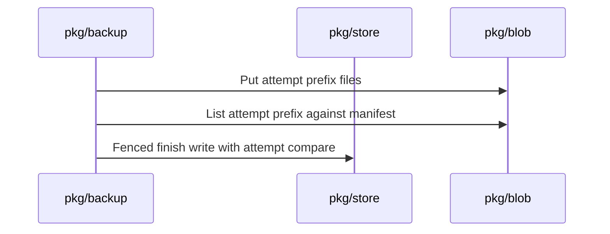
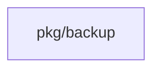
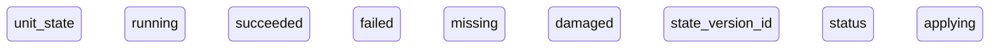
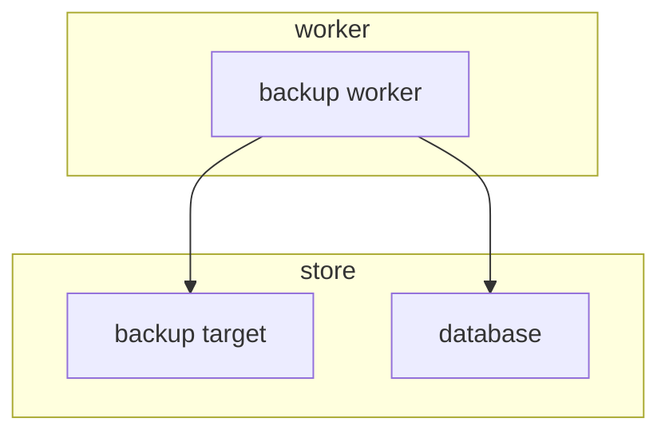

## Context

Backup target writes run on two or more instances behind one load balancer on one PostgreSQL database and one S3-compatible bucket with no conditional writes.

## Decisions

1. **Attempt prefix as a type.** Attempt-scoped layout `backups/<id>/<attempt>/` makes cross-attempt damage impossible by shape. NEW unexported type `attemptPrefix` in `pkg/backup` with NEW constructor `newAttemptPrefix` checks allowlist for each part and refuses dot-dot and slash. Clear, put, delete, and manifest-write helpers take `attemptPrefix`, never a plain string. The attempt equals the claim fencing token, stored in the backups baseline row and in the manifest. Each Put and each Delete re-reads the claim token right before the target call and skips the call when the claim moved. Finish calls `Check` on that prefix with sizes and blob copies, then commits in the fenced transaction that compares manifest attempt with live claim attempt. The manifest write is fenced too.
2. **Cleanup under the live claim.** Only the live-claim holder deletes old prefixes, after its own finish commit. The live holder lists the parent `backups/<id>/`, deletes only non-live attempt prefixes of the same backup, and re-checks the claim before each delete batch. It never deletes the live prefix named by the finished manifest. A stale writer that resumes after the delete recreates only its own stale prefix; the next list by the live holder or retention expiry removes it again. A backup that never finishes leaves prefixes until retention expiry deletes each prefix of the expired backup.
3. **Baseline edit.** Schema change is an in-place edit of the baseline of each dialect adding the backups attempt column, per ADR 322. No numbered migration and no old-layout read path because no tag shipped the old layout.

## Structure

NEW unexported type `attemptPrefix` in `pkg/backup` built only by NEW `newAttemptPrefix`; all target writes take it so a stale attempt cannot name the survivor prefix.

## Risks

- Manifest must name the attempt or a reader cannot tell which prefix is live.
- Each takeover leaves one orphaned prefix until the live holder or retention expiry deletes it.

## Diagrams

After this change:

Modules that the change touches, and their imports on main:

States on main in the touched packages:

## Quality attributes

| Attribute | Target | Unit | Scope |
| --- | --- | --- | --- |
| storage growth | at most 1 extra prefix per takeover until cleanup deletes it | prefixes | one backup |
| latency | at most 1 extra list of the attempt prefix per finish | lists | backup finish step |

## Threat model

Data flow and trust boundaries:

| Boundary | STRIDE | Threat | Layer | Guard | Hostile test |
| --- | --- | --- | --- | --- | --- |
| worker boundary | T | A stale holder deletes or truncates the survivor attempt prefix after the survivor finished. | boundary check | Allowlist on backup id and attempt when building the attempt prefix. | Send dot-dot and slash as attempt and check the constructor refuses them. |
| worker boundary | T | A stale holder deletes or truncates the survivor attempt prefix after the survivor finished. | encode or contain | Build target keys only from the attemptPrefix type, never by joining strings. | Remove the type and check the test fails to build. |
| worker boundary | T | A stale holder deletes or truncates the survivor attempt prefix after the survivor finished. | limit | Stale attempt addresses only its own prefix. | Replay a stale delete against the survivor prefix and check no file is removed. |
| worker boundary | T | A stale holder deletes or truncates the survivor attempt prefix after the survivor finished. | authorize at point of use | Finish commit compares manifest attempt with the claim fencing token. | Finish with a mismatched attempt and check the commit is refused. |
| worker boundary | T | A stale holder deletes or truncates the survivor attempt prefix after the survivor finished. | fail closed | Deny finish on any check or fence error and keep the backup running. | Fail the list and check the backup is not marked succeeded. |
| store boundary | I | A stale holder commits finish or cleanup for an attempt it no longer holds. | boundary check | Fenced finish transaction checks the claim token and the attempt in one statement. | Commit with a stale token and check the transaction refuses it. |
| store boundary | I | A stale holder commits finish or cleanup for an attempt it no longer holds. | encode or contain | Attempt stored as a bounded token string of at most 64 allowlisted characters. | Store an oversized attempt and check the write is refused. |
| store boundary | I | A stale holder commits finish or cleanup for an attempt it no longer holds. | limit | Only the live-claim holder deletes non-live prefixes of the same backup. | Delete a live prefix from a stale claim and check it is refused. |
| store boundary | I | A stale holder commits finish or cleanup for an attempt it no longer holds. | authorize at point of use | Cleanup delete checks the live claim at the point of use before each batch. | Run cleanup with a stale token and check no delete happens. |
| store boundary | I | A stale holder commits finish or cleanup for an attempt it no longer holds. | fail closed | Deny cleanup on fence loss and leave prefixes for retention expiry. | Lose the claim mid-cleanup and check remaining prefixes stay until expiry. |

## Contracts

**backup**

- Invariant: A finished backup id names exactly one live attempt prefix and its manifest names that attempt.
- Invariant: A stale attempt writes or deletes only under its own attempt prefix.
- Invariant: Only the holder of the live claim deletes a non-live attempt prefix of the same backup.
- `Check`: pre: Manifest names the attempt prefix of the backup.. Post: Reports corrupt when a listed file of the attempt prefix is missing or its size differs from the manifest..

## Failure modes

| Step | Failure | Retry | State after |
| --- | --- | --- | --- |
| Backup target write | Instance killed between target writes and finish commit | Another worker instance reclaims after lease expiry and runs the next attempt under a new prefix | Backup stays running; old prefix is orphaned until the live holder or retention expiry deletes it |
| Backup finish | Stale holder resumes with blob delete in flight after survivor finish | No retry; delete lands under the stale attempt prefix only | Finished backup stays complete; Check passes |
| Backup finish cleanup | Cleanup lists parent while a stale writer still runs | Live holder re-lists the parent and deletes the recreated stale prefix; retention expiry is the last cleanup | Live prefix stays readable; stale prefix is removed on the next pass |
