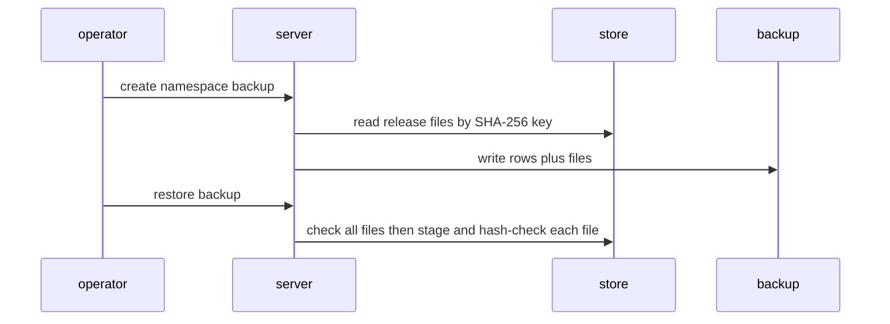
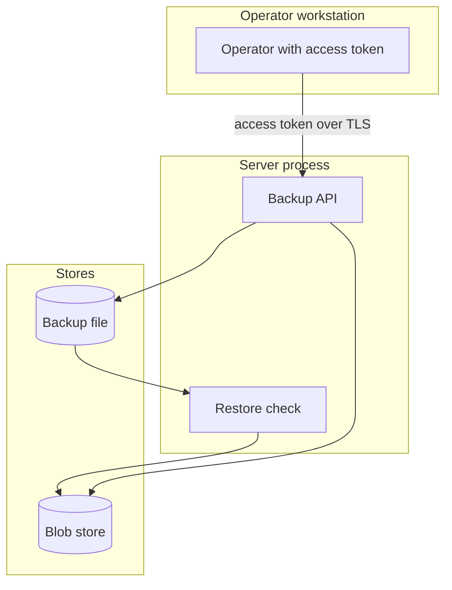

## Context

Namespace backups copy registry rows but not the release files under the SHA-256 content keys. A restore on another blob store leaves releases that name missing files.

## Decisions

1. **Copy registry files by content key.** Extend the backup blob collection to read SHA-256 hashes from published registry release rows and emit one blob reference per unique release file. Copy the files through the existing streamed blob copy path. Validate the manifest and the SHA-256 of each file during restore before any file lands at its final key, and fail the restore when a file is missing or corrupt.
2. **Keep state version references unchanged.** Keep the MD5 BlobRef shape for state versions. Add a separate registry file entry keyed by SHA-256 with 64 lowercase hex characters plus size, so old backups still read.
3. **Snapshot, scope and staged restore.** Read registry rows and the file list from one repeatable-read transaction per dialect on SQLite and on PostgreSQL, then copy blob bytes outside the transaction and re-check that no named hash changed before the manifest is sealed. Copy only files named by published releases, not staged uploads. Write restored files first under a staging prefix, hash-check each staged file, then make each key visible under namespaces/<namespace ID>/registry/sha256/ of the target namespace ID. Track each key this restore made visible and remove only those keys on failure.

## Structure

Unexported registryFileCollector built only by NewRegistryFileCollector with a namespace ID and a release reader; the constructor rejects an empty namespace ID and an empty hash.

## Risks

- Restore of an old backup without file entries still leaves unavailable releases until the team re-publishes them.
- Large release files increase backup size and backup time.

## Diagrams

After this change:

## Quality attributes

| Attribute | Target | Unit | Scope |
| --- | --- | --- | --- |
| correctness | 100 | percent of named release files copied and hash-checked | namespace backup with registry releases |
| reliability | 100 | percent of missing or corrupt files refused before any registry file write | namespace restore with registry files |

## Threat model

Data flow and trust boundaries:

| Boundary | STRIDE | Threat | Layer | Guard | Hostile test |
| --- | --- | --- | --- | --- | --- |
| Backup API | T | An attacker edits a release row or the backup manifest to add a path traversal key and writes outside the registry directory. | boundary check | Reject a file hash outside 64 lowercase hex characters at the boundary before any copy. | Send a release row with a path traversal hash and confirm refusal. |
| Backup API | T | An attacker edits a release row or the backup manifest to add a path traversal key and writes outside the registry directory. | encode or contain | Build each blob key only from the validated hex hash under the fixed registry prefix; never join raw input into a path. | Submit a key with separators and confirm no file lands outside the registry prefix. |
| Backup API | T | An attacker edits a release row or the backup manifest to add a path traversal key and writes outside the registry directory. | limit | Stream the copy with a per-file and total size cap and refuse above the cap. | Back up an oversize release file and confirm refusal with the size report. |
| Backup API | T | An attacker edits a release row or the backup manifest to add a path traversal key and writes outside the registry directory. | authorize at point of use | Check backup:create on the installation at the point of use. | Call backup create without the action and confirm denial with an audit entry. |
| Backup API | T | An attacker edits a release row or the backup manifest to add a path traversal key and writes outside the registry directory. | fail closed | Deny and keep the backup failed on any validation or read error; never keep a partial backup. | Fail one file hash check and confirm the whole backup fails closed. |
| Blob store | T | An attacker swaps registry file bytes in the backup or in the blob store so a restored release serves altered code. | boundary check | Reject a manifest entry outside 64 lowercase hex characters at restore before any write. | Restore a backup with a hostile manifest key and confirm refusal before any write. |
| Blob store | T | An attacker swaps registry file bytes in the backup or in the blob store so a restored release serves altered code. | encode or contain | Verify SHA-256 of each staged file at backup and at restore before the key becomes visible. | Swap bytes under a valid key name and confirm backup and restore both stop. |
| Blob store | T | An attacker swaps registry file bytes in the backup or in the blob store so a restored release serves altered code. | limit | Stream the restore with a per-file and total size cap and refuse above the cap. | Restore a backup with oversize files and confirm refusal with no visible keys. |
| Blob store | T | An attacker swaps registry file bytes in the backup or in the blob store so a restored release serves altered code. | authorize at point of use | Check restore:execute on the installation at the point of use. | Call restore without the action and confirm denial with an audit entry. |
| Blob store | T | An attacker swaps registry file bytes in the backup or in the blob store so a restored release serves altered code. | fail closed | Deny and remove only keys this restore staged on any missing or corrupt file; hash-check pre-existing keys and refuse on mismatch. | Corrupt one staged file and confirm the restore fails with no new visible keys. |

## Failure modes

| Step | Failure | Retry | State after |
| --- | --- | --- | --- |
| Copy registry files into backup. | Blob read fails midway through backup copy. | Fix blob store access and run `opendustpan backup create --namespace <namespace>` again. | Backup stays failed and no partial backup is kept. |
| Check registry files before write. | Restore stops on missing or corrupt registry file. | Run the backup again from the source installation, then restore the new backup. | Target store holds no new registry file from the failed restore; only keys this restore made visible are removed. |
