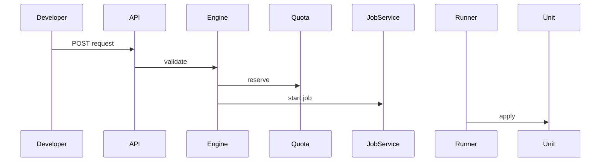
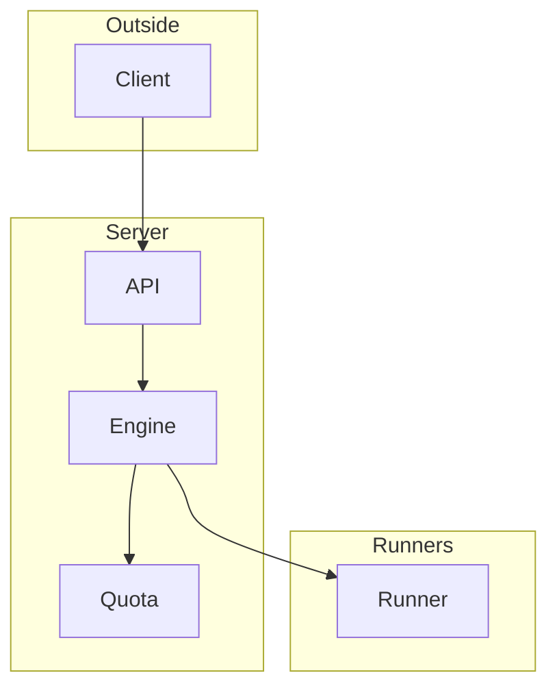

## Context

Self-service request path for milestone 6 step 1. The blueprint routes already exist on main. This change adds the request path and the quota use. The package pkg/catalog is new in the checkout if absent.

## Decisions

1. **Tool-neutral core.** The new package pkg/catalog holds request, blueprint and ports. Tool adapters for render and provision live in internal wiring.
2. **JSON Schema inputs.** Validate answers at the boundary with a 1 MiB body limit. An unknown input fails with an error that names it. Revisions pin the blueprint version.
3. **Quota in submit.** Reserve one unit per units key in the submit transaction through the quota.Tx adapter. The provisioner runs after it, idempotent by request ID.
4. **Idempotent submit.** Idempotency-Key is required. Same key and body returns the same revision. Same key and another body gives 409.

## Structure

Unexported type selfServiceEngine with constructor newSelfServiceEngine that checks schema, quota port and provisioner. Only the constructor makes a valid engine.

## Risks

- Schema change between versions; revisions pin the version.
- Count drift; hourly reconcile from inventory wins.

## Layers (defense in depth)

| Layer | Guard | Hostile test |
| --- | --- | --- |
| boundary input check | JSON Schema check against the pinned version | Extra input gives 400 that names it and no unit |
| safe render | Inputs encoded as plain data, no secret value | Shell and template markers stay data |
| authorization at use | Action check at each endpoint | Token without the action is denied with an audit entry |

## Diagrams

After this change:

## Quality attributes

| Attribute | Target | Unit | Scope |
| --- | --- | --- | --- |
| validation correctness | 100 | percent of bad inputs refused with named input | request submit |

## Threat model

Data flow and trust boundaries:

| Boundary | STRIDE | Threat | Layer | Guard | Hostile test |
| --- | --- | --- | --- | --- | --- |
| API ingress | T | Hostile inputs in a request | boundary check | JSON Schema allowlist | Extra input gives 400 and no unit |
| API ingress | T | Hostile inputs in a request | limit | 1 MiB body limit | 5 MiB body gives 413 |
| API ingress | T | Hostile inputs in a request | authorize at point of use | Action check at submit | Token without the action is denied |
| API ingress | T | Hostile inputs in a request | fail closed | Unknown blueprint gives 404 | Other namespace blueprint gives 404 |
| API ingress | T | Hostile inputs in a request | encode or contain | Inputs rendered as data | Shell markers stay data |

## Failure modes

| Step | Failure | Retry | State after |
| --- | --- | --- | --- |
| Provision then start job | Unit made but job start fails | Retry with the same key; the server starts one job | Empty unit with no job; reservation stays until the deadline |

## Change impact (computed from main)

Tests:

- `pkg/tempadmin/tempadmin_test.go` names `job.Service`
- `pkg/manuallock/manuallock_test.go` names `job.Service`
- `pkg/backup/export_internal_test.go` names `job.Service`
- `pkg/trigger/jobstarter/jobstarter_test.go` names `job.StartRequest`
- `pkg/job/defaulted_test.go` names `job.StartRequest`
- `pkg/durable/runner_claimed_test.go` names `job.StartRequest`
- `internal/mfasvc/service_test.go` names `quota.Counter`
- `pkg/mfa/gowebauthn/gowebauthn_test.go` names `quota.Counter`
- `internal/quota/quotatest/mem_test.go` names `quota.Counter`

Docs pages:

- `docs/guides/access-tokens.md:23` names `job.Service`
- `docs/guides/kubernetes.md:85` names `job.Service`
- `docs/guides/kubernetes.md:87` names `job.Service`

ADRs:

- `docs/adr/0114-the-policy-port-and-its-default-adapters.md` names `job.Service`
- `docs/adr/0149-ops-hardening.md` names `job.Service`
- `docs/adr/0200-profiles-config-secrets-and-credentials-for-every-tool.md` names `job.Service`
- `docs/adr/0116-request-states-jobs-approvals-and-freezes.md` names `job.StartRequest`
- `docs/adr/0110-the-catalog-a-gateway-of-declarative-requests.md` names `job.StartRequest`
- `docs/adr/0263-drift-detection-is-a-plan-only-refresh-with-an-opt-in-schedule.md` names `job.StartRequest`
- `docs/adr/0154-history-gaps-found-before-the-implementation.md` names `quota.Counter`
- `docs/adr/0110-the-catalog-a-gateway-of-declarative-requests.md` names `quota.Counter`
- `docs/adr/0115-quotas-and-reservations.md` names `quota.Counter`
