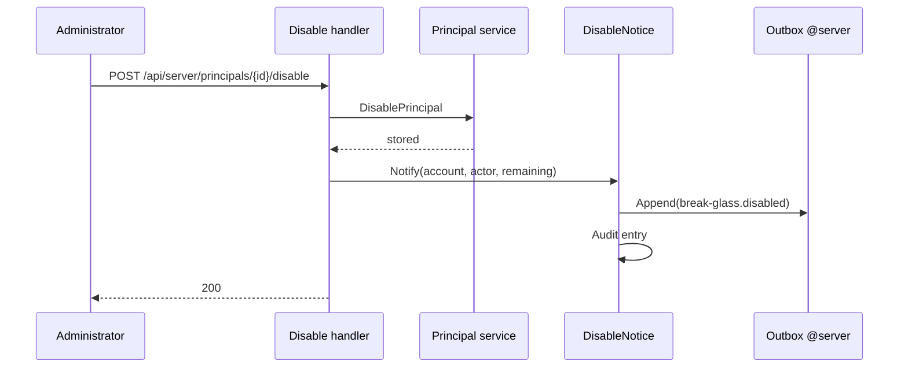

## Context

A break-glass account is a recovery path. The disable of one is a change that every administrator needs to know. Main stores an audit entry of the disable and sends no notice. The removal alert service already sends a notice of a different kind to the administrators, through the outbox of the server scope. This design adds a second service to that package and reuses its ports.

## Decisions

1. **Channel.** The notification outbox of the server scope. The sinks that the operator configured deliver the notice. No new channel kind exists.
2. **Recipients.** `notify.Recipient{Admins: true}`. The set is stored as the administrator grants. No code rule names a person.
3. **Place of the call.** After the disable commits, in the service that owns the disable. The disable and the notice are two writes, so the notice cannot undo the disable.
4. **Failure.** A failed append returns an error that wraps the cause. The service writes an audit entry of outcome failure. The disable stays stored. A rollback would restore an account that an administrator chose to disable.
5. **Type.** One new type, `break-glass.disabled`, in the catalog `Types()`. The type has a test that the catalog and the constants agree.
6. **Reuse.** `NewDisableNotice` takes the same ports as `New` of the removal alert, without the removal log and the member list. The two services share no state.

## Structure

- `pkg/notify/notify.go`: const `BreakGlassDisabled` and its line in `Types()`.
- `pkg/principal/`: const `ActionBreakGlassDisableNotice`, `principal:break-glass-disable-notice`.
- `internal/removalalertsvc/breakglass_disable.go` (NEW): `DisableNotice`, `NewDisableNotice`, `Notify`.
- `pkg/dustpan/localusers.go`: the wiring.
- `internal/api/server/principals.go`: the disable handler calls the notice after the disable.
- `docs/guides/break-glass.md`: the notice.

## Risks

- A notice flood: one disable gives one notice, and the guard of keep-two-working-break-glass limits the count of disables.
- The notice text names the actor. The text holds the stable ID and no free text from the caller.

## Layers

| Layer | Check | Test that fails when the check is removed |
| --- | --- | --- |
| Port adapter (outbox) | Rejects an attribute key with an invalid character. | Hostile key in the attributes table. |
| Service | Refuses a principal that is not a break-glass account. Refuses an empty actor. Fails closed with an audit entry. | Table of hostile inputs for `Notify`. |
| HTTP handler | Calls the notice only after a stored disable of a break-glass account. | Handler test: a failed disable sends no notice. |

## Diagrams

## Quality attributes

- Observability: the notice and its audit entry name the account, the actor and the remaining count.
- Reliability: a failed notice never hides a stored disable. The error reaches the caller and the audit log.
- Security: no free text from the caller enters the notice.

## Threat model

| STRIDE | Threat | Control |
| --- | --- | --- |
| Spoofing | A caller names another actor. | The actor comes from the session of the request, not from the body. |
| Tampering | A crafted attribute breaks the notice. | The attribute keys are constants. The values are stable IDs and numbers. |
| Repudiation | An administrator denies the disable. | The notice and the audit entry name the actor. |
| Information disclosure | The notice leaks account data. | The notice holds the stable ID, the actor and a count. |
| Denial of service | Many disables flood the outbox. | The floor guard limits the disables. The outbox has its own limits. |
| Elevation of privilege | A non-administrator reads the notice. | The recipients are the administrators. |

## Failure modes

| Failure | Result |
| --- | --- |
| The outbox is down. | The disable stays stored. The caller gets an error. An audit entry of outcome failure exists. |
| The audit write fails. | The caller gets an error that wraps both causes. |
| The account is not a break-glass account. | No notice. |
