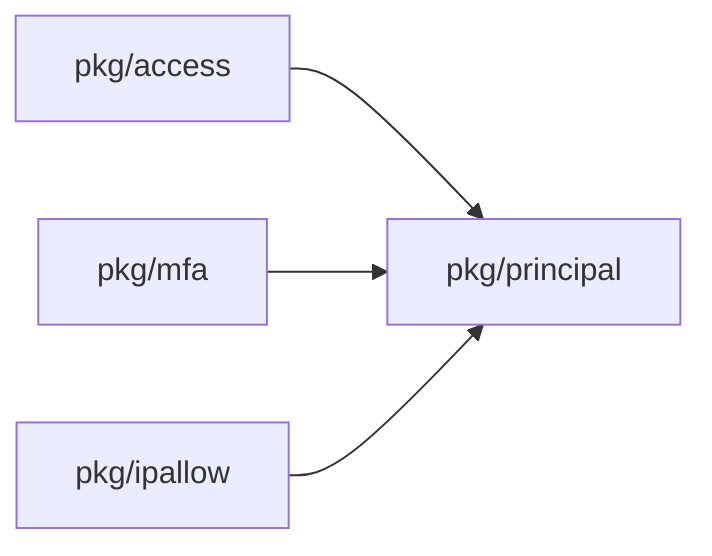
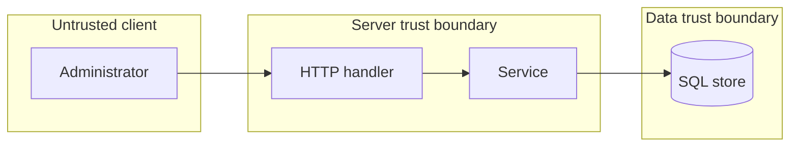

## Context

The change keep-two-working-break-glass adds the count function and the set type for disable, delete and restore. Three other writes can lower the count: the revoke of an access grant, the removal of a passkey and the write of an IP allowlist. Each one has its own transaction in its own port. This design adds the same check to each, with the one count function and the one sentinel, and adds no new route.

## Decisions

1. **One rule, three writes.** Each write runs the count function inside its own transaction, after its own change. It is refused when the count fell and the count after the write is below FloorWorkingPaths (2). A write that does not lower the count is never refused (Owner decision, 13 Nov 2026 (queue P19), item 17).
2. **The same set type.** The write takes the set of the change keep-two-working-break-glass from its transaction and calls its method requireFloor. No second count code and no second sentinel exist. The sentinel is ErrNoWorkingBreakGlass and the code is principal.no-working-break-glass.
3. **Count before and after.** The write reads the count before its change and after it, in the same transaction. A write whose after-count is not lower than its before-count passes. This keeps recovery possible below the floor.
4. **Only the grants that make an account work.** For RevokeGrant the write reads the grant first. If the grant is the grant that makes a break-glass account work (the role admin on the namespace on the hosted service, the site administrator grant on a self-hosted installation), the count runs. For any other grant the count does not run, so the cost of other revokes is unchanged.
5. **Only the passkeys of break-glass accounts.** For RemovePasskey the write reads the person first. If the person is not a break-glass account the count does not run.
6. **IP allowlist: count in the transaction.** SetNamespaceList runs the count after the list is replaced. On a self-hosted installation the namespace lists do not apply to installation sign-in, so the count does not fall and the write passes. The call stays so that a count that later reads the lists is covered with no new write path.
7. **Audit.** Each refusal writes an audit entry in the same transaction as the check, with the action of the route and the object of the write. A refusal changes no row of the write.
8. **Errors.** The adapters return the sentinel. The HTTP code maps it next to ErrLastSiteAdministrator in internal/api/server/access.go, in classifyIPAllowlist in internal/api/server/ip_allowlist.go, and in the passkey handler in internal/api/server/passkeys.go. All three answer 409.

## Structure

No new type. The conformance suites of the three ports get the cases of the guard, and each adapter calls the set of the change keep-two-working-break-glass in the transaction of its write. The passkey body is shared in internal/store/passkeystore/passkeystore.go, so the two passkey adapters get the guard from one function. RevokeGrant and SetNamespaceList have two adapters each (SQLite and PostgreSQL). Each adapter calls the one count function.

## Risks

- A revoke is refused and the administrator cannot remove a departed person. The 409 text names the live count and the route that lists the accounts. The administrator adds an account first, then revokes.
- A count that runs in every revoke makes revokes slower. Decision 4 limits the count to the grants that make a break-glass account work.
- The IP allowlist guard never refuses today. The conformance suite uses a counter that reports a lower count, so the guard has a test that fails when the call is removed.

## Layers (defense in depth)

| Layer | Guard | Hostile test |
| --- | --- | --- |
| service | The access, passkey and allowlist services pass the actor and the route action, and return the sentinel unchanged. | Call each service to lower the count below two. The service returns the sentinel. |
| store adapter | Each adapter counts in the transaction of its write and refuses below the floor. | Call each store method directly to lower the count below two. The store refuses and the row is unchanged. |
| HTTP handler | The handlers keep their actions and the fresh step, and map the sentinel to 409. | Send each write over HTTP to lower the count below two. The answer is 409 with principal.no-working-break-glass. |

## Diagrams

Modules that the change touches, and their imports on main:

## Quality attributes

| Attribute | Target | Unit | Scope |
| --- | --- | --- | --- |
| Guard latency | 100 | milliseconds, 99th percentile added to a guarded write | each guarded write on one installation with up to 50 break-glass accounts |
| Count accuracy | 0 | commits that leave fewer than two working paths after a write that lowers the count | each guarded write under parallel load in the conformance suite |

## Threat model

Data flow and trust boundaries:

| Boundary | STRIDE | Threat | Layer | Guard | Hostile test |
| --- | --- | --- | --- | --- | --- |
| Client to server | E | A caller revokes a grant, removes a passkey or writes a list so that fewer than two working paths stay. | boundary check | The handler validates the id and the body and keeps its action and fresh step. | Send a malformed grant id and a malformed passkey id. Both get 400 or 404 and the count is unchanged. |
| Client to server | E | A caller revokes a grant, removes a passkey or writes a list so that fewer than two working paths stay. | encode or contain | The stores use SQL placeholders only, and the ids are stable IDs. | Send an id with SQL text. The store matches no row. |
| Client to server | E | A caller revokes a grant, removes a passkey or writes a list so that fewer than two working paths stay. | limit | One write changes one grant, one passkey or one list. | Send a list of ids in the id field. The handler rejects it. |
| Client to server | E | A caller revokes a grant, removes a passkey or writes a list so that fewer than two working paths stay. | authorize at point of use | Each write checks its own action on its own object, as on main. | Call the service with an actor that lacks the action. It refuses and the count is unchanged. |
| Client to server | E | A caller revokes a grant, removes a passkey or writes a list so that fewer than two working paths stay. | fail closed | A failed count denies the write and writes an audit entry. | Make the count fail. The write is denied. |
| Server to data | D | Two writes run in parallel and each one alone leaves two working paths, but together they leave fewer. | boundary check | The store reads the grant or the person before it counts. | Revoke a grant that does not belong to a break-glass account. The count does not run. |
| Server to data | D | Two writes run in parallel and each one alone leaves two working paths, but together they leave fewer. | encode or contain | The count reads rows of its own scope with placeholders. | Revoke in namespace A and check that the count of namespace B is unchanged. |
| Server to data | D | Two writes run in parallel and each one alone leaves two working paths, but together they leave fewer. | limit | The count runs in the write transaction, so the database serializes the two writes on the rows. | Remove two passkeys of two accounts in parallel. One write is refused. |
| Server to data | D | Two writes run in parallel and each one alone leaves two working paths, but together they leave fewer. | authorize at point of use | Each adapter counts for each caller, whatever the service did. | Call each store method directly. The store refuses. |
| Server to data | D | Two writes run in parallel and each one alone leaves two working paths, but together they leave fewer. | fail closed | A refusal rolls back the whole write. | Refuse a revoke and read the grant. It is unchanged. |
| Client to server | R | A refused write leaves no record of who tried it. | boundary check | The handler sets the actor from the checked identity, never from the body. | Send a body with a forged actor. The entry names the real caller. |
| Client to server | R | A refused write leaves no record of who tried it. | encode or contain | The audit writer removes CR and LF from each text field. | Send a reason with line breaks. The entry holds one line. |
| Client to server | R | A refused write leaves no record of who tried it. | limit | The entry has a size limit on its fields. | Send a very long reason. The entry is cut or refused and the data stays consistent. |
| Client to server | R | A refused write leaves no record of who tried it. | authorize at point of use | Only the guard path writes the refusal entry. | Read the entry of a refusal. It names the action and the object. |
| Client to server | R | A refused write leaves no record of who tried it. | fail closed | A failed audit write fails the whole write. | Fail the audit write. The write is not stored. |

## Failure modes

| Step | Failure | Retry | State after |
| --- | --- | --- | --- |
| Revoke of a grant that leaves one working account | The count after the write is below two. | The caller adds an account, then revokes. | The grant stays and the audit log records the refusal. |
| Removal of the last passkey of a break-glass account | The count after the write is below two. | The caller rotates the credential instead. | The passkey stays. |
| Write of a list with a count that fails | The count returns an error. | The caller sends the write again. | The transaction rolls back and the list stays. |
