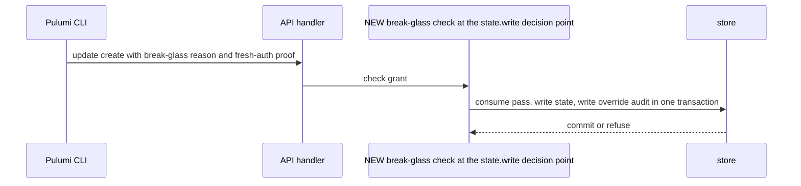
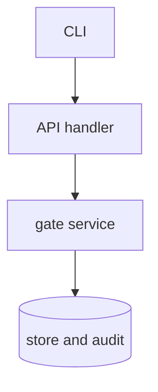

## Context

A gate engine error in enforce mode stops every write of its scope. The change adds a narrow single-use pass. The holder of the pass is the authenticated principal of the request, which is the principal of the issue text (same principal, unit and operation kind). The audit entry names the principal and, for a delegated request, the delegating actor when the request carries one.

## Decisions

1. **Break-glass as a checked value.** A value type built by one constructor that checks the grant, the reason and the fresh authentication, so an unchecked pass cannot be built. The holder is the authenticated principal of the request.
2. **Single-use timed pass.** The pass rides on the same write request. The store does a conditional consume in the same transaction as the write and the audit entry, so one caller wins and a rollback leaves the pass unused.

## Structure

Unexported type breakGlassPass with constructor newBreakGlassPass that checks grant, reason, fresh authentication and kind.

## Risks

- Pass reuse across units or kinds if the key is too wide.
- Deny bypass if the error path also passes deny.
- Clock skew if expiry uses the server clock.

## Layers (defense in depth)

| Layer | Guard | Hostile test |
| --- | --- | --- |
| handler | Checks reason, fresh authentication and grant at the boundary. | Send empty, overlong, control-character reasons, stale auth and no grant; each is refused with no pass row. |
| service | Consumes only for result error, same holder, unit and kind, once, within 15 minutes. | Replay the pass and use it on another unit; both fail closed. |
| store | Writes the override audit entry in the same transaction. | Drop the audit write; the conformance test fails. |

## Diagrams

After this change:

## Quality attributes

| Attribute | Target | Unit | Scope |
| --- | --- | --- | --- |
| correctness | 1 | winner per pass under concurrent use | break-glass consume |

## Threat model

Data flow and trust boundaries:

| Boundary | STRIDE | Threat | Layer | Guard | Hostile test |
| --- | --- | --- | --- | --- | --- |
| CLI boundary | S | A caller forges break-glass without the grant or with stale auth | boundary check | Allowlist for reason, grant and fresh auth | Send bad reasons, stale auth and no grant; each is refused |
| CLI boundary | S | A caller forges break-glass without the grant or with stale auth | encode or contain | Reason stored as inert text | Send markup and newlines; the stored text stays inert |
| CLI boundary | S | A caller forges break-glass without the grant or with stale auth | limit | 15-minute single-use pass | Replay after expiry; refused |
| CLI boundary | S | A caller forges break-glass without the grant or with stale auth | authorize at point of use | Grant checked for the unit at use | Swap the unit; refused |
| CLI boundary | S | A caller forges break-glass without the grant or with stale auth | fail closed | Deny never passes | Send break-glass on a deny; refused |

## Contracts

**BreakGlassPass**

- Invariant: One unused pass per holder, unit and kind
- Invariant: Expiry 15 minutes on the store clock
- `consume`: pre: Pass exists, unused, not expired. Post: Used once; a second consume is refused.

## Failure modes

| Step | Failure | Retry | State after |
| --- | --- | --- | --- |
| Commit | Crash before commit | Retry with the same pass | No write and the pass stays unused |

## Change impact (computed from main)

Tests:

- `internal/expr/owned_internal_test.go` names `gate.ErrRuleFailed`
- `internal/expr/hostile_test.go` names `gate.ErrRuleFailed`
- `internal/expr/timeout_internal_test.go` names `gate.ErrRuleFailed`

ADRs:

- `docs/adr/0114-the-policy-port-and-its-default-adapters.md` names `gate.ErrRuleFailed`
- `docs/adr/0112-blueprints-the-document-versions-and-expr.md` names `gate.ErrRuleFailed`
- `docs/adr/0223-access-limits-cedar-forbid-policies-for-each-scope.md` names `gate.ErrRuleFailed`
