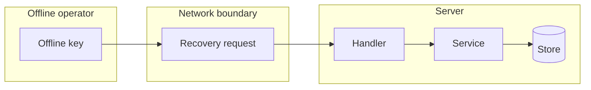

## Context

Mode 2 recovery for an installation with no working administrator. The server checks the signature of an offline-signed one-time request, refuses reuse, issues one session and writes an audit entry. The review waits for the RFC.

## Decisions

1. **Mode choice is immutable after first boot.** The store refuses a change of the recovery mode after data exists. A start in signed-request mode with no pinned key serves no recovery.
2. **Single-use requests by stored request ID.** One store holds used IDs with compare-and-set on use. A second use fails under retry, restart or concurrent submit. Used IDs are purged at expiry plus 7 days.
3. **One transaction for use.** Session issue, generation bump and audit entry commit in one transaction. A crash before commit leaves the request unused.
4. **Bounded pre-check cost.** An 8 KB body limit and a per-address refusal throttle with a bounded log. A valid signature bypasses the throttle.

## Structure

Unexported recovery service with a constructor that loads the pinned public key and the mode. Only its Redeem method marks a request ID used and issues the session.

## Risks

- Loss of the offline key leaves mode 2 unusable until a restore.
- Clock skew rejects fresh requests.
- A stolen offline key gives a short session; audit makes the use visible.

## Layers (defense in depth)

| Layer | Guard | Hostile test |
| --- | --- | --- |
| HTTP adapter | Checks mode, 8 KB body limit, shape, expiry, skew and ID form. | Send expired, future-dated, oversize and malformed requests directly to the handler. |
| Service | Checks the Ed25519 signature, audience and installation ID, and consumes the ID once. | Replay an ID, use another key, and submit the same ID twice at once to the service. |
| Store | Unique request ID and immutable mode. | Insert a duplicate ID and change the mode after first boot against the store. |

## Quality attributes

| Attribute | Target | Unit | Scope |
| --- | --- | --- | --- |
| security | 1 session for each valid request ID; a replay gives 409 with 0 sessions | sessions | recovery redeem |
| reliability | 0 sessions from a request that crashed before commit, 0 second sessions after commit | sessions | recovery redeem, one server restart |

## Threat model

Data flow and trust boundaries:

| Boundary | STRIDE | Threat | Layer | Guard | Hostile test |
| --- | --- | --- | --- | --- | --- |
| Network boundary | S | An attacker forges a recovery request. | boundary check | The service checks the Ed25519 signature against the pinned key. | Submit a request signed by another key to the service. |
| Network boundary | S | An attacker forges a recovery request. | fail closed | Any unknown value gives 401 and an audit entry. | Submit a malformed request and check for 401 and one audit entry. |
| Network boundary | T | An attacker replays a used request. | authorize at point of use | The store consumes the ID once with compare-and-set. | Submit the same ID twice at once to the store. |
| Server | D | A flood of bad requests exhausts the server. | limit | 8 KB body limit and a per-address refusal throttle; a valid signature bypasses it. | Send a flood of bad signatures, then one valid request from the same address. |
| Server | E | The recovery session gains more rights than recovery. | limit | The session lifetime uses the freshAuthSeconds window. | Use the session after the window and expect 401. |

## Failure modes

| Step | Failure | Retry | State after |
| --- | --- | --- | --- |
| Redeem | Crash before commit | Submit the same request ID again. | No session, no used ID. |
| Redeem | Concurrent duplicate submit | The loser makes a new request ID. | One session and one used ID. |
