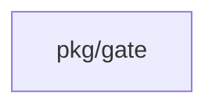
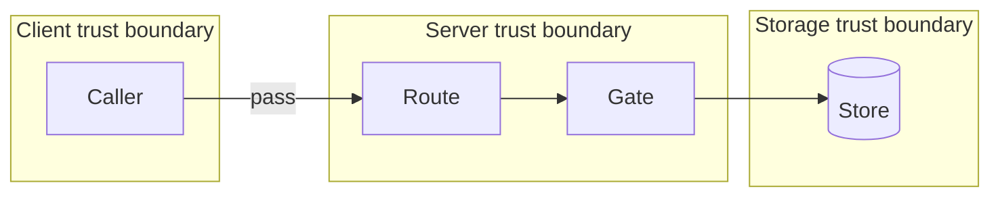

## Context

The pass logic exists in pkg/gate. The store, audit writer, grant check, route field and proof kind are open for the owner.

## Decisions

1. **Single use.** One conditional update in one transaction marks the pass used when it is unused, unexpired and for the unit. This holds for any store the owner chooses.

## Structure

An unexported pass type that only its constructor makes. The constructor checks the 15-minute limit and the unit.

## Risks

- The owner decision may change the shapes. The tasks wait for it.

## Layers (defense in depth)

| Layer | Guard | Hostile test |
| --- | --- | --- |
| boundary check | The handler accepts a pass ID of the allowed form only. | A pass of wrong length gives 403 and an audit entry. |
| limit | Single use, 15 minutes and one unit, checked in the store transaction. | Two parallel uses: one succeeds. |
| fail closed | An unknown pass or a store error is refused and audited. | A random pass gives 403 and an audit entry. |

## Diagrams

Modules that the change touches, and their imports on main:

## Quality attributes

| Attribute | Target | Unit | Scope |
| --- | --- | --- | --- |
| Pass lifetime | 15 | minutes | each break-glass pass |
| Pass use | 1 | use | each break-glass pass |

## Threat model

Data flow and trust boundaries:

| Boundary | STRIDE | Threat | Layer | Guard | Hostile test |
| --- | --- | --- | --- | --- | --- |
| HTTP route | E | A caller reuses or forges a pass to write state past a failed gate. | boundary check | The handler accepts a pass ID of the allowed form only. | A pass of wrong form gives 403. |
| HTTP route | E | A caller reuses or forges a pass to write state past a failed gate. | encode or contain | The store reads the pass by placeholder query only. | A pass with SQL text finds no row and gives 403. |
| HTTP route | E | A caller reuses or forges a pass to write state past a failed gate. | limit | Single use, 15 minutes and one unit in the store transaction. | A pass on another unit is refused. |
| HTTP route | E | A caller reuses or forges a pass to write state past a failed gate. | authorize at point of use | Unit and single-use check at the write. | A reused pass is refused. |
| HTTP route | E | A caller reuses or forges a pass to write state past a failed gate. | fail closed | An unknown pass or a store error is refused and audited. | A random pass gives 403 and an audit entry. |

## Failure modes

| Step | Failure | Retry | State after |
| --- | --- | --- | --- |
| Mark pass used | The store transaction fails. | The caller asks for a new pass. | No state is written. |
