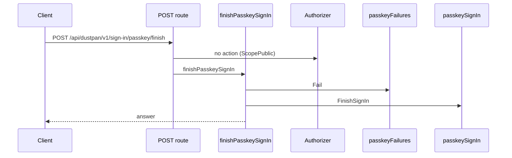
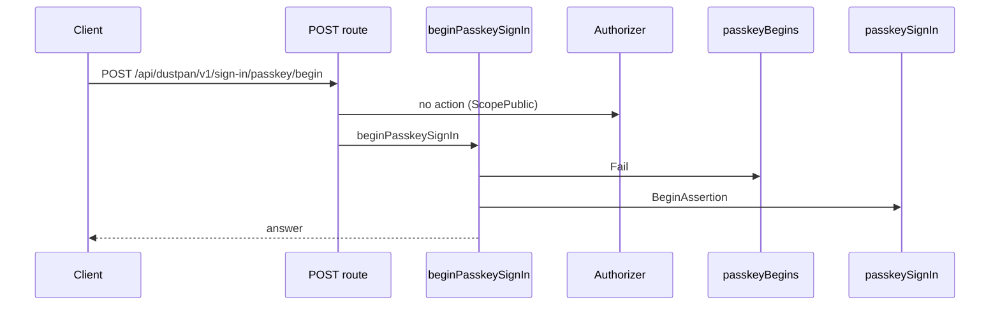
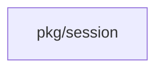
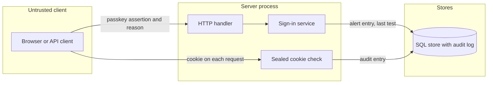

## Context

Break-glass sign-in is the last-resort path when the identity provider is lost. The change makes misuse visible and short-lived.

## Decisions

1. **One value checks reason and expiry.** One unexported value makes the session claims. Its constructor rejects an empty reason, an over-long reason, any control character, DEL, a line or paragraph separator, and an expiry beyond the setting or in the past.
2. **Limit is a setting.** The session limit is a key of the generic settings API. It follows the range, default and shorter-of rule of the temporary administrator session limit.
3. **Reason in the sealed cookie.** The sealed cookie holds the reason with its expiry. A tampered cookie fails to open.
4. **Generation read at each request.** The session check reads the session generation of the principal and denies an older cookie. No per-cookie row exists.
5. **Last test in the sign-in transaction.** The last test time is written in the same transaction as the alert entry. The response derives the flag from the injected clock, and from the creation time when no test exists.
6. **Assertion first.** The passkey assertion is checked before the reason. A failed assertion writes nothing.
7. **Fail closed per request, with exempt routes.** A failed per-request audit write fails the request with 503. Sign-out and the early end are exempt.

## Structure

Unexported breakGlassClaims with constructor newBreakGlassClaims. Only the constructor makes a value, and it checks the reason and the expiry bound.

## Risks

- A crash after the commit can lose the WARN line, and the audit entry stays.
- Clock skew between server processes can end a session early or late. The expiry bound limits the error.

## Layers (defense in depth)

| Layer | Guard | Hostile test |
| --- | --- | --- |
| port adapter | The sign-in adapter refuses an empty or hostile reason before any session claim. | Sign in with an empty reason, a 501-character reason, a tab, a DEL, U+2028 and CR LF. Each gives refusal and no cookie. |
| service | The service issues only claims from the constructor and denies an expired or old-generation cookie. | Replay an expired cookie, a far-future cookie, a tampered cookie and an old-generation cookie. Confirm denial. |
| HTTP handler | The handler checks the expiry at the point of use and writes the audit entry. | Send a request after expiry and confirm 401. Fail the audit write and confirm no session at sign-in and 503 on a request. |

## Diagrams

Today: `POST /api/dustpan/v1/sign-in/passkey/finish` on main (from the route table and the handler body, route row internal/api/server/passkeysignin.go:122, handler internal/api/server/passkeysignin.go:231).

Today: `POST /api/dustpan/v1/sign-in/passkey/begin` on main (from the route table and the handler body, route row internal/api/server/passkeysignin.go:118, handler internal/api/server/passkeysignin.go:191).

Modules that the change touches, and their imports on main:

## Quality attributes

| Attribute | Target | Unit | Scope |
| --- | --- | --- | --- |
| Added latency of the per-request audit write | 50 | ms at the 99th percentile | each request of a break-glass session |
| Reason length | 500 | characters at most | one break-glass sign-in |
| Stale test window | 90 | days | each break-glass account |

## Threat model

Data flow and trust boundaries:

| Boundary | STRIDE | Threat | Layer | Guard | Hostile test |
| --- | --- | --- | --- | --- | --- |
| Untrusted client to server process | S | An attacker replays or forges a passkey assertion to get a break-glass session. | boundary check | The handler checks the passkey assertion before it reads the reason. | Send a bad assertion with a valid reason and confirm refusal, no alert and no cookie. |
| Untrusted client to server process | S | An attacker replays or forges a passkey assertion to get a break-glass session. | encode or contain | The assertion challenge is bound to one pending sign-in cookie and is used once. | Replay a used assertion against a new pending sign-in and confirm refusal. |
| Untrusted client to server process | S | An attacker replays or forges a passkey assertion to get a break-glass session. | limit | The sign-in routes keep their rate limits by client address. | Send repeated bad assertions from one address and confirm the limit refuses further tries. |
| Untrusted client to server process | S | An attacker replays or forges a passkey assertion to get a break-glass session. | authorize at point of use | The service issues a session only for a principal that is a break-glass account with a valid credential. | Present a valid passkey of an ordinary person on the break-glass path and confirm no break-glass session. |
| Untrusted client to server process | S | An attacker replays or forges a passkey assertion to get a break-glass session. | fail closed | An unknown or failed assertion gives refusal and no session. | Replay a used assertion and confirm refusal. |
| Untrusted client to server process | T | An attacker changes the sealed cookie to lengthen the expiry or change the reason. | boundary check | The cookie must open with the session key. | Flip one byte of the cookie and confirm 401. |
| Untrusted client to server process | T | An attacker changes the sealed cookie to lengthen the expiry or change the reason. | encode or contain | The expiry and the reason live only inside the sealed value, never in a plain cookie or header. | Send a plain cookie with an expiry and a reason and confirm 401. |
| Untrusted client to server process | T | An attacker changes the sealed cookie to lengthen the expiry or change the reason. | limit | The server denies an expiry later than the setting allows. | Present a far-future expiry and confirm 401 with an audit entry. |
| Untrusted client to server process | T | An attacker changes the sealed cookie to lengthen the expiry or change the reason. | authorize at point of use | Each request checks the session generation of the principal, so a copy of an old cookie gives no access. | Replay an old-generation cookie and confirm 401. |
| Untrusted client to server process | T | An attacker changes the sealed cookie to lengthen the expiry or change the reason. | fail closed | A cookie that does not parse into claims through the constructor is denied. | Seal a cookie with an empty reason with the real key and confirm 401. |
| Untrusted client to server process | T | A reason with CR, LF or a control character forges a log or audit line. | boundary check | The adapter refuses a reason with a control character, DEL or a line separator before any write. | Sign in with CR LF and U+2028 in the reason and confirm refusal. |
| Untrusted client to server process | T | A reason with CR, LF or a control character forges a log or audit line. | encode or contain | The WARN line removes CR and LF, and audit values are stored as data, not as lines. | Call the log writer with CR LF in the reason and confirm one log line. |
| Untrusted client to server process | T | A reason with CR, LF or a control character forges a log or audit line. | limit | The reason has at most 500 characters. | Send 501 characters and confirm refusal. |
| Untrusted client to server process | T | A reason with CR, LF or a control character forges a log or audit line. | authorize at point of use | Only the sign-in service writes the reason, after the assertion passes. | Send a reason with no assertion and confirm no audit entry. |
| Untrusted client to server process | T | A reason with CR, LF or a control character forges a log or audit line. | fail closed | The constructor returns an error for any hostile reason, and the sign-in then ends with no session. | Call the constructor with each hostile value and confirm an error. |
| Server process to SQL store | R | A break-glass session acts with no record. | boundary check | The session check rejects a cookie that has no session ID before it runs any handler. | Send a cookie with no session ID and confirm 401. |
| Server process to SQL store | R | A break-glass session acts with no record. | encode or contain | The audit store writes values with placeholders only. | Use a reason with a SQL quote and confirm it is stored as plain text. |
| Server process to SQL store | R | A break-glass session acts with no record. | limit | Each entry has a bounded size from the reason limit. | Confirm the largest entry is below the store limit. |
| Server process to SQL store | R | A break-glass session acts with no record. | fail closed | A failed audit write fails the request with 503 and the sign-in with no session. | Fail the audit store and confirm 503 on a request and no session at sign-in. |
| Server process to SQL store | R | A break-glass session acts with no record. | authorize at point of use | Each request writes an entry with the session ID and the reason. | Send a request and read the entry with the session ID. |
| Server process to SQL store | I | The reason or the cookie leaks in a log. | boundary check | The log field list is fixed, so the cookie is not a log field. | Sign in and confirm no log line has the cookie value. |
| Server process to SQL store | I | The reason or the cookie leaks in a log. | encode or contain | Log values have CR and LF removed. | Log a reason with CR LF and confirm one line. |
| Server process to SQL store | I | The reason or the cookie leaks in a log. | limit | Logs hold the session ID and the reason of the audit entry only, never the cookie. | Sign in and confirm the log has no cookie value. |
| Server process to SQL store | I | The reason or the cookie leaks in a log. | authorize at point of use | Only a holder of the audit read action reads the reason through the audit API. | Read the entry with a token that has no audit read action and confirm 403. |
| Server process to SQL store | I | The reason or the cookie leaks in a log. | fail closed | If the log writer fails, it drops the line and the session stays governed by the audit entry. | Fail the log writer and confirm no cookie value is written elsewhere. |
| Untrusted client to server process | D | A client floods the sign-in route with long reasons. | boundary check | The handler refuses an invalid reason before any store write. | Send an invalid reason and confirm no store write. |
| Untrusted client to server process | D | A client floods the sign-in route with long reasons. | encode or contain | The handler reads a request body of bounded size only. | Send a body over the size limit and confirm refusal. |
| Untrusted client to server process | D | A client floods the sign-in route with long reasons. | limit | The reason has at most 500 characters and the sign-in routes keep their rate limits. | Send a 501-character reason and confirm refusal before any write. |
| Untrusted client to server process | D | A client floods the sign-in route with long reasons. | authorize at point of use | The reason is read only after a valid assertion, so an unauthenticated flood does no store write. | Send many long reasons with bad assertions and confirm no audit entry. |
| Untrusted client to server process | D | A client floods the sign-in route with long reasons. | fail closed | Over the rate limit the server refuses the request. | Exceed the limit and confirm refusal. |
| Untrusted client to server process | E | A session outlives its limit or its revocation and keeps administrator rights. | boundary check | The cookie must open and parse into claims through the constructor. | Present a cookie with a past expiry and confirm 401. |
| Untrusted client to server process | E | A session outlives its limit or its revocation and keeps administrator rights. | encode or contain | The expiry is read from the sealed claims only. | Send an expiry in a header and confirm it has no effect. |
| Untrusted client to server process | E | A session outlives its limit or its revocation and keeps administrator rights. | limit | The setting bounds the expiry of each issued session. | Set a short limit and confirm the issued expiry is within it. |
| Untrusted client to server process | E | A session outlives its limit or its revocation and keeps administrator rights. | authorize at point of use | Each request checks the expiry and the session generation. | Replay an expired cookie and an old-generation cookie and confirm 401. |
| Untrusted client to server process | E | A session outlives its limit or its revocation and keeps administrator rights. | fail closed | If the generation read fails, the server denies the request. | Fail the generation read and confirm 401 or 503, never access. |
