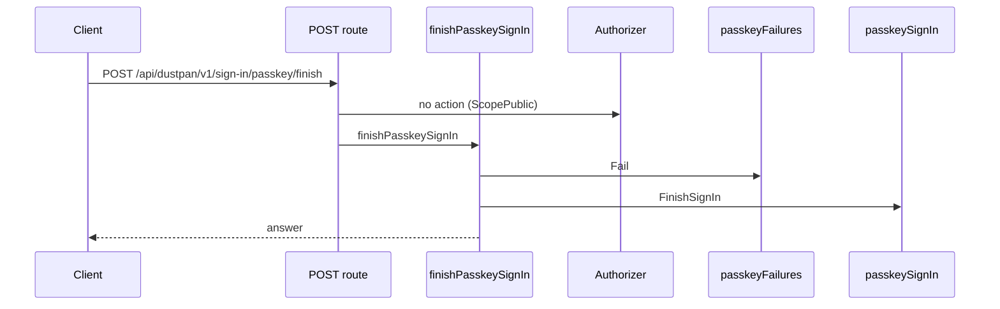
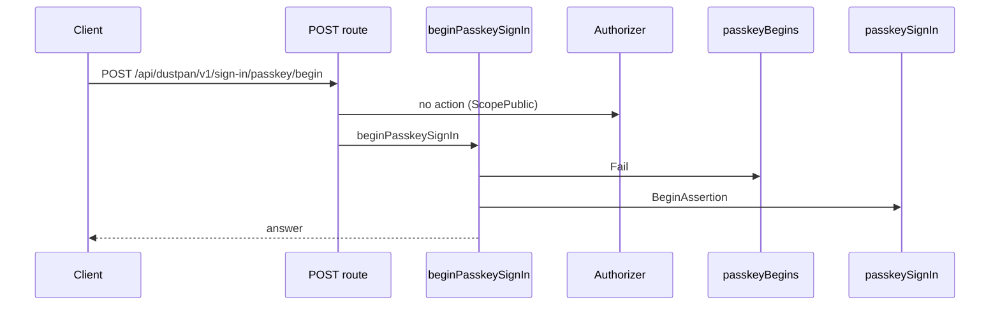
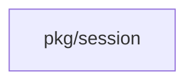
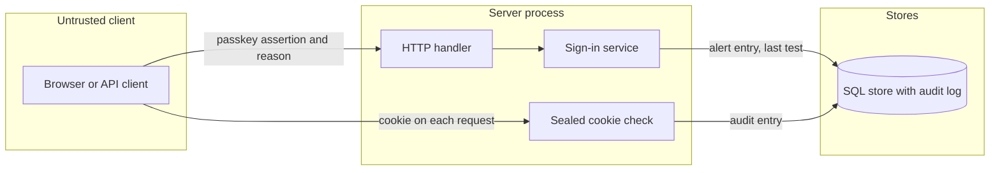

## Context

Break-glass sign-in is the last-resort path when the identity provider is lost. The change makes misuse visible and short-lived.

## Decisions

1. **One value checks reason and expiry.** One unexported value makes the session claims. Its constructor rejects an empty reason, an over-long reason, any control character, DEL, a line or paragraph separator, and an expiry beyond the setting or in the past.
2. **Limit is a setting.** The session limit is a key of the generic settings API. It follows the range, default and shorter-of rule of the temporary administrator session limit.
3. **Reason in the sealed cookie.** The sealed cookie holds the reason with its expiry. A tampered cookie fails to open.
4. **Generation read at each request.** The session check reads the session generation of the principal and denies an older cookie. No per-cookie row exists.
5. **Last test in the sign-in transaction.** The last test time is written in the same transaction as the alert entry. The response derives the flag from the injected clock, and from the creation time when no test exists.
6. **Assertion first.** The passkey assertion is checked before the reason. A failed assertion writes nothing.
7. **Fail closed per request, with exempt routes.** A failed per-request audit write fails the request with 503. Sign-out and the early end are exempt.

## Structure

Unexported breakGlassClaims with constructor newBreakGlassClaims. Only the constructor makes a value, and it checks the reason and the expiry bound.

## Risks

- A crash after the commit can lose the WARN line, and the audit entry stays.
- Clock skew between server processes can end a session early or late. The expiry bound limits the error.

## Layers (defense in depth)

| Layer | Guard | Hostile test |
| --- | --- | --- |
| port adapter | The sign-in adapter refuses an empty or hostile reason before any session claim. | Sign in with an empty reason, a 501-character reason, a tab, a DEL, U+2028 and CR LF. Each gives refusal and no cookie. |
| service | The service issues only claims from the constructor and denies an expired or old-generation cookie. | Replay an expired cookie, a far-future cookie, a tampered cookie and an old-generation cookie. Confirm denial. |
| HTTP handler | The handler checks the expiry at the point of use and writes the audit entry. | Send a request after expiry and confirm 401. Fail the audit write and confirm no session at sign-in and 503 on a request. |

## Diagrams

Today: `POST /api/dustpan/v1/sign-in/passkey/finish` on main (from the route table and the handler body, route row internal/api/server/passkeysignin.go:122, handler internal/api/server/passkeysignin.go:231).

Today: `POST /api/dustpan/v1/sign-in/passkey/begin` on main (from the route table and the handler body, route row internal/api/server/passkeysignin.go:118, handler internal/api/server/passkeysignin.go:191).

Modules that the change touches, and their imports on main:

## Quality attributes

| Attribute | Target | Unit | Scope |
| --- | --- | --- | --- |
| Added latency of the per-request audit write | 50 | ms at the 99th percentile | each request of a break-glass session |
| Reason length | 500 | characters at most | one break-glass sign-in |
| Stale test window | 90 | days | each break-glass account |

## Threat model

Data flow and trust boundaries:

| Boundary | STRIDE | Threat | Layer | Guard | Hostile test |
| --- | --- | --- | --- | --- | --- |
| Untrusted client to server process | S | An attacker replays or forges a passkey assertion to get a break-glass session. | boundary check | The handler checks the passkey assertion before it reads the reason. | Send a bad assertion with a valid reason and confirm refusal, no alert and no cookie. |
| Untrusted client to server process | S | An attacker replays or forges a passkey assertion to get a break-glass session. | fail closed | An unknown or failed assertion gives refusal and no session. | Replay a used assertion and confirm refusal. |
| Untrusted client to server process | T | An attacker changes the sealed cookie to lengthen the expiry or change the reason. | boundary check | The cookie must open with the session key. | Flip one byte of the cookie and confirm 401. |
| Untrusted client to server process | T | An attacker changes the sealed cookie to lengthen the expiry or change the reason. | limit | The server denies an expiry later than the setting allows. | Present a far-future expiry and confirm 401 with an audit entry. |
| Untrusted client to server process | T | A reason with CR, LF or a control character forges a log or audit line. | encode or contain | The constructor refuses control characters, DEL and line separators, and the WARN line removes CR and LF. | Sign in with CR LF and U+2028 in the reason and confirm refusal. |
| Server process to SQL store | R | A break-glass session acts with no record. | fail closed | A failed audit write fails the request with 503 and the sign-in with no session. | Fail the audit store and confirm 503 on a request and no session at sign-in. |
| Server process to SQL store | R | A break-glass session acts with no record. | authorize at point of use | Each request writes an entry with the session ID and the reason. | Send a request and read the entry with the session ID. |
| Server process to SQL store | I | The reason or the cookie leaks in a log. | limit | Logs hold the session ID and the reason of the audit entry only, never the cookie. | Sign in and confirm the log has no cookie value. |
| Untrusted client to server process | D | A client floods the sign-in route with long reasons. | limit | The reason has at most 500 characters and the sign-in routes keep their rate limits. | Send a 501-character reason and confirm refusal before any write. |
| Untrusted client to server process | E | A session outlives its limit or its revocation and keeps administrator rights. | authorize at point of use | Each request checks the expiry and the session generation. | Replay an expired cookie and an old-generation cookie and confirm 401. |
