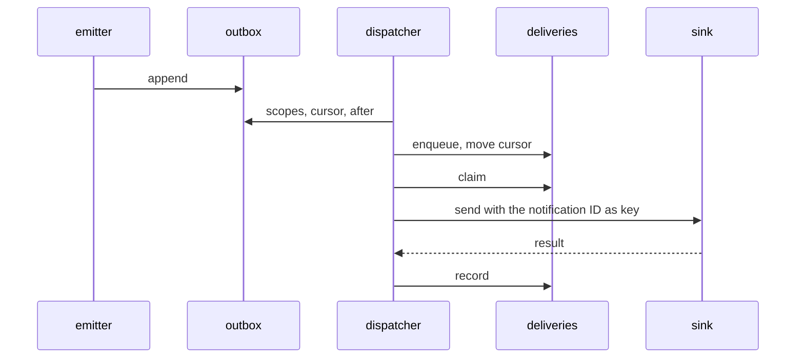
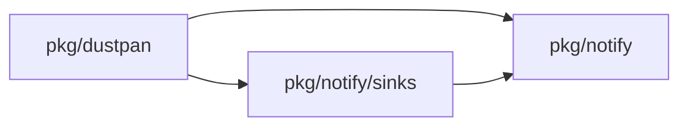
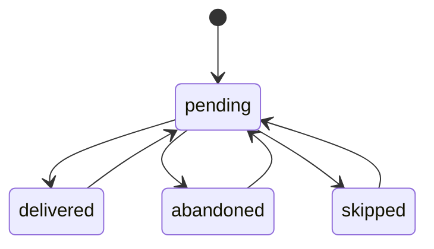
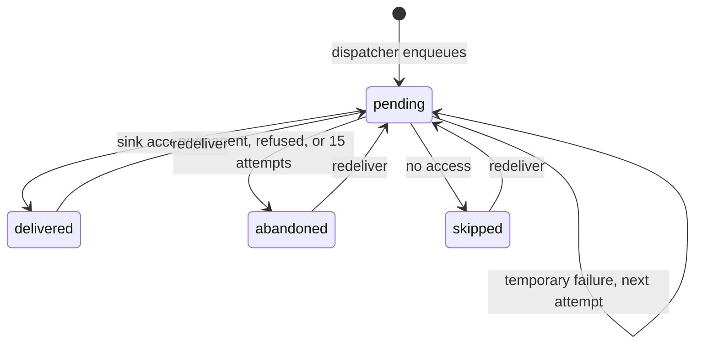
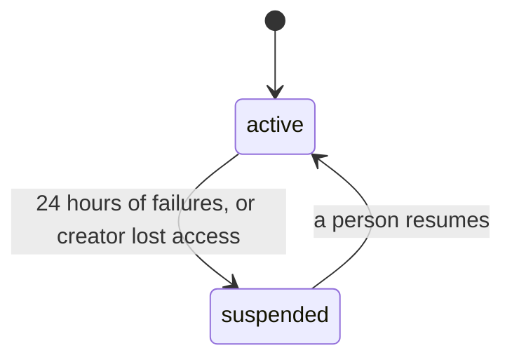
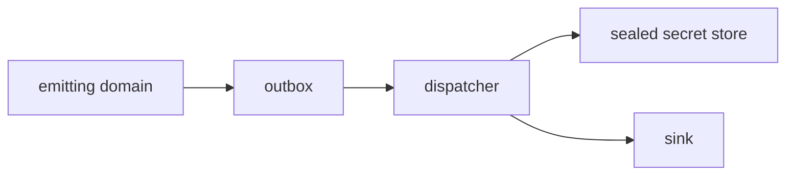

## Context

The model of notifications is on main: the ports, the stores, the sink and subscription services, the history route, the redeliver route, the retry rule and the two senders. No code runs the cycle. This change adds only that: a dispatcher that routes the outbox, sends the due deliveries and records the results. It adds one narrow port, one exported check and one notice function. It adds no table, no route, no setting and no API value.

The facts below come from main and are confirmed in task 0.1.

## Decisions

1. **One package, one type.** The NEW package internal/notifydispatch holds an unexported dispatcher type. It is built only by New(Config), which rejects a nil port. Run(ctx) loops until the context ends. RunOnce(ctx) does one route round and one deliver round, so tests need no timer.
2. **Route round (ADR 145 decision 9).** For each scope from Outbox.Scopes: take the fence, read the cursor named "dispatcher", read up to 100 notifications after it, read the subscriptions of the scope once, and call notify.Route for each notification. Enqueue all deliveries in one call, then MoveCursor from the old cursor to the last routed sequence. ErrConflict on MoveCursor drops the round: another instance routed it. A port error on a notification stops the round before that notification, so the cursor never passes it. Enqueue is idempotent, so a repeated round makes no second delivery.
3. **Delivery rows.** One delivery for each matched subscription: a NEW dlv- ID, Principal = the creator of the subscription, Sink = the sink of the subscription, state pending, NextAt = now, no contact. Recipients are ignored.
4. **Deliver round (ADR 145 decision 17).** DueScopes(now), then Claim with a limit of 10 and a lease of 2 minutes. Group the claimed deliveries by sink. One goroutine runs each group, in order, and a semaphore limits the groups to 8. A slow sink never blocks another sink. A group stops when now plus the send timeout passes the lease. A full batch starts the next round at once.
5. **One attempt.**
   1. Read the stored subscription of the delivery. A missing one is the zero value.
   2. Read the notification with notify.Fetcher. NotFound records skipped.
   3. Call notify.BeforeAttempt. ErrNoAccess records skipped. Another error counts as a temporary failure (ADR 149 decision 14).
   4. Check, once for each round and creator, that the creator still holds the actions of notify.ScopeActions on the object of the scope, with one Reader.CanRead call. When it does not, suspend the subscription with a reason constant and record skipped.
   5. Find the sink in Subscriptions.Sinks. A missing sink is abandoned with the class permanent.
   6. Find the sender by kind. A missing sender (email) is abandoned with the class permanent.
   7. Open the destination with SinkSealer.OpenDestination. ErrNoURL is permanent. The code always calls Destination.Clear with defer.
   8. Call sinks.CheckAddress on the destination (the third layer of ADR 334 decision 2).
   9. Send with a timeout of sinks.SendTimeout. The secrets are the keys of the destination, or the auth secret of a chat token. Actions are nil.
6. **Recorded result (ADR 145 decisions 18 and 28).**
   - Sent: state delivered, attempts plus 1, DeliveredAt = now, LastError empty.
   - Skipped: state skipped, DeliveredAt = now.
   - Failure: notify.RetryAt gives the next time. When it says no (permanent, refused, or the 15th attempt), the state is abandoned. Otherwise the state is pending with NextAt. LastError is the class from notify.Class and nothing else. The code never stores an address, a secret or the text of an error.
   - Record answers ErrConflict when the claim lapsed. The dispatcher logs it and does not retry the record. The next claimer sends again. The notification ID is the idempotency key of both senders, so the receiver can drop the duplicate (at least once).
   - After a cancel, a finished send is recorded with context.WithoutCancel and a timeout of 5 seconds. A send that did not finish records nothing. Run waits for all goroutines.
7. **Suspend after 24 hours (ADR 145 decision 19).** After the deliver round, for each subscription that had a failure in the round: read the history newest first (at most 1000 rows, pages of 200), and stop at the first delivered row. When the oldest row of that failing run has CreatedAt at or before now minus notify.SuspendAfter, suspend. First append notify.SubscriptionFailingNotice, then call PutSubscription with state suspended, the reason "failed for 24 hours, last error class: <class>" and an audit entry. ErrConflict stops without error. If the process stops between the two writes, the next round appends the notice again with the same dedupe key, so there is one notice.
8. **Fence.** A small fencer interface gives the fence of a scope: the zero fence for the server scope, otherwise Namespaces.WritableHere and the fence of the namespace. ErrNotHome and ErrNotFound skip the scope in this round. ErrFenced drops the round. The interface hides the type of the scope, so notify-scope-namespace-id changes one adapter and not the dispatcher.
9. **The new port.** notify.Fetcher has one method, Notification(ctx, scope, id). It is a separate interface and not a new method of Outbox, so existing fakes do not break. The conformance suite notifytest.RunFetcher comes first. A sqlc query in each dialect reads by the key (scope, id).
10. **Access without contacts.** The dispatcher wraps the Reader in a private Access whose contact methods return none. A personal notice is out of scope, so nothing in this change can send to a contact.
11. **No setting.** The values are constants of the package: poll interval 5 seconds, route batch 100, claim limit 10, lease 2 minutes, parallel sinks 8, record timeout 5 seconds. With a send timeout of 10 seconds, 10 deliveries take at most 100 seconds, less than the lease.

## Structure

- internal/notifydispatch/dispatcher.go: Config, New, Run, RunOnce.
- internal/notifydispatch/route.go: the route round.
- internal/notifydispatch/deliver.go: the deliver round and one attempt.
- internal/notifydispatch/suspend.go: the suspend rule.
- pkg/notify/fetcher.go: the Fetcher port.
- pkg/notify/suspend.go: SubscriptionFailingNotice.
- pkg/notify/sinks/test.go: CheckAddress, exported, and the method delegates to it.
- pkg/dustpan/notifydispatch.go: the wiring. It reuses sinkSenders, so the test route and the dispatcher use the same senders.

## Risks

- A duplicate send after a crash between the send and the record. The notification ID is the key, and both senders send it. The change states at most one extra send for each delivery after a crash.
- A slow sink holds its group until the lease ends. The group stops before its next send when the lease is too near.
- The suspend subject. See the ADR check of the proposal.
- The dependency on notify-scope-namespace-id for the Reader. Without it, the dispatcher cannot start in production, and the wiring refuses to start it without a Reader.

## Diagrams

After this change:

Modules that the change touches, and their imports on main:

New imports of this change (each one allowed by the module rules):

- `internal/notifydispatch` imports `pkg/notify` and `pkg/notify/sinks`
- `pkg/dustpan` imports `internal/notifydispatch`

States on main in the touched packages:

The last three transitions are the redeliver route, which exists on main. The subscription has the states active and suspended.

States and transitions after this change:

## Quality attributes

| Attribute | Target | Unit | Scope |
| --- | --- | --- | --- |
| extra sends of one delivery after a crash | 1 | sends | one delivery |
| duplicate deliveries for one notification and subscription | 0 | rows | two instances |
| time from append to first attempt | 5 | seconds, poll interval, without load | one scope |
| goroutines after Run returns | 0 | goroutines | the package tests |

## Threat model

Data flow and trust boundaries:

The sink address and the secrets come from a principal. The receiver answer comes from outside. The notification body is data of the server.

| Boundary | STRIDE | Threat | Layer | Guard | Hostile test |
| --- | --- | --- | --- | --- | --- |
| sink address | S, I | A principal saves an address in a private range to reach an internal service. | contain the value where used | sinks.CheckAddress before the send, and the dial guard of the sender. Each layer stops it alone. | A table of addresses (loopback, link-local, private range, a name that resolves to one, a forbidden port, a host outside the strict list): each ends abandoned with class refused, and the sender is not called. A second table calls the sender with a fake CheckAddress that allows everything, and the dial guard refuses. |
| secret | I | A secret or an address appears in a delivery, a log or an answer. | limit the effect | Only the class of an error is stored. Destination.Clear runs with defer. | A table of failing senders whose errors carry the URL and the token: the stored LastError, the log text and the history answer hold neither. |
| creator access | E | A principal who lost access still causes sends. | authorize at point of use | notify.BeforeAttempt and the creator probe run before each send. | A table of creators (lost read, lost manage, both): each records skipped, the subscription reads suspended, and the sender is not called. |
| subscription state | E | A suspended subscription still sends, or a notice loops. | fail closed | notify.Route skips a subscription that is not active, and BeforeAttempt checks the stored one. | A suspended subscription gets no delivery, and the suspend notice routes to no suspended subscription. |
| another installation | T | A non-primary installation routes a namespace. | authorize at point of use | The fence from WritableHere. ErrNotHome skips the scope. | A fencer that answers ErrNotHome: no delivery, no cursor move. A fencer that answers ErrFenced: no write succeeds. |
| claim | T, R | A holder with a lapsed lease overwrites the result of the next claimer. | fail closed | Record needs the live owner and version. | A fake clock test: the late Record gets ErrConflict and the row keeps the result of the second claimer. |
| port error | D | A failing port makes the dispatcher skip a notification. | fail closed | The cursor never passes a notification that failed to route. | A table of failing ports (Subscriptions, Route, Enqueue): the cursor stays and the next round routes it. |
| receiver answer | D | A receiver holds a send open, or answers with a huge body. | limit the effect | The send timeout and the size limit of the sender. | A receiver that never answers: the attempt ends at the timeout and the delivery retries. |
| shutdown | D | A cancel leaks goroutines or loses a result. | limit the effect | Run waits for all groups. A finished send records with a fresh context. | A goleak test and a cancel test with a send in flight. |

## Contract

**notify.Fetcher**

- `Notification(ctx, scope, id) (Notification, error)`: pre: scope and id name a stored notification. Post: the stored notification. Errors: ErrNotFound when absent. The adapters translate driver errors to the sentinel.

**sinks.CheckAddress**

- `CheckAddress(sink, to, ports) error`: pre: sink is a stored sink and to is the address for one send. Post: nil only when the scheme, the address range, the port and the host pass. Errors: egress.ErrRefused. The test route and the dispatcher call it.

**notify.SubscriptionFailingNotice**

- Builds the notice subscription.suspended with the dedupe key "<subscription ID>/suspended/<version>" and the administrators and the creator as recipients, in the shape of SinkChangedNotice.

**notifydispatch**

- `New(Config) (*Dispatcher, error)`: pre: every port is set. Errors: an error that names the missing port.
- `Run(ctx) error`: loops until ctx ends, waits for its goroutines, returns nil on cancel.
- `RunOnce(ctx) error`: one route round and one deliver round.
- Invariant: one delivery for each notification and subscription pair. The cursor never passes an unrouted notification.

## Failure modes

| Step | Failure | Retry | State after |
| --- | --- | --- | --- |
| Route | A port fails | Next round | Cursor stays |
| Route | MoveCursor conflict | Next round | Another instance routed it |
| Fence | ErrNotHome, ErrNotFound | Next round | Scope skipped |
| Fence | ErrFenced | Next round | Round dropped |
| Fetch | Not found | None | skipped |
| Access | No access | None | skipped, subscription suspended |
| Access | Port cannot decide | Backoff | pending |
| Address | Refused | None | abandoned, class refused |
| Send | Temporary | Backoff, 30 seconds to 1 hour | pending |
| Send | Permanent | None | abandoned |
| Send | 15th failed attempt | None | abandoned |
| Record | ErrConflict | Next claimer sends again | Row of the next claimer |
| Suspend | ErrConflict | Next round | No change |
