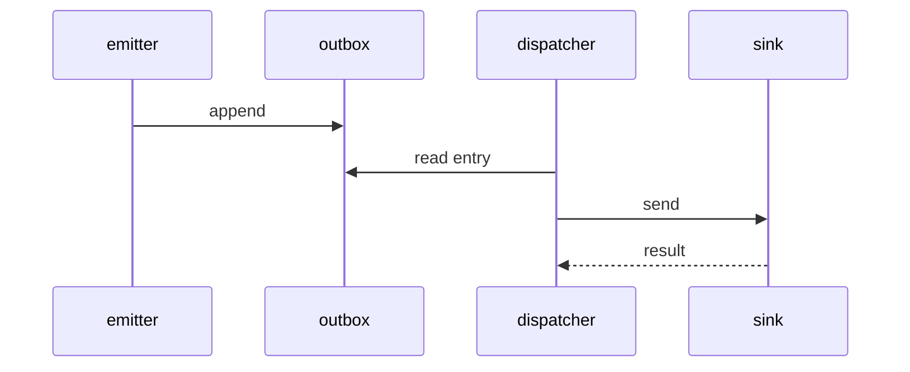
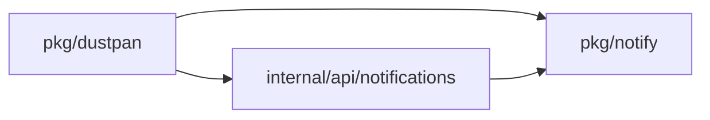
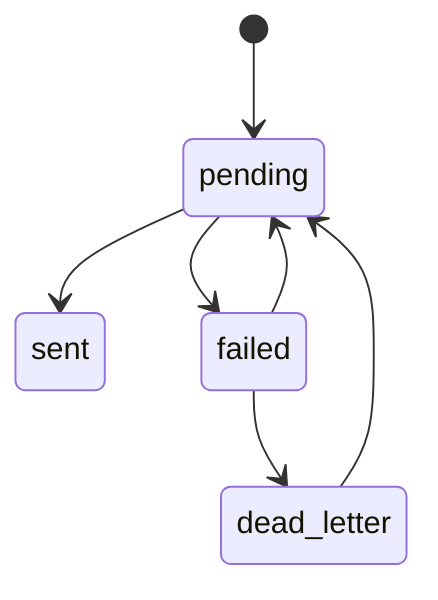

## Context

A1 ports on main define the model. A2 adds the stores, the dispatcher and the delivery operation behind those ports. Retry rule: exponential backoff up to 24 hours, then dead-letter. A manual redeliver recovers a dead-letter row, and the API shows the effective values.

## Decisions

1. **Cursor dispatch.** The dispatcher reads the outbox with the cursor of the A1 port and writes one delivery per matching subscription.
2. **Stable key.** Each delivery has a unique pair of outbox entry and subscription ID. Delivery is at-least-once.
3. **Isolation.** One failed delivery never blocks another.

## Structure

Unexported type dispatcher with unexported ports, built only by NewDispatcher, which rejects nil ports.

## Risks

- Duplicate send after a crash between send and mark; the stable key covers it.
- Table growth; retention purge covers it.

## Diagrams

After this change:



Modules that the change touches, and their imports on main:



New imports of this change (each one allowed by the module rules):

- `internal/notifydispatch` imports `pkg/notify`

States on main in the touched packages:


States and transitions after this change:



## Quality attributes

| Attribute | Target | Unit | Scope |
| --- | --- | --- | --- |
| duplicate deliveries per pair | 0 | rows | one entry after a crash |

## Threat model

Data flow and trust boundaries:

```mermaid
emitting domain to outbox to dispatcher to sink
```

| Boundary | STRIDE | Threat | Layer | Guard | Hostile test |
| --- | --- | --- | --- | --- | --- |
| namespace | I | A principal reads deliveries of another namespace. | authorize at point of use | Each route checks its action on the namespace. | A principal without the grant reads deliveries and gets 403. |

## Contracts

**Delivery**

- Invariant: One delivery for each entry and subscription pair.
- `MarkSent`: pre: Delivery is pending. Post: Delivery reads sent.

## Failure modes

| Step | Failure | Retry | State after |
| --- | --- | --- | --- |
| Send to a sink | The sink fails | Backoff up to 24 hours, then dead-letter | Other deliveries proceed |
