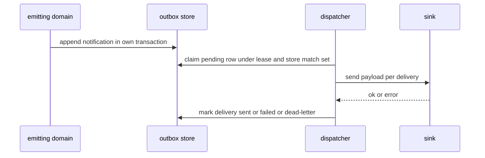
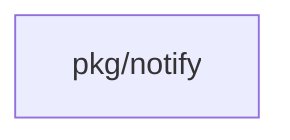

## Context

Part A2 of the chat theme persists notifications and delivers them. A1 owns the notify model and the sink contract. This change owns persistence, match, delivery rows, and dispatch with at-least-once delivery, a stable idempotency key, a stored match set, one retry and dead-letter rule, and retention that keeps a dispatched outbox row while any delivery reads dead-letter.

## Decisions

1. **Outbox then dispatch.** The emitting domain appends rows to the outbox in the same transaction as its own write. A durable delivery operation claims a pending row under a lease, stores the matching active subscription set in the claim transaction, writes one delivery row per match, then calls sinks. A reclaim reuses the stored set.
2. **Idempotency key per delivery.** Each delivery row carries a stable key made from the outbox row ID and the subscription ID, with a unique constraint on that pair. Delivery is at-least-once per subscription.
3. **Dispatcher owns fan-out state.** The dispatcher has unexported fields. Only its constructor builds a valid dispatcher and it rejects nil ports. The lease lasts 60 seconds from the server clock. A mark after expiry fails with a lease-mismatch error.
4. **Per-subscription isolation.** The failure of one delivery never blocks the send, retry, or mark of another delivery of the same outbox row.

## Structure

Unexported type dispatcher with unexported fields outbox, subscriptions, deliveries, sinks, and clock, built only by NewDispatcher which checks invariants.

## Risks

- Duplicate send after a crash between send and mark; mitigated by the stable key.
- Two dispatchers claim one row; mitigated by the lease.
- A failing sink blocks a working sink; mitigated by isolation.
- Unbounded table growth; mitigated by retention purge that keeps dead-letter rows.

## Diagrams

After this change:



Modules that the change touches, and their imports on main:



New imports of this change (each one allowed by the module rules):

- `add the new file internal/notifydispatch` imports `pkg/notify`

States on main in the touched packages:


States and transitions after this change:

```mermaid
stateDiagram-v2
[*] --> pending: append
pending --> claimed: claim under lease
claimed --> dispatched: fan-out done
claimed --> pending: lease expired
pending --> sent: sink ok
pending --> failed: sink error before limit
failed --> pending: backoff retry
failed --> dead-letter: limit reached
dead-letter --> pending: manual retry
```

## Quality attributes

| Attribute | Target | Unit | Scope |
| --- | --- | --- | --- |
| delivery fan-out isolation | 1 | working delivery marked sent | one outbox row with two subscriptions where one sink fails |
| duplicate delivery rows on reclaim | 0 | second rows per pair | one claimed outbox row reclaimed after partial fan-out |
| lease reclaim delay | 60 | seconds | one claimed outbox row whose holder stops |

## Threat model

Data flow and trust boundaries:

```mermaid
emitting domain to outbox store to dispatcher to sink; subscription management by namespace administrator
```

| Boundary | STRIDE | Threat | Layer | Guard | Hostile test |
| --- | --- | --- | --- | --- | --- |
| namespace trust boundary | T | A caller forges a notification or reads deliveries of another namespace. | authorize at point of use | Authorization check on subscription create, delivery read, and manual retry routes. | A principal without the manage grant creates a subscription or retries a delivery and gets 403. |
| namespace trust boundary | T | A caller forges a notification or reads deliveries of another namespace. | limit | Size limit and UTF-8 check on the notification payload at intake. | An oversize payload with invalid UTF-8 gets 422 with no row. |

## Contracts

**Delivery**

- Invariant: One delivery row per outbox row and subscription pair.
- Invariant: A dead-letter row never resumes without a manual retry.
- `MarkSent`: pre: Delivery row exists and reads pending or failed.. Post: Delivery reads sent with sent time..
- `MarkDeadLetter`: pre: Retry count reached the retry limit.. Post: Delivery reads dead-letter and automatic retry stops..

## Failure modes

| Step | Failure | Retry | State after |
| --- | --- | --- | --- |
| Claim pending outbox row under lease. | Second dispatcher claims the same row. | Loser sees the row as claimed and skips it. | One lease holder stays. |
| Send payload to each sink. | Lease expires while a slow holder still sends. | New holder reclaims with the stored match set and same keys; old holder mark fails. | One delivery row per pair. |
| Write delivery rows. | Process crashes after partial fan-out. | Reclaim writes only missing rows. | One delivery row per matched subscription. |
| Send payload to each sink. | Sink send fails or times out. | Exponential backoff to retry limit 5 within 24 hours, then dead-letter. | Other deliveries still proceed. |
| Mark delivery outcome. | Process crashes between send and mark. | Retry repeats the same key. | Delivery reads sent once the mark lands. |
