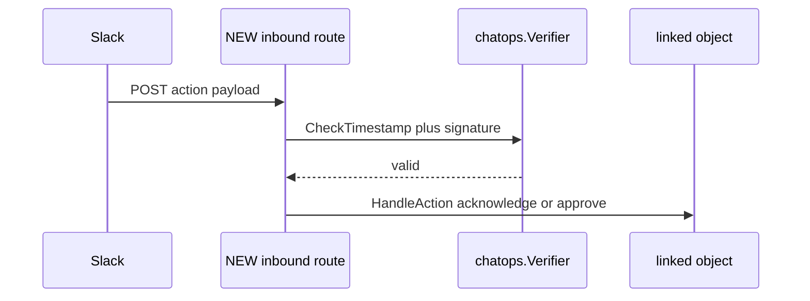
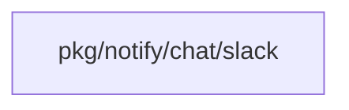
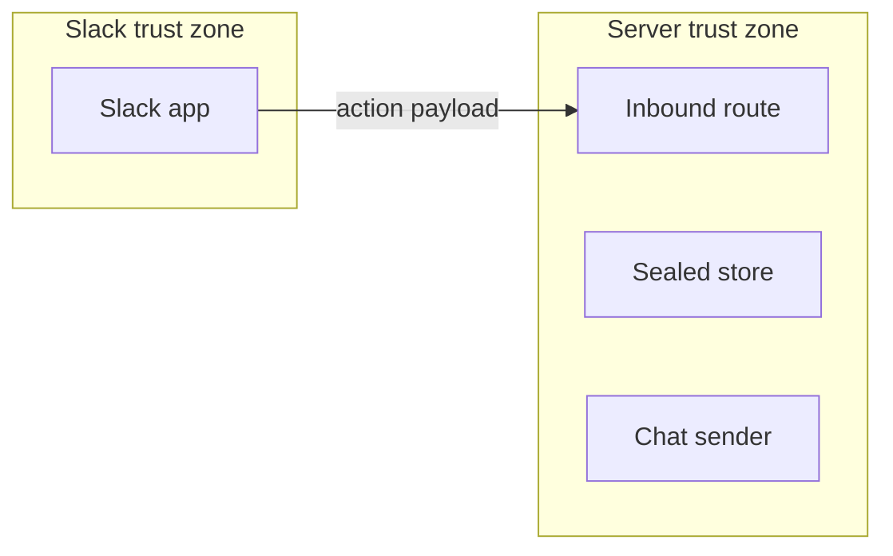

## Context

Outbound Slack webhook sinks exist in pkg/notify/chat/slack. No chat.postMessage caller exists on main. chatops.Verifier exists with CheckTimestamp. This change adds a sealed installation-level connection, a connection-form sink that posts as the app, a Slack user link, and verified acknowledge and approve actions.

## Decisions

1. **Scope of connection and sinks.** Connection is installation-scoped at @server and managed through installation-level NEW routes. Sinks stay namespace-scoped under /api/dustpan/v1/namespaces/{namespace}. A connection-form sink holds connection ID plus channel ID and posts with chat.postMessage as the app. Webhook-form sinks never render action buttons. Installation-scope chat sinks stay refused.
2. **Connection plus app-post sink plus verified actions.** Add installation-level Slack app connection holding bot token and signing secret sealed as secret items, referenced by stable ID. Sink form with connection ID plus channel ID posts with chat.postMessage as the app through the egresshttp check. Inbound NEW route verifies with chatops.Verifier then maps acknowledge and approve to the linked object. Webhook-form sinks never render action buttons.
3. **Slack user link and actor.** Link is an explicit console step: the person signs in with a session, enters the Slack user ID and the workspace team ID, the server stores the pair on the principal. HandleAction loads the linked principal and acts as that principal. Unlinked users receive a link-required error. One installation-level connection serves all namespaces. Management needs the NEW action slack-connection:manage on the installation object. Each action checks the stored grant of the linked principal on the linked object, including the approve grant for approve.
4. **Nonce store, rotation overlap, and delete block.** Replay defense is a SQL nonce table keyed by Slack action ID with a 12 hour expiry. Insert is atomic. A duplicate insert refuses as duplicate. Expiry deletes rows after 12 hours. Restart keeps rows because the table is durable. Concurrent duplicates serialize on the unique key and only one wins. Overlap for signing secret rotation is 24 hours: both old and new secrets verify during 24 hours, then the old secret stops. Delete of a connection is refused while a sink references it.
5. **Actor and object checks.** Approve acts as the linked principal and passes through the same grant and separation-of-duties checks as a console approve, including refusal of self-approval where the rule requires it. The inbound route checks that the channel ID and the linked object belong to a sink that references the connection of the request.

## Structure

Unexported slackConnection type with constructor SealConnection that seals bot token and signing secret before store; only the constructor makes a usable value.

## Risks

- Sealed bot token leaks through logs or errors.
- Forged action executes acknowledge or approve.
- Buttons shown on untrusted webhook sink invite spoofed approval.

## Layers (defense in depth)

| Layer | Guard | Hostile test |
| --- | --- | --- |
| boundary check | Verify Slack signature and timestamp with chatops.Verifier at inbound route before any parse. | Replay expired timestamp and forged signature; both refused. |
| encode or contain | Render action buttons only for sinks with a connection reference; strip buttons from webhook-form payloads. | Send button payload to webhook sink and confirm no buttons render. |
| limit | Bound request body, event age window, and chat.postMessage rate limit per connection. | Send oversize body and rapid repeats; oversize refused and repeats limited. |
| authorize at point of use | Check grant on linked object for acknowledge and approve at point of use as the linked principal. | Unentitled principal action refused even with valid Slack signature. |
| fail closed | Unknown action, failed verify, or failed grant fails closed with error and audit entry; no state change. | Corrupt payload and revoked grant both leave state unchanged. |

## Diagrams

After this change:

Modules that the change touches, and their imports on main:

## Quality attributes

| Attribute | Target | Unit | Scope |
| --- | --- | --- | --- |
| inbound verification latency | 200 | ms p95 | POST inbound Slack action route |
| outbound post latency | 2000 | ms p95 | chat.postMessage send per notification |

## Threat model

Data flow and trust boundaries:

| Boundary | STRIDE | Threat | Layer | Guard | Hostile test |
| --- | --- | --- | --- | --- | --- |
| Slack to inbound route | S | Spoofed Slack action executes acknowledge or approve. | boundary check | Allowlist action IDs acknowledge and approve; reject unknown actions; check timestamp window with chatops.Verifier. | Send unknown action and expired timestamp; both refused. |
| Slack to inbound route | S | Spoofed Slack action executes acknowledge or approve. | encode or contain | Parse payload with strict decode; contain channel and object refs as IDs, never HTML. | Send markup and oversize payload; markup escaped and oversize refused. |
| Slack to inbound route | S | Spoofed Slack action executes acknowledge or approve. | limit | Bound body size, verify timeout, per-connection post rate limit. | Flood actions; excess limited with 429. |
| Slack to inbound route | S | Spoofed Slack action executes acknowledge or approve. | authorize at point of use | Check grant of linked principal on linked object at point of use. | Valid signature without grant refused. |
| Slack to inbound route | S | Spoofed Slack action executes acknowledge or approve. | fail closed | Fail closed on verify or grant failure with audit entry and no state change. | Tamper signature; state unchanged and denial logged. |
| Server to Slack API | I | Bot token leaks or message posts to attacker host. | boundary check | Post only to allowlisted Slack hosts with HTTPS and no redirect; token from sealed connection only. | Redirect and non-Slack host refused. |
| Server to Slack API | I | Bot token leaks or message posts to attacker host. | encode or contain | Renderer never sees secrets; sender sets auth header from sealed item. | Inspect renderer input; no secret present. |
| Server to Slack API | I | Bot token leaks or message posts to attacker host. | limit | Context deadline on chat.postMessage and bounded response read. | Slow Slack answer times out without retry storm. |
| Server to Slack API | I | Bot token leaks or message posts to attacker host. | authorize at point of use | Use connection grant scoped to installation; sink must reference its connection. | Cross-connection token use refused. |
| Server to Slack API | I | Bot token leaks or message posts to attacker host. | fail closed | 2xx checked by renderer Check; 408 429 5xx temporary, other 4xx permanent; errors never include token. | Error text holds no token. |
| Sealed store at rest | I | Stored bot token discloses or fails to unseal. | boundary check | Seal bot token and signing secret at the boundary with allowlisted fields. | Submit plain-text read; plain text never returns. |
| Sealed store at rest | I | Stored bot token discloses or fails to unseal. | encode or contain | Keep secrets out of logs and error text; redact on output. | Force post failure; error holds no secret. |
| Sealed store at rest | I | Stored bot token discloses or fails to unseal. | limit | Bound secret size and rotation overlap window of 24 hours. | Oversize secret refused; old secret stops after window. |
| Sealed store at rest | I | Stored bot token discloses or fails to unseal. | authorize at point of use | Require installation manage action to read or rotate secrets. | Unentitled read refused. |
| Sealed store at rest | I | Stored bot token discloses or fails to unseal. | fail closed | Fail closed when a secret fails to unseal; refuse post and action with audit entry. | Corrupt sealed bytes; operation refused with no post. |

## Contracts

**Slack app connection**

- Invariant: Bot token and signing secret stay sealed and never return in plain text.
- Invariant: Sink references the connection by stable connection ID.
- Invariant: Action buttons render only for sinks that reference a connection.
- Invariant: One stored nonce per action ID refuses a repeat.
- `CreateConnection`: pre: Caller holds installation manage action.. Post: Connection stored with sealed secrets and stable ID..
- `RotateSigningSecret`: pre: Caller holds installation manage action.. Post: New secret active, old secret valid for 24 hours..
- `DeleteConnection`: pre: Caller holds installation manage action and zero sinks reference the connection.. Post: Connection removed when no sink references it..
- `LinkSlackUser`: pre: Caller proves control of the principal through console session.. Post: Slack user ID maps to one principal subject..
- `HandleAction`: pre: Verifier accepts timestamp and signature and nonce is new.. Post: Acknowledge or approve applied as the linked principal, or refused with no state change..
- `PostAsApp`: pre: Sink references an existing connection and a channel ID.. Post: Message posted with chat.postMessage as the app..

**Chat sink**

- Invariant: SecretRefs holds the URL only in webhook form.
- Invariant: Connection form holds connection ID and channel ID.
- `SendWithConnection`: pre: Sink platform is slack and connection exists.. Post: Renderer output sent through chat.Sender with app token..
