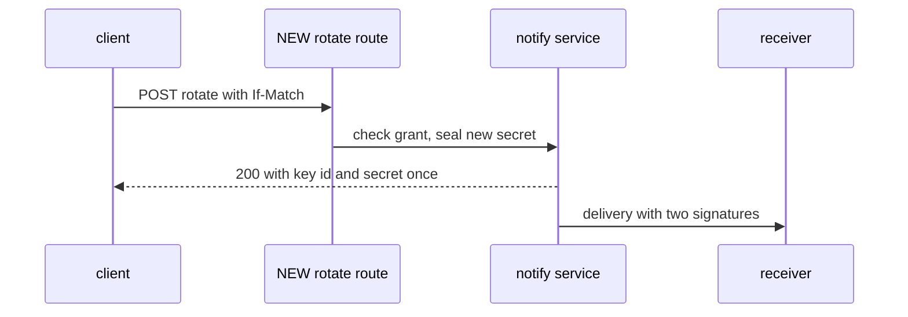
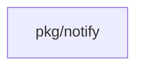
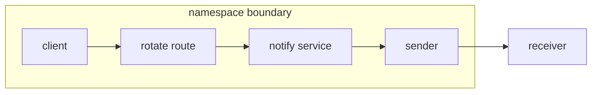

## Context

Webhook sinks sign each delivery. Rotation must not break the receiver, secrets must stay sealed, and installation scope stays refused.

## Decisions

1. **Rotation with two server-made keys.** The NEW rotate route seals a second server-made secret under a new ref, answers it once, and keeps both refs active until the NEW confirm route retires the named old ref.
2. **Guarded rotation.** Rotate requires If-Match on the sink version and replays by Idempotency-Key per caller and route. A replay answers the ref id without the secret. A rotate sealed but not activated leaves an inactive ref that the retry reuses. Namespace stays the only scope.

## Structure

An unexported sealedRef type in pkg/notify holds the signing secret refs. Only its constructor seals a value, and only the sender opens it at send time.

## Risks

- A receiver that checks only the first signature breaks when the old key retires
- A lost secret needs a new rotation cycle

## Layers (defense in depth)

| Layer | Guard | Hostile test |
| --- | --- | --- |
| boundary check | Allowlist of sink kind webhook and a namespace scope | Rotate an email sink and a @server sink; expect sink.invalid |
| encode or contain | Store holds sealed refs; read and audit hold no secret | Read the sink after rotate; no secret bytes |
| limit | At most two active refs, stale If-Match gives 412 | Third rotate gives sink.conflict |
| authorize at point of use | namespace:manage-notifications on the route; creator grant checked before each delivery | Rotate without the grant; expect denial and an audit entry |
| fail closed | Unknown ref or failed seal blocks delivery | Remove the new ref then send; expect no unsigned POST |

## Diagrams

After this change:

Modules that the change touches, and their imports on main:

## Quality attributes

| Attribute | Target | Unit | Scope |
| --- | --- | --- | --- |
| latency | 300 | ms p95 | POST sinks/{id}/rotate |

## Threat model

Data flow and trust boundaries:

| Boundary | STRIDE | Threat | Layer | Guard | Hostile test |
| --- | --- | --- | --- | --- | --- |
| namespace boundary | T | An attacker swaps the signing key or forces an unsigned delivery | boundary check | Allowlist of kind and scope at the route | Rotate email and @server sinks; expect sink.invalid |
| namespace boundary | T | An attacker swaps the signing key or forces an unsigned delivery | encode or contain | Sealed refs only | Search read, logs and audit for secret bytes |
| namespace boundary | T | An attacker swaps the signing key or forces an unsigned delivery | limit | Two active refs at most; If-Match | Third rotate gives sink.conflict |
| namespace boundary | T | An attacker swaps the signing key or forces an unsigned delivery | authorize at point of use | manage-notifications at the route; creator grant before each delivery | Rotate from another namespace; expect denial |
| namespace boundary | T | An attacker swaps the signing key or forces an unsigned delivery | fail closed | Seal failure or unknown ref blocks delivery | Corrupt the new ref; expect no POST |

## Contracts

**notify.Sink**

- Invariant: Each secret has its own ref and is answered once
- Invariant: At most two active signing refs
- Invariant: Both signatures go out while two refs are active
- `RotateSigningKey`: pre: Caller holds namespace:manage-notifications; Webhook sink with fewer than two active refs; If-Match holds the current version. Post: New ref active, old ref active until confirm; A change audit entry with no secret.
- `ConfirmRotation`: pre: Caller holds namespace:manage-notifications; Two active refs; Named ref is active. Post: Named old ref retired, one ref stays active; A change audit entry with no secret.
