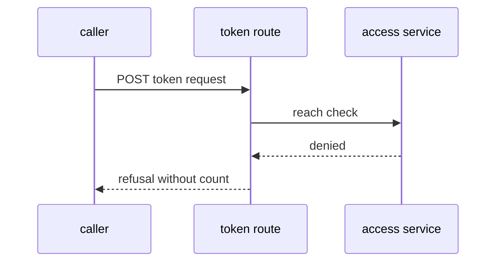
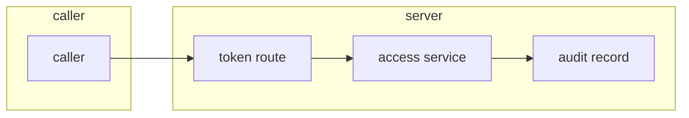

## Context

The token reach refusal tells the caller how many objects the caller cannot read. This change removes that count from the caller-visible refusal and keeps it in the audit record.

## Decisions

1. **No count in the refusal.** principalReachRefusal builds the refusal text without the count of unreadable objects. The audit writer still records the count for operators.

## Structure

The refusal is built in one unexported builder, principalReachRefusal, which takes no count argument. No caller can put a count in the text.

## Risks

- A caller loses the count in the refusal text and must use the audit record.

## Layers (defense in depth)

| Layer | Guard | Hostile test |
| --- | --- | --- |
| encode or contain | Refusal builder takes no count argument so no caller can add a count. | Call the refusal builder with a denied reach that has unreadable objects and check the text has no digits for the count. |
| fail closed | Service returns a fixed refusal shape that names the denied decision and the help operation only. | Request a token denied by the reach check and check the answer matches the fixed shape. |

## Diagrams

After this change:

## Quality attributes

| Attribute | Target | Unit | Scope |
| --- | --- | --- | --- |
| none affected | Refusal text only, no latency or storage change |  |  |

## Threat model

Data flow and trust boundaries:

| Boundary | STRIDE | Threat | Layer | Guard | Hostile test |
| --- | --- | --- | --- | --- | --- |
| caller to token route | I | Information disclosure: the refusal count tells the caller about objects the caller cannot read. | boundary check | Route accepts only the documented token request shape and rejects the rest. | Send a malformed token request and check the server refuses it. |
| caller to token route | I | Information disclosure: the refusal count tells the caller about objects the caller cannot read. | encode or contain | Refusal text is a fixed template with no count field. | Force a denied reach and check the answer has no count. |
| caller to token route | I | Information disclosure: the refusal count tells the caller about objects the caller cannot read. | limit | Refusal carries no object identifiers and no count. | Force a denied reach over many objects and check the answer leaks no total. |
| caller to token route | I | Information disclosure: the refusal count tells the caller about objects the caller cannot read. | authorize at point of use | Reach decision runs before the refusal is built. | Request a token without reach and check the server still denies. |
| caller to token route | I | Information disclosure: the refusal count tells the caller about objects the caller cannot read. | fail closed | Unknown reach outcome denies with the same fixed refusal. | Inject an authorizer error and check the answer is the fixed denial. |

## Contracts

**Principal reach**

- Invariant: A refusal names the denied decision and the help operation, with no object count.
- `principalReachRefusal`: pre: The reach check denied a token request.. Post: The refusal text has no count of unreadable objects..
