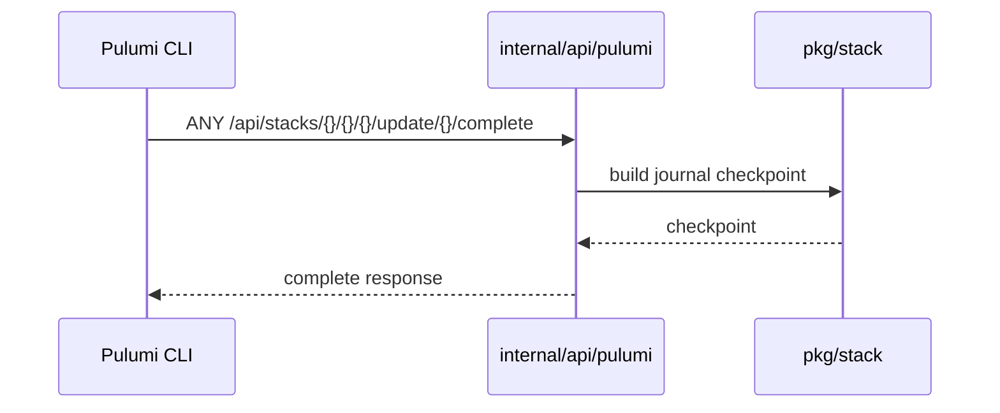
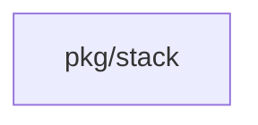

## Context

A journaled Pulumi update builds the final checkpoint at complete inside a fixed bound in pkg/stack. The Pulumi CLI stops waiting after its own limit, which nobody measured.

## Decisions

1. **Closed inputs.** One create update at the largest accepted size from tune-new-state-bound-real, or 10,000 resources until that change lands, journal version forced on through e2e/journalcap.go, sealed blobs on, one local blob backend, 5 repeats. Record the CLI version, backend, each build time, the CLI wait time seen on a stalled complete call, and the margin.
2. **Pass rule.** Pass means each build time is below the recorded CLI wait time. A fail opens an issue and stores no new bound.

## Structure

Measurement only, no new type. The bound MaxJournalBuildDuration in pkg/stack stays at 5 minutes and no code in pkg/stack changes.

## Risks

- The CLI wait limit varies by CLI version; re-measure when the verified CLI version moves.
- Load noise changes single runs; record the median and the maximum of 5 repeats.

## Diagrams

After this change:

Modules that the change touches, and their imports on main:

## Quality attributes

| Attribute | Target | Unit | Scope |
| --- | --- | --- | --- |
| none affected | Measurement only; no behavior or limit changes |  |  |
