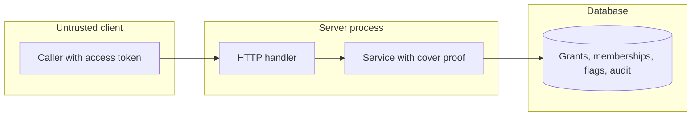

## Context

Grant, membership and token issue are act-as paths. The reach check and the write run in one transaction. A later widening is flagged, not refused.

## Decisions

1. **Cover check at each new act-as edge.** Compute reach with the shared reach function. Compare cover before a grant, a member add or a token issue, in the write transaction. Store the approved reach as a sorted set of action and object pairs.
2. **Transaction rule.** PostgreSQL uses serializable isolation. SQLite serializes writers. On a serialization failure the service retries up to 3 times with no delay. After the third failure it returns 409 and asks the caller to retry. Both adapters run the same conformance test.
3. **Flag instead of refuse growth.** Owner decision, 13 Nov 2026 (queue P18). Each write that widens an edge sets a flag by the stable ID of the edge in the same transaction. A covering person acknowledges or revokes it. Each action writes an audit entry.
4. **Flag life cycle.** The flag holds the stable ID of the edge. When the grant, principal, group or membership ends, the same transaction ends the flag and writes an audit entry.
5. **Protected group.** Owner decision, 13 Nov 2026 (queue P21). A group with write access to every state is protected. A grant that protects a group with identity provider members needs a trust decision in the same request.

## Structure

An unexported coverProof type with a constructor that returns a value only when the caller reach covers the target reach. The grant, member and token services take this type, so no write path skips the check. The flag references the edge by stable ID.

## Risks

- The reach function can differ between paths. One shared function and one proof type prevent it.
- A concurrent write can change reach between check and write. The transaction rule prevents it and a test covers each case.
- The owner decisions are provisional. A different answer changes the flag, protect and token issue services and their tests.

## Layers (defense in depth)

| Layer | Guard | Hostile test |
| --- | --- | --- |
| port adapter | The store checks the proof and the fence in the write transaction and fails closed. | Write through the adapter with a missing proof. Expect refusal and no row. |
| service | The service builds the proof, refuses when cover fails, and sets or clears the flag. | Remove the check. The tests for a non-covering caller and for concurrent writes fail. |
| HTTP handler | The handler maps the sentinels to 403 or 409 and checks the action of the flag routes. | Send a refused grant, member add, token create and an acknowledge without cover. Expect 403. |

## Quality attributes

| Attribute | Target | Unit | Scope |
| --- | --- | --- | --- |
| Latency of the grant check | added time of at most 50 | milliseconds at the 95th percentile | one grant or member add on a principal with at most 100 grants |
| Serialization retries | at most 3 | retries | one write call of grant, member add or token issue |

## Threat model

Data flow and trust boundaries:

| Boundary | STRIDE | Threat | Layer | Guard | Hostile test |
| --- | --- | --- | --- | --- | --- |
| Untrusted client | E | A caller with a small reach gives a token right to a target with a larger reach and gains its reach. | boundary check | The handler validates the ID of the target and the trust decision field. | Send a grant with a malformed target ID. Expect 400 and no row. |
| Untrusted client | E | A caller with a small reach gives a token right to a target with a larger reach and gains its reach. | authorize at point of use | The service builds the cover proof for the target at write time. | Send a grant from a non-covering caller. Expect 403 and no grant. |
| Untrusted client | E | A caller with a small reach gives a token right to a target with a larger reach and gains its reach. | fail closed | The store refuses a write with no proof and writes an audit entry. | Write through the adapter with no proof. Expect refusal and an audit entry. |
| Server process | T | A concurrent write changes reach between the check and the write. | limit | The check and the write run in one serializable transaction with at most 3 retries. | Run a concurrent grant and revoke on both adapters. Expect a refusal of the grant without cover. |
| Database | R | An acknowledge or a revoke of a flag leaves no record. | fail closed | The flag change and its audit entry share one transaction. | Fail the audit write. Expect the flag to stay and the call to fail. |
| Untrusted client | I | A caller reads flagged edges that it cannot cover. | authorize at point of use | The list filters each edge by the reach of the caller. | List flags as a non-covering caller. Expect none of the other edges. |
