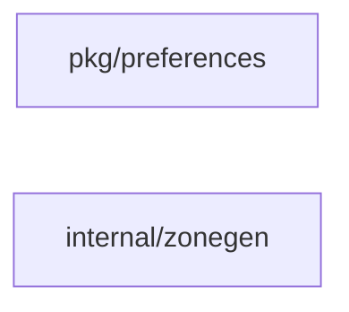

## Context

PATCH /api/dustpan/v1/me/preferences checks timeZone in pkg/preferences before storage. The current last layer reads ZONEINFO and host zone files, so two hosts can answer differently for one name.

## Decisions

1. **Check the embedded database only.** Replace the host-dependent load layer in pkg/preferences with a lookup in a generated allowlist built from the embedded time/tzdata database of the Go toolchain that builds the server. Keep zoneShape and the refused-name block as first layers. The map lives in pkg/preferences and only the NEW constructor loadEmbeddedZones builds it from generated data. Regeneration runs internal/zonegen through a go generate directive plus a NEW make target, and CI fails when the generated list differs from the generator output.
2. **Grandfather stored values.** Already stored values stay readable and restore and import keep them byte for byte. A PATCH that sets a new timeZone value must pass the new check. A PATCH of other fields, or one that repeats the stored value, leaves the stored timeZone unchanged without rechecking it. A consumer that formats with a stored zone uses UTC when the embedded database lacks that name.

## Structure

Unexported allowlist map built once by the NEW constructor loadEmbeddedZones; timeZone only reads that map and never loads host zone files.

## Risks

- Generated list must match the Go release that builds the server; the two-direction test and the CI freshness check catch drift.

## Diagrams

Modules that the change touches, and their imports on main:

## Quality attributes

| Attribute | Target | Unit | Scope |
| --- | --- | --- | --- |
| none affected | No latency, storage, or limit change: one map lookup replaces one file lookup. |  |  |

## Contracts

**preferences**

- Invariant: A newly stored timeZone names only a zone in the embedded database.
- Invariant: A stored timeZone value from before the fix stays readable.
- `timeZone`: pre: Value passed zoneShape and the refused-name block.. Post: Returns nil only when value is in the embedded allowlist..
