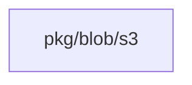

## Context

CI only. No server code, no API, no store code and no schema change. The go job in .github/workflows/ci.yml starts a RustFS service container, sets the four S3 test variables, makes one bucket, then go test -race ./... runs the existing pkg/blob/s3 suite. The suite already runs blobtest.Run when the variables have values and skips when they have none.

## Decisions

1. **Fixed container shape.** RustFS service rustfs with image rustfs/rustfs pinned by the digest checked at work start, ports 9000:9000, env RUSTFS_ROOT_USER dustpan-test and RUSTFS_ROOT_PASSWORD a fixed test-only value stored in plain text in .github/workflows/ci.yml. Reason: the value is a fake test credential, and GitHub secrets are not available to pull requests from forks, so a secret would fail closed for outside contributors.
2. **Readiness by S3 API retry.** The service block sets no container health command. A CI step waits for readiness by retrying aws s3api list-buckets with the endpoint-url flag until it exits 0 or the step times out. Reason: the change has no proof which shell tools the rustfs image holds or which health path it serves.
3. **Bucket tool is aws cli.** Make the bucket with aws cli on ubuntu-latest with aws s3api create-bucket --endpoint-url http://localhost:9000 --region us-east-1, with credentials exported for the step, and treat BucketAlreadyOwnedByYou and BucketAlreadyExists as success so a rerun on a reused service passes. Reason: aws cli ships on ubuntu-latest, it adds no action, no Go tool and no repository script.
4. **No silent skip guard.** The S3 log is captured with go test -v, and a guard step fails the job when the pkg/blob/s3 log holds the standard Go skip line --- SKIP or when the package result is not ok. Reason: without -v the skip text may not show.

## Structure

No new structure. No server type changes. The fix boundary is .github/workflows/ci.yml plus the pull request note of the tested store, version and date.

## Risks

- Digest drift of the RustFS image between brief and work start. Mitigation: recheck the digest at work start, pin the full digest in .github/workflows/ci.yml, and record the digest and the check date in the pull request.
- Registry outage or pull failure. Mitigation: the job fails closed with a clear error; no fallback image and no latest tag.
- Shared bucket state across parallel packages. Mitigation: only pkg/blob/s3 uses the CI bucket, and the S3 suite keeps its unique key prefix for each subtest; the bucket lives only for the job so no cleanup step is needed.

## Diagrams

Modules that the change touches, and their imports on main:

## Quality attributes

| Attribute | Target | Unit | Scope |
| --- | --- | --- | --- |
| none affected | CI only; no server latency, storage growth, rate limit or timeout change |  |  |
