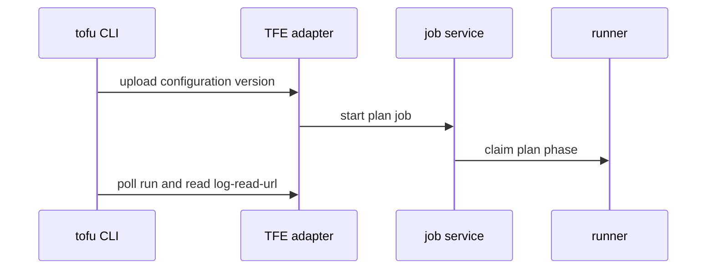
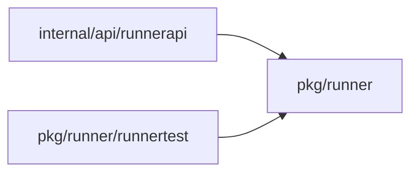
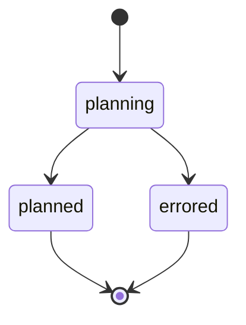
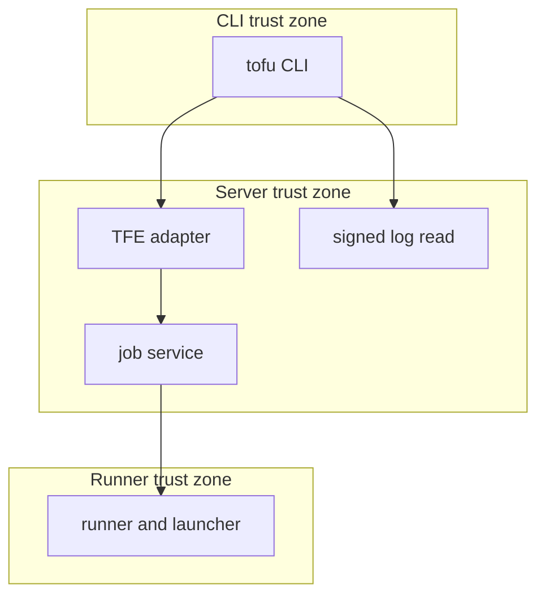

## Context

The OpenTofu cloud block drives runs through the TFE-compatible API. ADR 254 ships speculative plans on runners. The apply stays open in ADR 254 decision 10, so the roadmap step stays partly open until the owner accepts the partial scope.

## Decisions

1. **Keep slice 1 unchanged.** Upload a configuration version as a file set with archive checks. Start a plan job with source kind cli and only the fixed arguments refresh, refresh-only, target-addrs, replace-addrs and is-destroy. Seal run variables. Read the log through a signed URL. Answer poll routes without 404. Refuse every apply route. The adapter check runs before a run exists. The gate check runs after, so the run ends as errored.
2. **Leave the apply for its own ADR.** The apply mapping, the stored plan, auto-approve, the saved plan of -out and the remote backend stay open. Cancel of a plan cancels its job. Masking covers the exact value across chunk bounds. Derived values stay a documented limit. A rotation of the log URL signing key ends live URLs, and the CLI asks the runs API for a new one.

## Structure

Unexported type remotePlan with constructor newRemotePlan that checks the workspace execution mode, the speculative flag, the allowlisted arguments and the pool before it makes a job spec, so no caller builds a remote plan without the checks.

## Risks

- A secret run variable leaks into a log, an audit entry or an answer.
- Masking covers only the exact value; a value derived from a secret is not masked.
- The CLI polls a route that answers 404 and stops.
- A signed log URL replays for another job or principal.

## Layers (defense in depth)

| Layer | Guard | Hostile test |
| --- | --- | --- |
| TFE adapter | Allows only speculative uploads on agent workspaces with allowlisted arguments and refuses every apply route. | Send speculative=false, an unknown argument, a bad archive and actions/apply directly to the adapter. |
| job service | Checks the run action on the unit and the change.propose gates before the plan job starts. | Start a plan without the grant and with a gate refusal; no job starts. |
| HTTP handler | Binds the log URL to one job, phase and principal, checks the read action at mint and at read, and masks values. | Replay the URL for another job or after expiry; send a secret split across chunks. |

## Diagrams

After this change:

Modules that the change touches, and their imports on main:

States on main in the touched packages:

States and transitions after this change:

## Quality attributes

| Attribute | Target | Unit | Scope |
| --- | --- | --- | --- |
| signed log URL lifetime | 15 minutes past phase end | minutes | one plan phase read |

## Threat model

Data flow and trust boundaries:

| Boundary | STRIDE | Threat | Layer | Guard | Hostile test |
| --- | --- | --- | --- | --- | --- |
| CLI to server | I | A secret run variable leaks into a log, an audit entry or an answer, or a log URL replays for another job. | boundary check | Adapter accepts only speculative uploads and allowlisted arguments. | Send a bad archive and an unknown argument. |
| CLI to server | I | A secret run variable leaks into a log, an audit entry or an answer, or a log URL replays for another job. | encode or contain | Variables are sealed in the job spec and masked in the log. | Send a secret variable and check log, audit entry and answer. |
| CLI to server | I | A secret run variable leaks into a log, an audit entry or an answer, or a log URL replays for another job. | limit | Log URL is bound to one job, phase and principal with a short expiry. | Replay the URL after expiry. |
| CLI to server | I | A secret run variable leaks into a log, an audit entry or an answer, or a log URL replays for another job. | authorize at point of use | Handler checks the log read grant at mint and at read. | Remove the grant after mint and read. |
| CLI to server | I | A secret run variable leaks into a log, an audit entry or an answer, or a log URL replays for another job. | fail closed | Expired or unbound reads fail with no partial secret. | Read for another principal. |

## Failure modes

| Step | Failure | Retry | State after |
| --- | --- | --- | --- |
| Configuration version upload | Upload or archive check fails | The CLI stops with the JSON:API error; no job starts | no run, no job |
| Gate and authorization check | Gate refusal or missing grant after the run exists | No retry | run errored, job not claimed |
| Signed log read | Log URL expired or key rotated | The CLI asks the runs API for a fresh log-read-url and resumes | job keeps running, log read resumes |
