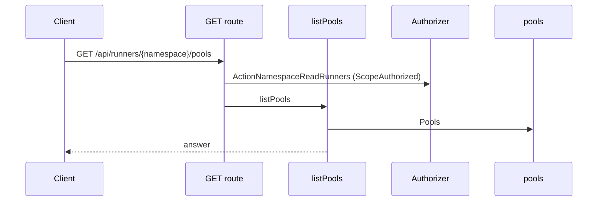

## Context

The CLI prints one retry hint for each HTTP failure. The runner routes vanish with no public URL. faultlog classes ENOSPC as network.

## Decisions

1. **Refused requests carry no retry hint.** The CLI adds the retry hint only for a connection failure and a 5xx answer. For each 4xx answer, including 429, it prints the server message once with no retry hint.
2. **Errno before network test.** faultlog tests ENOSPC before the net.Error test and returns the NEW cause no_space. Other errno values keep the current class.

## Structure

An unexported CLI helper takes the HTTP status class in its constructor and returns a retry hint only for the connection and 5xx classes, so a 4xx hint cannot exist.

## Risks

- Server messages and codes stay unchanged, so clients parse the same codes.

## Diagrams

Today: `GET /api/runners/{namespace}/pools` on main (from the route table and the handler body, route row internal/api/runnerapi/routes.go:97, handler internal/api/runnerapi/admin.go:102).

## Quality attributes

| Attribute | Target | Unit | Scope |
| --- | --- | --- | --- |
| none affected | Error text and log cause only; no latency or storage target changes |  |  |
