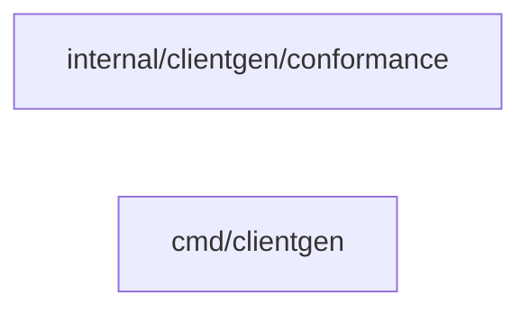
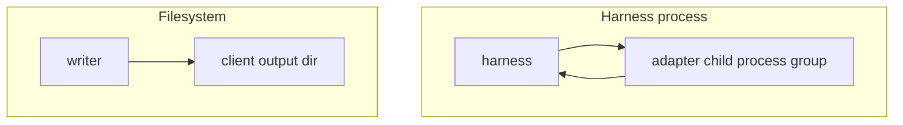

## Context

The harness in internal/clientgen/conformance drives generated adapters over JSON-RPC; 22 cases have no body, paginate returns an error, and adapter cleanup and stale-file removal have known races.

## Decisions

1. **Bodies for buildable cases only.** Write bodies buildable on existing fixtures: unknown-enum-value-is-kept, merge-patch-null-clears-a-field, absent-field-is-not-sent, error-args-keep-their-json-types, error-without-error-code, transport-error-is-not-a-server-error, query-parameter-is-encoded. The 4 pagination cases, the 8 idempotency retry cases and missing-required-if-match-gives-428 stay BLOCKED as out_of_scope until the depended-on changes land.
2. **Bound enforced by the loop counter.** Each paginate loop counts pages against the existing MaxPages field of the call and stops after MaxPages pages with a truncation report. No new limit value is set.
3. **Frozen fixture for goldens.** Generator golden tests read the NEW file internal/clientgen/testdata/description.json, a trimmed copy of the live description. A comment in the test lists every template branch the fixture covers.
4. **Adapter hardening per platform.** On Linux lock the forking thread and set Pdeathsig; on other platforms kill the process group. Skip kill once done is closed. Match IsGenerated only before the package clause. Skip dot directories in removeStale. Strip CR and LF from RPCError.Message and cap it at 512 bytes.

## Structure

The paginate loop takes a page counter checked against MaxPages, so an unbounded loop is impossible.

## Risks

- A frozen fixture drifts from the live description if a new template branch ships with no golden.
- Pdeathsig follows the forking thread, so the thread must stay locked.

## Diagrams

Modules that the change touches, and their imports on main:

## Quality attributes

| Attribute | Target | Unit | Scope |
| --- | --- | --- | --- |
| latency | 60 | s | clients-conformance after first build |

## Threat model

Data flow and trust boundaries:

| Boundary | STRIDE | Threat | Layer | Guard | Hostile test |
| --- | --- | --- | --- | --- | --- |
| Harness process to adapter child process group | T | A hostile adapter answer or a surviving child process corrupts the run or the host. | boundary check | Allowlist RPC methods and bound message size in the harness reader. | Send an over-size frame and an unknown method; harness refuses both. |
| Harness process to adapter child process group | T | A hostile adapter answer or a surviving child process corrupts the run or the host. | encode or contain | Own process group; strip CR and LF and cap RPCError.Message at 512 bytes. | Return CR, LF and a long message; output holds no CR or LF and is capped. |
| Harness process to adapter child process group | T | A hostile adapter answer or a surviving child process corrupts the run or the host. | limit | Bound paginate by existing MaxPages and adapter lifetime by timeout plus group kill. | Return endless cursors and hang the child; loop stops and Close ends the group. |
| Harness process to adapter child process group | T | A hostile adapter answer or a surviving child process corrupts the run or the host. | authorize at point of use | No authorization is claimed; the harness runs as the invoking developer. | Run with no grants; harness runs because no object is authorized. |
| Harness process to adapter child process group | T | A hostile adapter answer or a surviving child process corrupts the run or the host. | fail closed | Fail on adapter crash, bad frame or timeout and report the case id. | Kill the adapter mid-case; the case is marked failed. |
| Writer to client output dir | T | The generator removes or overwrites a hand-written file. | boundary check | Match IsGenerated only before the package clause. | A hand-written file quoting the header after the package clause is kept. |
| Writer to client output dir | T | The generator removes or overwrites a hand-written file. | encode or contain | Write through a contained root and remove only files with the header. | A file with no header is kept by removeStale. |
| Writer to client output dir | T | The generator removes or overwrites a hand-written file. | limit | Skip dot directories in the stale walk. | A .git tree and a node_modules tree are skipped. |
| Writer to client output dir | T | The generator removes or overwrites a hand-written file. | authorize at point of use | No authorization is claimed; the writer uses the file rights of the developer. | The writer writes only inside the target root. |
| Writer to client output dir | T | The generator removes or overwrites a hand-written file. | fail closed | On I/O error leave hand-written files in place. | A read-only target gives an error and removes nothing. |

## Failure modes

| Step | Failure | Retry | State after |
| --- | --- | --- | --- |
| Paginate cursor loop | Server keeps returning new cursors | No retry; stop the loop and report truncation | Adapter returns collected pages with truncation report |
| Adapter cleanup | Adapter child survives Close | Kill the process group once, then report failure | No adapter process remains; case marked failed |
