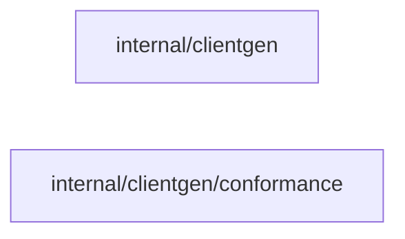

## Context

Generator ports exist in internal/clientgen with a conformance suite in internal/clientgen/conformance. The Python set mirrors the Go set. The NEW protocol document lands before the NEW Python adapter.

## Decisions

1. **Python set mirrors the Go set, docs first.** Add the NEW package internal/clientgen/python with golden files and a determinism test. Write the NEW protocol document first, then add the NEW Python adapter with generator option httpx as bool default false and harness field InitializeParams.Transport with allowlist urllib and httpx. The Go adapter reports net/http only. The generated package targets Python 3.10 to 3.13 with py.typed and extra name httpx, urllib.request by default with no extra install.

## Structure

Unexported type pythonName in the NEW package internal/clientgen/python. Only its constructor makes a value, and it checks the allowlist and reserved words.

## Risks

- Generated Python drifts from the Go set, mitigated by shared cases and golden files

## Diagrams

Modules that the change touches, and their imports on main:

New imports of this change (each one allowed by the module rules):

- `internal/clientgen/python` imports `internal/clientgen`

## Quality attributes

| Attribute | Target | Unit | Scope |
| --- | --- | --- | --- |
| none affected | Generator output only, no request path changes |  |  |
