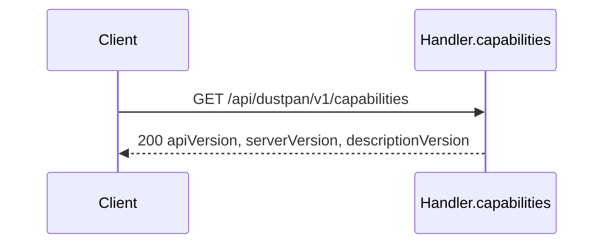
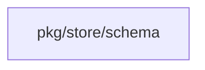

## Context

Provider and CLI clients need server and description versions before other calls without server:observe.

## Decisions

1. **Extend tool-neutral capabilities with two version fields.** Add NEW fields serverVersion and descriptionVersion to the tool-neutral GET /api/dustpan/v1/capabilities entry in internal/api/apidesc/openapi.json and serve them from the existing handler at internal/api/pulumi/pulumi.go:317 (func Handler.capabilities). The route declares caller:read on the installation, which every signed-in caller holds. This change sets that rule; no claim about current anonymous behavior. Unauthenticated, expired, revoked, or invalid credential gets 401 with no version values and no caching of version answers. Server sends binary version string as held via pkg/store/schema form, and DocumentVersion from internal/api/apidesc/document.go:15 as descriptionVersion. Empty or unset binary version sends dev. Forms: MAJOR.MINOR.PATCH with optional pre-release, dev or commit hash, describe tag with suffix. Extra JSON fields keep Pulumi CLI contract safe because clients ignore unknown fields; verified by make e2e against real CLI. Pulumi Cloud-compatible and TFE-compatible shapes stay unchanged. Build after let-lock-in-static-settings and add the version fields to the same capabilities schema in the API description.
2. **Keep upgrade-check unchanged.** Leave ANY/GET /api/dustpan/v1/upgrade-check behind server:observe unchanged. No new route, no new auth action, no public version endpoint.

## Structure

No new type; extend capabilities response shape with two string fields built by existing handler constructor from build version and DocumentVersion.

## Risks

- Version disclosure to signed-in callers only; public callers still get 401 with no values and no cache.

## Diagrams

After this change:

Modules that the change touches, and their imports on main:

## Quality attributes

| Attribute | Target | Unit | Scope |
| --- | --- | --- | --- |
| latency | 95th percentile under 200 ms in-process | ms | GET /api/dustpan/v1/capabilities |

## Contracts

**Capabilities document**

- Invariant: Unauthenticated callers receive no version values.
- Invariant: apiVersion value and upgrade-check authorization stay unchanged.
- `capabilities`: pre: Caller holds valid access token or session, which grants caller:read.. Post: Response holds apiVersion unchanged plus serverVersion and descriptionVersion for signed-in caller..

## Failure modes

| Step | Failure | Retry | State after |
| --- | --- | --- | --- |
| Serve GET /api/dustpan/v1/capabilities version fields | Version source read fails at startup or request time | Fail the request with 500; do not cache a prior version value | Capabilities route still serves apiVersion; version fields return on next successful read |
