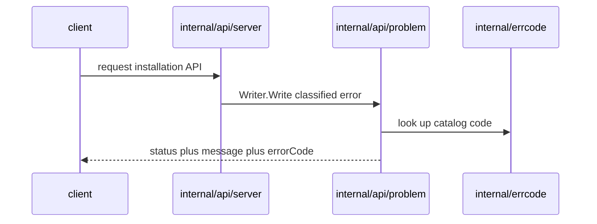
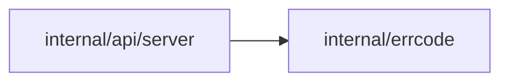
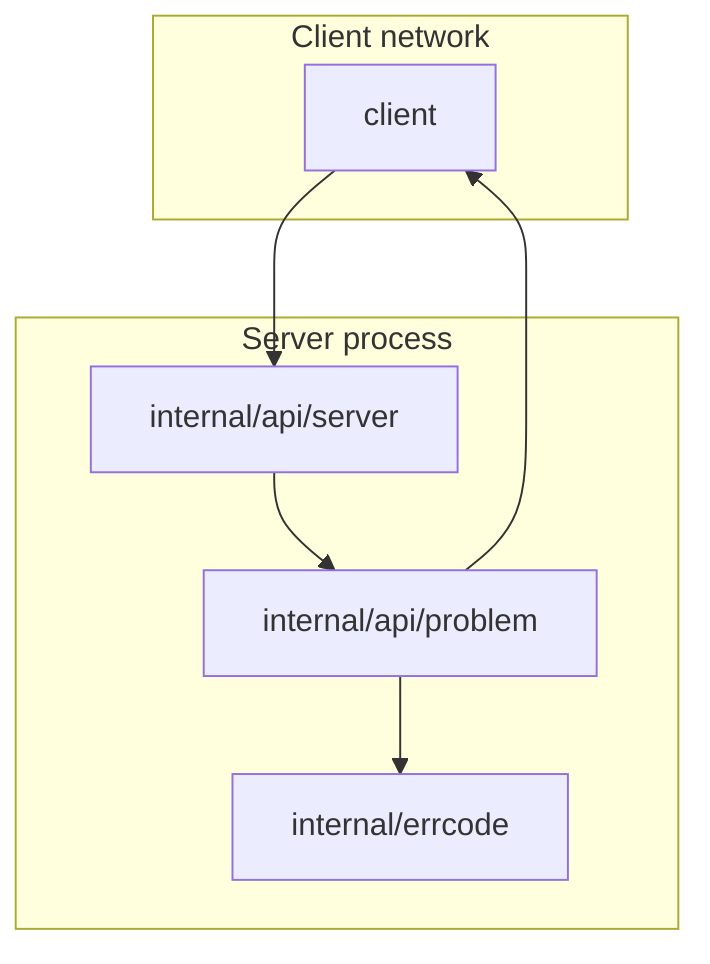

## Context

The installation API in internal/api/server answers about 150 paths without a catalog code from classifyAccess, classifyBackup, classifyGateConfig, git-host paths, classifyIPAllowlist, classifyPrincipal, classifyProviders, registry paths, classifySessionPolicy, classifySignIn, classifyToken, the audit chain, ErrNoPaging, errCheckpointsOff and ErrNoWorker.

## Decisions

1. **Code each class then move it onto the Writer in four slices.** Add one errcode.Spec per error class in internal/errcode with meaning and arguments, then move each classify function onto the Classify hook of the problem.Writer built by problemWriter in internal/api/server, in four slices with fixed chain order. Reuse the codes defined by the depended-on changes and do not define a second code for the same refusal.

## Structure

Unexported failure mapping in internal/api/server stays the single place that maps domain errors to problem.Problem values; only the problemWriter constructor builds the Writer with the combined Classify chain.

## Risks

- Status or message changes during the move alter tool output and break search strings.

## Layers (defense in depth)

| Layer | Guard | Hostile test |
| --- | --- | --- |
| classified error codes | Catalog allowlist: Classify returns only a code declared in internal/errcode with declared argument names and kinds. | Send a wrapped ErrNoPaging and a hostile unknown error; each answer carries a catalog code and no uncoded path passes the gate. |
| coded fallback | Writer fallback: problemWriter chain ends in a coded fallback with existing status and message so no path answers without a code. | Force an error no classify function maps; answer still carries a catalog code with fallback status. |

## Diagrams

After this change:

Modules that the change touches, and their imports on main:

## Quality attributes

| Attribute | Target | Unit | Scope |
| --- | --- | --- | --- |
| none affected | Additive errorCode field only; no latency or storage target changes. |  |  |

## Threat model

Data flow and trust boundaries:

| Boundary | STRIDE | Threat | Layer | Guard | Hostile test |
| --- | --- | --- | --- | --- | --- |
| client network to installation API | I | Error arguments disclose identifiers or secrets beyond the existing message. | boundary check | Classify allowlist in internal/api/server accepts only known sentinels and request shapes. | Send unknown error type and hostile subject string; answer uses coded fallback, no uncoded path. |
| client network to installation API | I | Error arguments disclose identifiers or secrets beyond the existing message. | encode or contain | ErrorArgs encode only declared identifier, quantity, or time values; message text unchanged. | Inject CRLF and JSON metacharacters in names; stored args stay encoded and message stays stable. |
| client network to installation API | I | Error arguments disclose identifiers or secrets beyond the existing message. | limit | Args carry at most declared fields with catalog length limits; no secret or token value enters args. | Request token and sign-in errors; errorArgs hold no secret material. |
| client network to installation API | I | Error arguments disclose identifiers or secrets beyond the existing message. | authorize at point of use | Existing authorization checks run before error mapping; code addition does not grant access. | Call ANY /api/audit/entries without grant; refusal stays denied with code added. |
| client network to installation API | I | Error arguments disclose identifiers or secrets beyond the existing message. | fail closed | Unmapped errors fail closed to coded fallback with existing 5xx status. | Force ErrNoWorker and unknown store error; each answers a catalog code, none answers uncoded. |
| client network to installation API | T | Tampered error mapping changes status, message, or code meaning. | boundary check | Chain order fixed in problemWriter so overlapping classify matches keep first code. | Craft error matching two classes; answer carries first-chain code only. |
| client network to installation API | T | Tampered error mapping changes status, message, or code meaning. | encode or contain | Status and message pass through unchanged; only errorCode and errorArgs are added. | Diff answers before and after slice; status and message match exactly. |
| client network to installation API | T | Tampered error mapping changes status, message, or code meaning. | limit | One code per class; reuse of depended-on change codes avoids duplicate refusal codes. | Trigger same refusal from two paths; both answers carry the same single code. |
| client network to installation API | T | Tampered error mapping changes status, message, or code meaning. | authorize at point of use | No grant or route change in this change; route actions and objects stay as on main. | List route actions for touched routes; each matches main. |
| client network to installation API | T | Tampered error mapping changes status, message, or code meaning. | fail closed | Gate TestUncodedPathsNeedsTheSkippedFunctions fails on any new uncoded path. | Add uncoded return in slice; gate test fails. |
