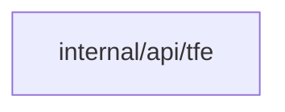

## Context

The Pulumi adapter and the TFE adapter must reach the same placement outcome. Rules hold the stable ID of the collection, so a rename keeps the rule. The namespace create writes the default and the rule in its own transaction.

## Decisions

1. **One resolver.** An unexported placementResolver is made only by NewPlacementResolver from the ordered rules and the collections read in the create transaction. Adapters pass tool, project and unit name and get a collection ID or a typed refusal.
2. **Default at namespace create.** The existing namespace create route writes the default collection, the catch-all rule and their audit entries in one transaction with the namespace. The opt-out field skips the two. The default collection has no special grants.
3. **Race safety by structure.** The unit row has a foreign key to the collection ID, and the rule row has a foreign key to its collection. A collection delete that rules or units still name is refused by the key. The unit insert and the rule read run in one transaction with the namespace fence.
4. **Reorder.** A reorder is a PUT of the rule position on the existing rule route. It locks the rule rows of the namespace, so concurrent reorders run one after the other.
5. **Audit.** A placement and a rule change write their entry in the same transaction. A refusal writes its entry after the transaction ends. If that write fails, the answer stays 422 and the server logs the failure.
6. **Same-name creates.** A unique name constraint on units serves the Pulumi and TFE paths. Of two concurrent creates, one wins and the other gets a conflict.

## Structure

Unexported type placementResolver with constructor NewPlacementResolver(rules, collections). Rules hold the collection ID, never the name. Adapters hold no pattern logic. A foreign key makes a rule or unit that names a missing collection impossible.

## Risks

- A broad early rule shadows a later narrow rule. The rule list shows the order.
- A TFE project that matches no collection blocks workspace creates in that project. The refusal names the fix.
- A refusal audit entry can be lost if the process stops after the 422. The refusal changes no state.

## Diagrams

Modules that the change touches, and their imports on main:

## Quality attributes

| Attribute | Target | Unit | Scope |
| --- | --- | --- | --- |
| Placement lookup cost | 100 | rules scanned at most per create | one CLI create in one namespace |

## Failure modes

| Step | Failure | Retry | State after |
| --- | --- | --- | --- |
| Refusal audit write | the write fails or the process stops after the 422 | the developer runs the CLI create again | no unit exists; the refusal entry may be missing and the failure is logged |
| Namespace create | the store of the collection or the rule fails | the administrator repeats the create | no namespace, collection or rule exists |
