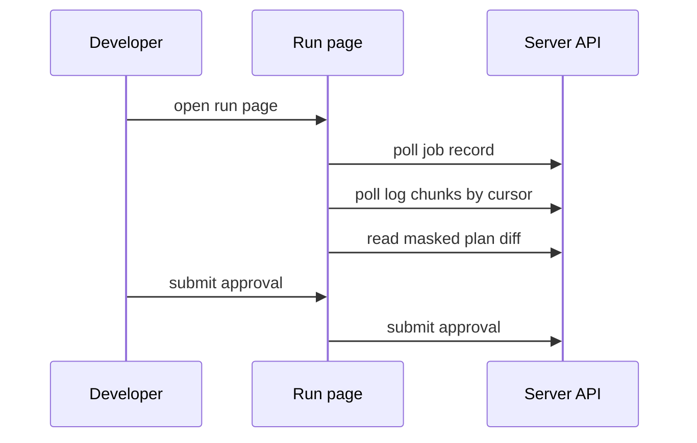
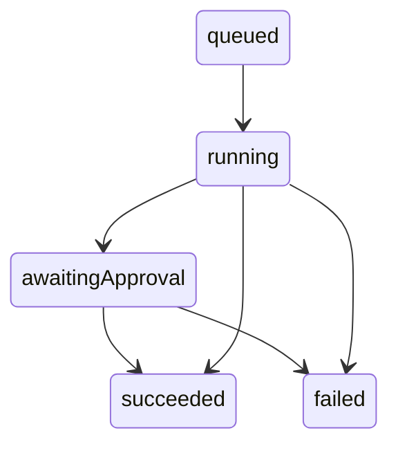
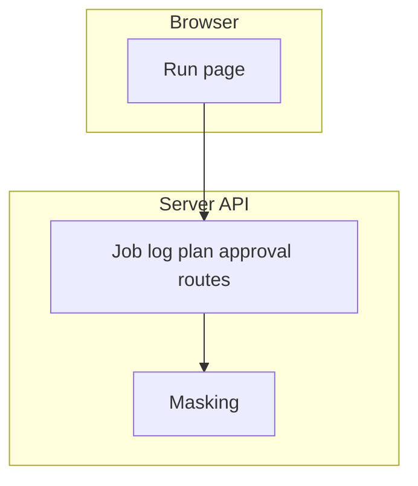

## Context

The server already starts jobs, serves log chunks, serves stored plans and records approvals through items that own those routes. The run page lives in the console repository. This change wires the run page to those records and runs its browser tests against the suite server.

## Decisions

1. **Run page in console repository.** The run page reads only the public jobs API and writes only through the approval route that policy-approvals owns. Masking, pagination and cursor rules stay in the items that own those routes.
2. **Render masked text only.** The page renders the masked text that the server sends without further processing.
3. **Polling for live updates.** The page polls the job, log and approval routes every 5 seconds, with a manual refresh control and the time of the last poll. No server-sent event channel ships in this slice.

## Structure

No new stored type. The console view model uses unexported field runView.source with constructor newRunView that accepts only server API records.

## Risks

- Browser tests flake when live log timing varies.
- Plan diff grows large on big units and slows first render.

## Diagrams

After this change:

States and transitions after this change:

## Quality attributes

| Attribute | Target | Unit | Scope |
| --- | --- | --- | --- |
| refresh lag | 5 | seconds | run page live log while a job runs |
| first render of paginated plan diff | 2 | seconds | run page plan section for a stored plan |

## Threat model

Data flow and trust boundaries:

| Boundary | STRIDE | Threat | Layer | Guard | Hostile test |
| --- | --- | --- | --- | --- | --- |
| console to server API | I | A principal reads a job of another namespace through a guessed job ID. | boundary check | Server rejects malformed namespace, job and cursor values at the boundary. | Send hostile job ID and cursor strings and check for rejection with no record leak. |
| console to server API | I | A principal reads a job of another namespace through a guessed job ID. | encode or contain | Server masks secret values in log chunks and plan diff before send. | Request log and diff that hold secrets and check that the answer holds masked values only. |
| console to server API | I | A principal reads a job of another namespace through a guessed job ID. | limit | Server bounds log and diff pages and poll rate. | Request an oversize page and a fast poll burst and check for bounded answers. |
| console to server API | I | A principal reads a job of another namespace through a guessed job ID. | authorize at point of use | Server checks read action on the unit for job, log and plan reads. | Request a foreign job ID and check for 404 with no record leak. |
| console to server API | I | A principal reads a job of another namespace through a guessed job ID. | fail closed | Server denies on error or unknown value and writes the denial to the audit log. | Force a lookup error and check that the page shows no record and the denial is logged. |

## Contracts

**run view**

- Invariant: The view shows only records of one namespace.
- Invariant: The view never renders an unmasked secret value.
- `Run timeline from job records`: pre: The source records come from the jobs API.. Post: The view holds only server API records..

## Failure modes

| Step | Failure | Retry | State after |
| --- | --- | --- | --- |
| Run browser tests against suite server. | Suite server is unreachable during browser tests. | Start the suite server again and rerun the browser suite from the first test. | No run page state changes; tests report setup failure. |
| Follow live log while the job runs. | A log or job poll fails with 5xx, expired token or network loss. | Keep shown chunks and retry on the next 5 second poll or manual refresh. | Page keeps shown chunks, shows last poll time and poll error. |
| Read the masked plan diff. | Stored plan is not yet served for a running plan phase. | Poll the plan route again after the phase ends. | Plan section shows plan pending. |
