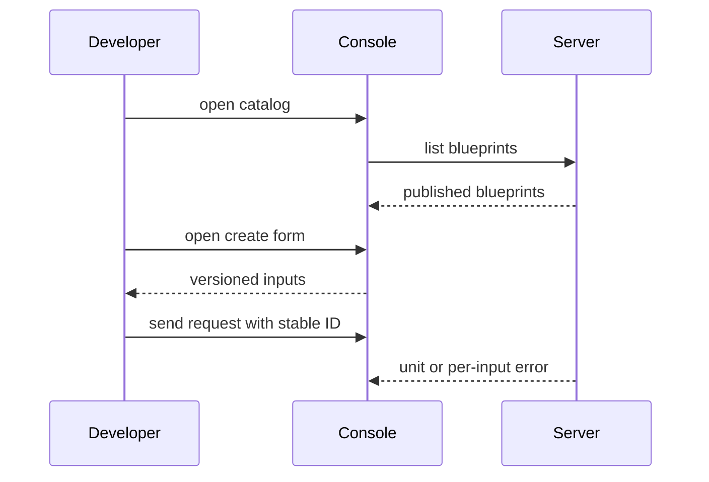

## Context

The console lives in a separate repository and uses only the tool-neutral REST API. The blueprints change owns the server routes, the input check, the unit write, the grants, and the audit record. This change owns only the console catalog pages and the browser test gate.

## Decisions

1. **Console pages live in console repo, gate job lives in server repo.** The console repository holds the catalog page, the create form, and the browser tests. This repository holds only the e2e gate job that runs that browser suite against the real binary over TLS. No server route changes in this change.
2. **Idempotency-Key lifecycle bound to one unchanged form.** The console generates one Idempotency-Key when the form opens, keeps it for reload and retry of the same values, and generates a new key after any edit. A resend with the same key and a changed body shows the 409 conflict text unchanged.

## Structure

No new server structure in this change. The server keeps stable IDs for blueprint and unit references so a rename of a blueprint keeps the request valid. The console holds no copy of blueprint rules.

## Risks

- The console repository and the server suite drift when the request shape changes.
- Long input schemas cost time when the form shows inputs that do not apply to the chosen blueprint.

## Diagrams

After this change:

## Quality attributes

| Attribute | Target | Unit | Scope |
| --- | --- | --- | --- |
| latency | 2 | s | console catalog list render of 50 published blueprints |

## Failure modes

| Step | Failure | Retry | State after |
| --- | --- | --- | --- |
| Send create request from the form | First send times out before an answer | Resend with the same Idempotency-Key | One unit exists, no second unit made |
| Send create request from the form | Same key resent with a changed body | Show the 409 conflict text unchanged and make a new key after edit | No second unit made, form keeps user values |
