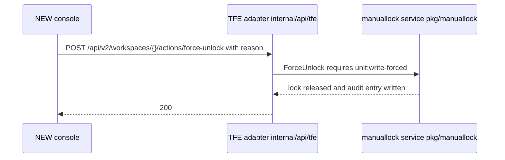

## Context

The server stores workspaces, state versions and locks. The page needs stable reads and a force-unlock that records a reason.

## Decisions

1. **No new route.** Use the existing routes. Add only the NEW reason field on the console force-unlock request: 1 to 500 characters after trim, control characters rejected. The TFE-compatible route keeps the reason optional so the CLI works; then the server records the lock identity as the reason.
2. **Route and service check.** The route declares unit:write-forced. The service checks it again before the store write. The release and the audit entry commit in one store transaction.

## Structure

No unexported type removes this bug class. A route check and a service check guard it, each with its own hostile test.

## Risks

- G1 to G12 may hold more work than the reason field; each open gap gets its own issue.

## Diagrams

After this change:

## Quality attributes

| Attribute | Target | Unit | Scope |
| --- | --- | --- | --- |
| none affected | No latency or storage target changes; the change adds a reason field and tests only. |  |  |

## Contracts

**workspace lock**

- Invariant: At most one holder holds the lock of a workspace at a time.
- Invariant: A force-unlock writes an audit entry with the actor and the reason.
- `forceUnlock`: pre: The workspace exists.; The caller holds unit:write-forced.. Post: The lock is released and the audit entry is stored in the same transaction..

## Failure modes

| Step | Failure | Retry | State after |
| --- | --- | --- | --- |
| Release the lock and write the audit entry in one transaction | The process stops before the commit. | The caller repeats force-unlock; the first call changed nothing. | The lock is held and no audit entry exists. |
| Second force-unlock on an unlocked workspace | The server answers 404 with `workspace.not-locked`. | None needed; read the workspace to see the state. | The workspace stays unlocked. |
| A job writes with a stale lock identity after a release | The server answers 409 with `workspace.lock-mismatch`. | The job takes a new lock and writes again. | The state is unchanged. |
