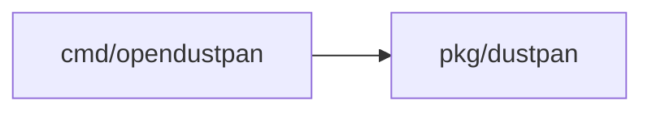

## Context

Main holds WithSQLite, WithPostgreSQL, and settings.setStoreOptions in pkg/dustpan. cmd/opendustpan still holds its own wiring. This change moves that wiring to the constructors with no behavior change.

## Decisions

1. **Single wiring point in pkg/dustpan.** cmd/opendustpan selects the constructor by the configured store kind: SQLite uses WithSQLite with the configured path, PostgreSQL uses WithPostgreSQL with the configured DSN. The existing With...Store options stay. Flags, defaults, ordering, error text, and close behavior stay as main holds them. The DSN password never appears in errors or logs.

## Structure

The unexported settings type in pkg/dustpan sets every store option through settings.setStoreOptions. cmd/opendustpan keeps no store wiring of its own, so it cannot drift.

## Risks

- The switch changes a default of cmd/opendustpan by mistake.

## Diagrams

Modules that the change touches, and their imports on main:

## Quality attributes

| Attribute | Target | Unit | Scope |
| --- | --- | --- | --- |
| none affected | Wiring refactor with no latency or storage change |  |  |

## Contracts

**dustpan server options**

- Invariant: The existing With...Store options stay usable.
- `WithSQLite`: pre: The path is not empty.. Post: The server opens the built-in SQLite store..
- `WithPostgreSQL`: pre: The DSN is not empty.. Post: The server opens the built-in PostgreSQL store..
