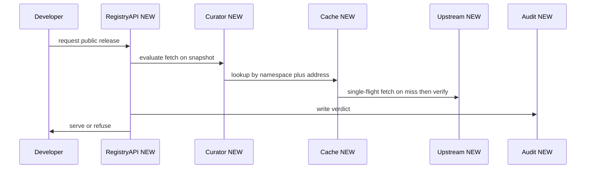
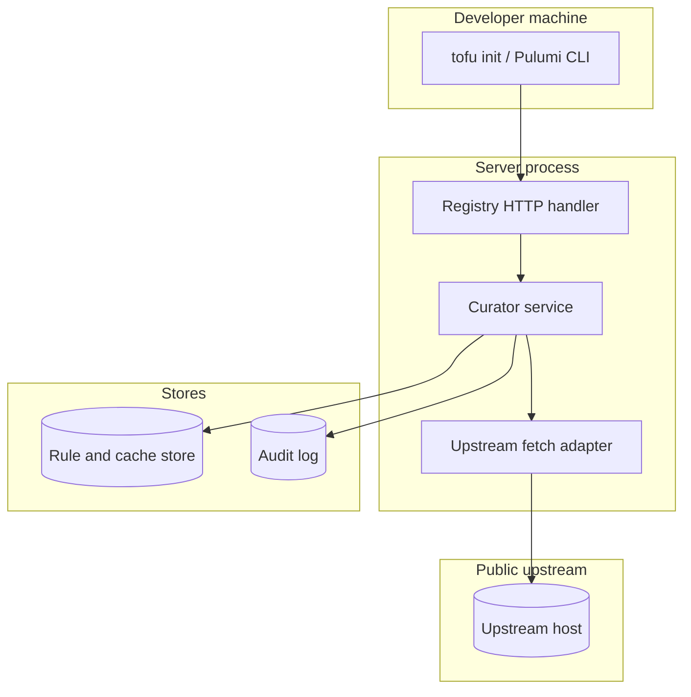

## Context

Milestone 6 step 5 needs curation of public upstreams. The registry fetches a public release from its upstream host, holds it in cache keyed by namespace, and serves it through the registry and tool-compatible fetch endpoints only when the curation setting and rules of the namespace allow it. The curation part of RFC 10 is open, so this change gives the design and links the left open questions.

## Decisions

1. **Curation is opt-in with explicit allow rules.** Curation is a per-namespace curation-enabled setting that defaults to off with an effective value in the API, plus explicit allow rules keyed by namespace ID. Rules combine with logical OR and each rule names an upstream host matched exactly without subdomain wildcard, a registry address prefix matched at a path boundary, and a semver constraint. The address model covers OpenTofu provider and module addresses and Pulumi plugin names. Rule host never holds an IP literal and upstream fetch uses HTTPS only.
2. **One snapshot per request, curation before cache, single-flight fetch then verify then serve, audit before serve.** Each fetch loads one immutable snapshot of the setting and rules of the namespace at request start and uses that snapshot for the whole request. When curation is on, the curation check runs before the cache lookup and deny is the default with no direct upstream fallback. Cache entries are keyed by namespace ID so entries from before curation was on or from another namespace never serve. A removed rule stops later serves even when bytes stay cached. A cache miss for an allowed address fetches under single-flight so concurrent misses for the same address cause one upstream fetch, stores only after checksum verify and size and timeout limits pass, then serves. When curation is off, the server skips the curation check and writes no curation audit entry. Toggling the setting retains stored rules. The audit write for an allow or refuse precedes the serve and a failed audit write refuses the fetch.

## Structure

Type curator with unexported fields rules and clock. Constructor newCurator checks each rule for an allowed host that is not an IP literal, a non-empty address prefix, and a parsable semver constraint. No other code path fetches an upstream release.

## Risks

- A broad prefix allows more releases than planned.
- Rule sprawl slows review of what is allowed.
- A hostile upstream fills the cache without size and time limits.

## Layers (defense in depth)

| Layer | Guard | Hostile test |
| --- | --- | --- |
| service | Service loads the rule snapshot of the request namespace and allows the fetch only when host, address prefix at a path boundary, and semver constraint of one rule all match. | Request a release with a close host name, a prefix that shares characters across a path boundary, and a version outside the constraint; each case is refused. |
| HTTP handler | HTTP adapter rejects a request with an encoded traversal, an absolute URL, or a path escape in the registry address before the service runs. | Send encoded traversal and absolute URLs as the registry address; the adapter returns 400 without a fetch. |
| port adapter | Fetch adapter allows only the exact host of the matched rule over HTTPS, rejects an IP literal rule host, and stops on redirect to any other host. | Point a matched rule at a redirect to an unlisted host and submit an IP literal host; the fetch stops and records the refusal. |

## Diagrams

After this change:

## Quality attributes

| Attribute | Target | Unit | Scope |
| --- | --- | --- | --- |
| refusal correctness | 100 | percent refused when no rule matches | curation gate when on |
| serve latency overhead | 50 | ms p99 added | cached allowed release fetch path |
| audit completeness | 100 | percent with audit entry before serve | curation allow and refuse verdicts |

## Threat model

Data flow and trust boundaries:

| Boundary | STRIDE | Threat | Layer | Guard | Hostile test |
| --- | --- | --- | --- | --- | --- |
| Server process: registry HTTP handler | S | Spoofed registry address bypasses curation and pulls an unlisted release. | boundary check | Reject encoded traversal, absolute URL, and path escape with 400 before service runs. | Send encoded traversal as registry address and check no fetch starts. |
| Server process: registry HTTP handler | S | Spoofed registry address bypasses curation and pulls an unlisted release. | encode or contain | Normalize and contain the address to the registry path before match. | Send mixed-encoding traversal and check the contained path stays inside the registry. |
| Server process: registry HTTP handler | S | Spoofed registry address bypasses curation and pulls an unlisted release. | limit | Cap address length and rule list page size on the route. | Send oversize address and check 400 without a fetch. |
| Server process: registry HTTP handler | S | Spoofed registry address bypasses curation and pulls an unlisted release. | authorize at point of use | Check namespace curation read and manage actions at the route. | Call rule edit without the manage action and check 403. |
| Server process: registry HTTP handler | S | Spoofed registry address bypasses curation and pulls an unlisted release. | fail closed | Deny on malformed address and write the denial to the audit log. | Send malformed address and check 400 with a denial record. |
| Server process: curator service | T | Tampered rule or request version widens the allow set past review. | boundary check | Load the request snapshot of rules before match and reject unknown rule shape. | Change rules mid-fetch and check the old snapshot decides. |
| Server process: curator service | T | Tampered rule or request version widens the allow set past review. | encode or contain | Contain prefix match to a path boundary with exact host match. | Request wide-prefix across a boundary and check refusal. |
| Server process: curator service | T | Tampered rule or request version widens the allow set past review. | limit | Cap prefix breadth by path-boundary match and reject IP literal hosts. | Submit IP literal rule host and check 400. |
| Server process: curator service | T | Tampered rule or request version widens the allow set past review. | authorize at point of use | Check the namespace of the snapshot at the point of use for each serve. | Serve from another namespace cache entry and check refusal. |
| Server process: curator service | T | Tampered rule or request version widens the allow set past review. | fail closed | Allow only when host, path-boundary prefix, and semver constraint of one snapshot rule all match; deny by default. | Request close host and out-of-range version and check refusal. |
| Server process: upstream fetch adapter | I | Upstream redirect leaks the fetch to an unlisted host without a record. | boundary check | Validate redirect target against the matched rule host before follow. | Return redirect to unlisted host and check fetch stops before connect. |
| Server process: upstream fetch adapter | I | Upstream redirect leaks the fetch to an unlisted host without a record. | encode or contain | Fetch only the matched rule host over HTTPS and contain bytes to the cache entry. | Return cross-host redirect and check no bytes store. |
| Server process: upstream fetch adapter | I | Upstream redirect leaks the fetch to an unlisted host without a record. | limit | Enforce size limit, time limit, and single-flight for concurrent misses. | Flood concurrent misses and oversize bytes and check one bounded fetch. |
| Server process: upstream fetch adapter | I | Upstream redirect leaks the fetch to an unlisted host without a record. | authorize at point of use | Check curation verdict at the point of store and serve for each fetch. | Remove the matching rule mid-fetch and check later serves refuse. |
| Server process: upstream fetch adapter | I | Upstream redirect leaks the fetch to an unlisted host without a record. | fail closed | Deny fetch when audit write fails and log the failure with no bytes served. | Fail the audit write and check no bytes are served. |

## Contracts

**curation-rule**

- Invariant: Each rule belongs to one namespace ID.
- Invariant: Rule host is not an IP literal.
- Invariant: Address prefix is non-empty and matches at a path boundary.
- Invariant: Cache entry is keyed by namespace ID plus registry address plus version.
- `create-rule`: pre: Caller holds namespace curation manage action.; Host, prefix, and semver constraint are valid.. Post: Rule is stored keyed by namespace ID..
- `evaluate-fetch`: pre: Request snapshot of setting and rules is loaded.. Post: Fetch is allowed only when one rule matches host, prefix, and constraint.; One audit entry is written before serve..

## Failure modes

| Step | Failure | Retry | State after |
| --- | --- | --- | --- |
| Record curation decision | Audit write fails. | Retry the fetch; no bytes are served. | Refusal is logged to the server log and no cache entry is added. |
| Fetch allowed release | Upstream redirects to an unlisted host. | Retry after fixing the rule or the upstream release. | Fetch stops and the refusal is recorded. |
| Edit curation rule | Two administrators edit the same rule. | Re-list the rules and re-apply the intended edit. | Last write wins until the version check question is decided and the stored rule is the last stored value. |
| Fetch allowed release | Concurrent cache misses for the same address. | Waiters share the single in-flight fetch; retry joins the same flight. | One upstream fetch runs and waiters get the same verified result. |
| Fetch allowed release | Partial fetch or crash mid-store. | Retry the fetch; the partial entry never serves. | Partial bytes are discarded and no cache entry is added until verify passes. |
| Fetch allowed release | Upstream 5xx, timeout, or DNS failure. | Retry after the upstream recovers. | No cache entry is added and a 502 names the address. |
