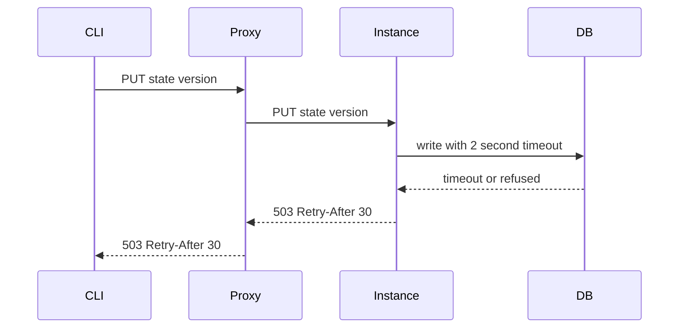

## Context

Two or more instances share one PostgreSQL database. A database stop must surface as 503 with Retry-After 30 seconds on ready and on writes, while live stays green. Recovery needs no restart. Half-write atomicity belongs to the atomic part.

## Decisions

1. **One outage error mapped at the edge.** Map only a store outage to one NEW sentinel error and translate it at the HTTP adapters into 503 with Retry-After 30 seconds in each wire shape: tool-neutral JSON, Pulumi camelCase error, TFE JSON:API error. Connection refused, connection timeout and ping timeout map to the outage error; constraint errors, client context cancel and query logic errors never map. Keep GET /health/live free of store checks.
2. **Bounded probe with no cache.** Ready ping timeout is 2 seconds and write store wait timeout is 2 seconds, so GET /health/ready answers within 5 seconds even when packets drop. No cached ready result; each probe pings once.

## Structure

Unexported outageError type built only by constructor newOutageError(retryAfterSecs int); HTTP adapters switch on it before other error mapping.

## Risks

- A write path that misses the mapping still answers 500 during an outage.
- A ready check that touches extra stores stays slow during an outage.

## Diagrams

After this change:

## Quality attributes

| Attribute | Target | Unit | Scope |
| --- | --- | --- | --- |
| availability | 503 within 5 | seconds | GET /health/ready per instance during PostgreSQL stop |
| availability | 200 within 1 | seconds | GET /health/live per instance during PostgreSQL stop |
| latency | 2 | seconds | store probe per ready check during outage |
| latency | 30 | seconds | Retry-After header on ready and on writes during outage |
