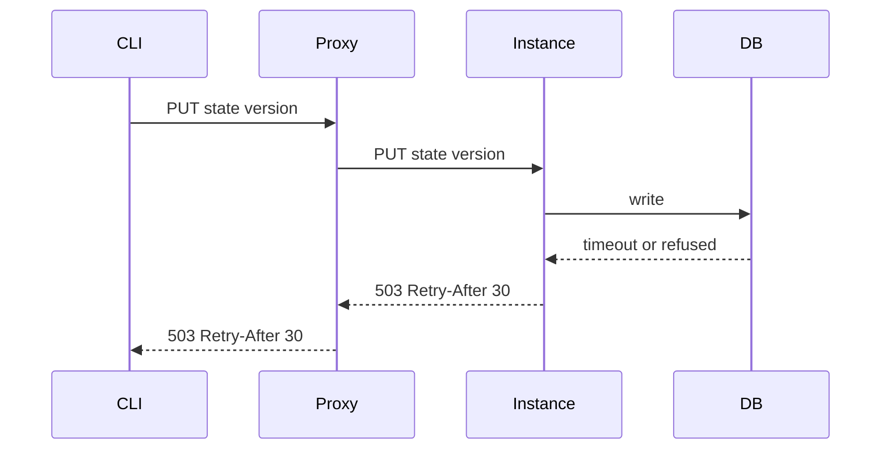

## Context

Two or more instances share one PostgreSQL database. A database stop must surface as 503 with Retry-After on ready and on writes, while live stays green. Recovery needs no restart. Half-write atomicity belongs to the atomic part.

## Decisions

1. **Reuse the outage error that main has.** No new sentinel. A store outage is `namespace.ErrUnavailable` (defined in package namespace; the store adapters wrap it, and a connection failure also wraps `namespace.ErrUnreachable`). A new sentinel in `pkg/dustpan` would make an import cycle, because `pkg/dustpan` imports the adapters. The adapters already switch on `namespace.ErrUnavailable` before other mapping: Handler.writeError of the TFE adapter, Handler.writeError of the Pulumi adapter and the status writer of the HTTP backend adapter. Constraint errors and client context cancel never wrap it, so they never map. The store `Ping` keeps its cause out of each SQL store adapter and maps any failed ping to `namespace.ErrUnavailable`; this change leaves both adapters as they are, so any failed ping counts as an outage.
2. **One Retry-After value.** All shapes read `problem.StoreRetryAfter` (`internal/api/problem/problem.go:370`). The change sets it to 30 seconds, if the owner agrees (see the proposal, Open questions); no adapter gets its own value. `GET /health/ready` sets the same header through `problem.SetStoreRetryAfter` when the failed list holds the store check (`pkg/dustpan/health.go:308` and `:427`).
3. **Bounded probe with no cache.** Ready ping timeout stays 2 seconds (`readinessTimeout`, `pkg/dustpan/health.go:23`), so GET /health/ready answers within 5 seconds even when packets drop. No cached ready result; each probe pings once. The statement timeout of writes is not changed here (ADR 298 sets it).
4. **Live stays 204.** `GET /health/live` answers 204 with no store check on main (`pkg/dustpan/dustpan.go:4130`) and keeps it.

## Structure

No new type and no new package. The edge mapping is the code that main has in the three adapters; the change edits one constant and the readiness handler.

## Risks

- A write path that misses the mapping still answers 500 during an outage.
- A ready check that touches extra stores stays slow during an outage.

## Diagrams

After this change:

## Quality attributes

| Attribute | Target | Unit | Scope |
| --- | --- | --- | --- |
| availability | 503 within 5 | seconds | GET /health/ready per instance during PostgreSQL stop |
| availability | 204 within 1 | seconds | GET /health/live per instance during PostgreSQL stop |
| latency | 2 | seconds | store probe per ready check during outage |
| latency | 30 | seconds | Retry-After header on ready and on writes during outage (the owner confirms) |
