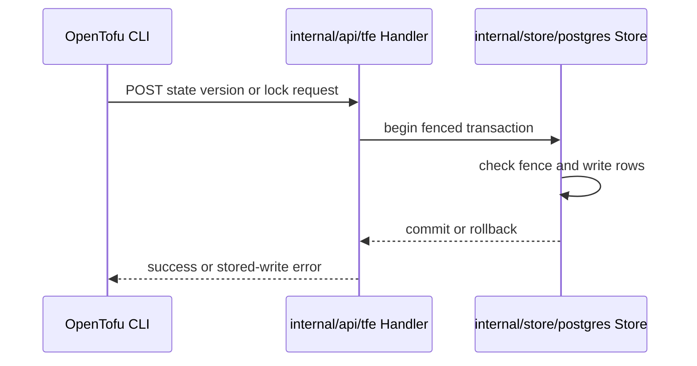
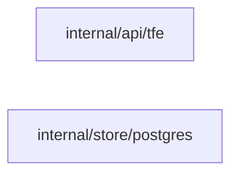
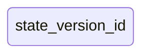

## Context

OpenTofu state version writes and workspace lock writes must survive a database outage in the middle of a commit without leaving half state or a stuck lock.

## Decisions

1. **One fenced transaction per commit.** Wrap each state version commit and each lock acquire and release with the namespace fence in one store transaction. A commit that cannot finish rolls back the whole transaction. A committed lock row carries holder identity. The lock has no expiry: it stays held until release or force-unlock. Lock refresh keeps the existing refresh path unchanged.

## Structure

Lock writes stay on the workspace port method `SaveWorkspace`, which runs the fence check and the lock write in one transaction on each store. The unexported guard built by the NEW constructor `newStateCommit()` in the PostgreSQL adapter covers the state version commit only.

## Risks

- A partial transaction leaves a visible half-written state version.
- A failed lock acquire leaves a held lock that blocks the next apply.
- A lost reply causes the caller to retry a commit that already succeeded.

## Diagrams

After this change:

Modules that the change touches, and their imports on main:

States on main in the touched packages:

## Quality attributes

| Attribute | Target | Unit | Scope |
| --- | --- | --- | --- |
| correctness | 0 half-written state versions and 0 stuck locks after a failed commit | count | each TFE state version commit and lock commit on PostgreSQL |
| availability | 1 retry completes without manual unlock | count | retry of the same failed write after the database returns |

## Contracts

**workspace**

- Invariant: One workspace holds at most one held workspace lock.
- Invariant: One state version is current for one workspace.
- Invariant: A state version row is immutable once marked current.
- `writeStateVersion`: pre: Caller holds the workspace lock for the write.; Caller supplies the fence and the lock identity of the write.. Post: Either the new state version is current and visible, or no new state version row remains visible.; A repeated request with the same lock identity returns the committed result without a duplicate state version..
- `lockWorkspace`: pre: Workspace exists and caller passes authorization.; Caller supplies the fence and the requested lock identity.. Post: Either the lock row is held by the caller, or no lock row remains held.; A repeated acquire with the same lock identity returns the held lock without a second lock row..
- `unlockWorkspace`: pre: Caller supplies the lock identity it holds and the fence of the release.. Post: The caller lock is released, or the lock already belongs to another holder after fenced takeover.; A repeated release with the same lock identity returns success without changing another holder lock..

## Failure modes

| Step | Failure | Retry | State after |
| --- | --- | --- | --- |
| Commit state version in one transaction. | Database stops after row insert but before commit. | Caller retries the same write after the database returns with the same upload token. | Transaction rolls back; no current state version changes and no lock stays held. |
| Acquire workspace lock in one transaction. | Database stops after lock insert but before commit. | Caller retries lock acquire after the database returns with the same lock identity. | Transaction rolls back; workspace has no held lock. |
| Reply after commit. | Connection is lost after commit but before the reply. | Caller retries with the same upload token; the server returns the committed result without a duplicate row. | Committed state stays current and committed lock stays held. |
| Release workspace lock in one transaction. | Lock release fails mid-outage. | Caller retries release with the same lock identity after the database returns, or fenced takeover runs after expiry. | Lock stays held until retry succeeds or takeover moves it. |
