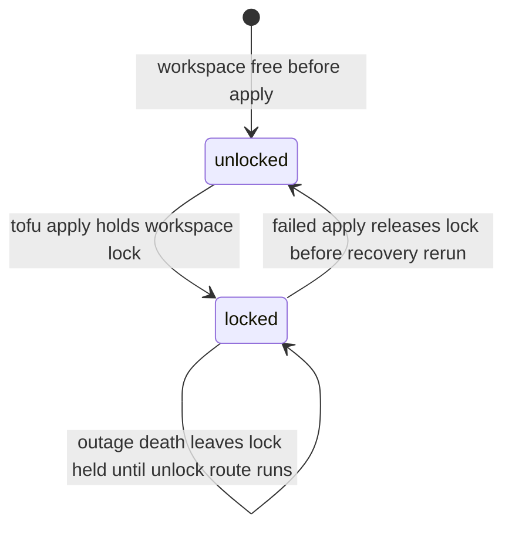

## Context

Three serve instances behind a round-robin proxy on one PostgreSQL database. A database proxy in front of PostgreSQL stops the database for 60 s and for a short window. This part adds only suite steps, fixtures, and measurements. It adds no server code.

## Decisions

1. **Probe reuses real CLI scenarios with provisional margin.** Reuse the existing full milestone 1 Pulumi scenario and milestone 2 OpenTofu scenario through the proxy. Add two outage steps, 7a long and 7b short, plus retry measurement per CLI version. The probe runs only when both depended parts are merged, else the probe skips with a message that names the missing part. Until the PM answers the open question, the probe uses the provisional margin of 50 percent of the smallest measured retry window for the short stop.
2. **Outage is at the database proxy with deferred restore.** The database proxy stops PostgreSQL, not the server instances. Health and API assertions run against each instance directly and through the proxy so the record shows every instance answered 503 with Retry-After during the outage. The fixture wraps each stop in a deferred restore that restarts PostgreSQL and polls GET /health/ready to green, and the stop asserts it took effect by a failed write probe before CLI work starts.

## Structure

No new server structure. The bug class is a missing outage regression. The constructor is the NEW suite fixture `NewDatabaseOutageProbe` that takes the proxy control, the instance list, and the CLI matrix, and refuses an empty matrix or a short window above 50 percent of the smallest measured retry window.

## Risks

- Probe flakes if the short outage window exceeds a CLI retry window on a slow runner
- Retry measurement varies by CLI version and network timing

## Diagrams

States and transitions after this change:

## Quality attributes

| Attribute | Target | Unit | Scope |
| --- | --- | --- | --- |
| test duration | 600 | s | e2e-ha database outage probe on PostgreSQL with 3 instances |
| retry measurement resolution | 1 | s | per CLI version in the matrix |

## Failure modes

| Step | Failure | Retry | State after |
| --- | --- | --- | --- |
| Start the database stop at the proxy control | Database proxy fails to stop PostgreSQL, so the outage never starts | Probe write check fails fast and aborts the step with no CLI run | Database stays up and later steps run |
| Restore the database after the stop | Database proxy fails to restart PostgreSQL after a test failure or timeout | Deferred restore in the NEW fixture restarts PostgreSQL and polls GET /health/ready to green before the next step | Database returns and instances turn ready with no restart, else the suite reports a blocked database restart. |
| Check no leftover workspace lock | A failed tofu apply leaves a workspace lock | Probe reads the lock before and after, and unlocks only through the existing unlock route with credential kind access token where the roadmap allows it, else it fails the step | No lock remains on the workspace before recovery rerun begins. |
| Check no half-written state version | A failed apply leaves a half-written state version | Probe lists state versions before and after with credential kind access token and fails the step when the count or serial grows without a committed version record | No half-written state version remains visible in the version list. |
