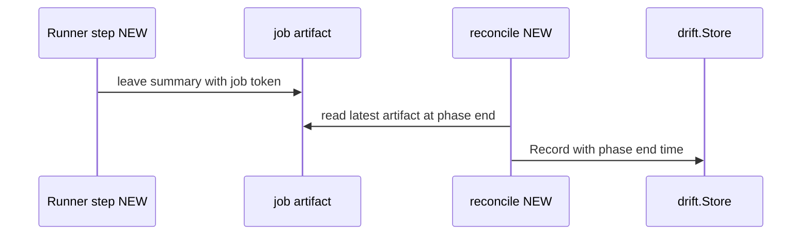
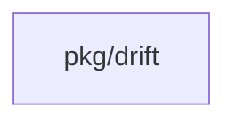
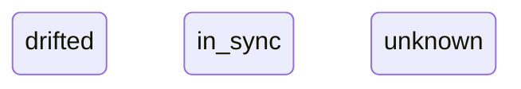
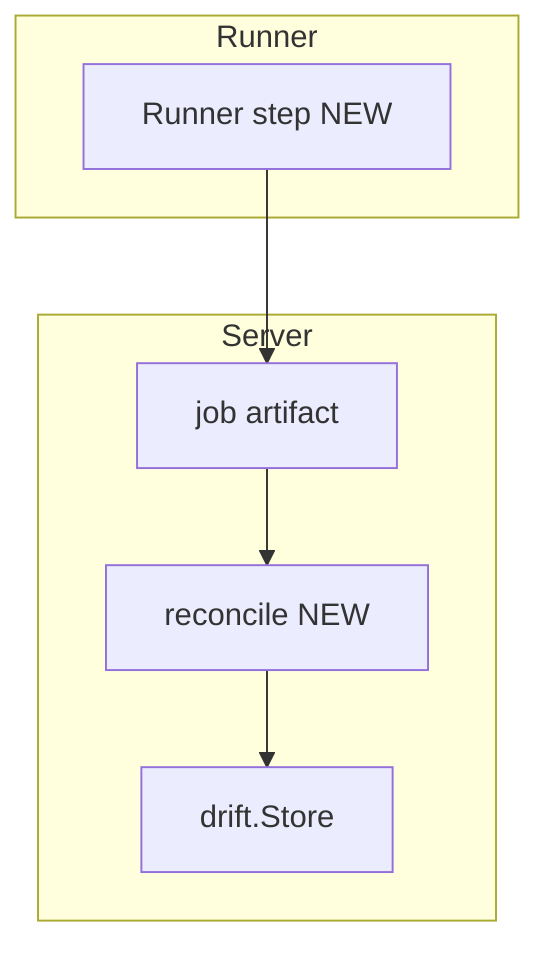

## Context

Slice 1a has drift.Store, the routes, and the docs. This slice adds the plan reduction, the summary artifact, Validate, and the reconcile at phase end.

## Decisions

1. **One constructor for the summary.** The NEW function Validate in pkg/drift makes the only valid summary: printable address text, one address at most 1024 characters, no duplicates, no attribute names or values, cut at 1000 addresses with truncated true. Runner time is ignored, never stored.
2. **Reconcile at phase end.** The NEW reconcile in internal/driftreconcile runs in the transaction that ends the plan phase. It reads only the latest artifact of the same job. Valid marks succeeded and calls Record with phase end time. Missing, malformed, or invalid marks failed and keeps the last result. Record is idempotent on job ID.
3. **Spike without secret values.** The spike runs the reduction against a plan of a unit with client-side encryption and checks addresses only. It opens no secret value and asserts no attribute name or value appears in the summary.

## Structure

An unexported summary type that only Validate in pkg/drift can make; the reconcile has no public constructor for a result.

## Risks

- The runner is not trusted, so a hostile summary changes nothing.

## Layers (defense in depth)

| Layer | Guard | Hostile test |
| --- | --- | --- |
| boundary check | Validate allowlist in pkg/drift. | TestHostileSummaryChangesNothing sends control characters, duplicates, and over-long addresses. |
| limit | 1000 addresses and 1024 characters per address. | 1001 addresses store 1000 with truncated true. |
| authorize at point of use | Unit and job come from the job token of the phase claim; reconcile checks purpose drift-check and same unit. | A summary for another unit is refused. |
| fail closed | Any mismatch fails the phase and keeps the last result. | Runner time after job end is ignored and never stored. |

## Diagrams

After this change:

Modules that the change touches, and their imports on main:

New imports of this change (each one allowed by the module rules):

- `internal/driftreconcile` imports `pkg/drift`
- `internal/driftreconcile` imports `pkg/job`

States on main in the touched packages:

## Quality attributes

| Attribute | Target | Unit | Scope |
| --- | --- | --- | --- |
| latency | 500 | ms p95 | reconcile at the end of the plan phase |
| storage growth | 1000 | addresses maximum | each drift result |

## Threat model

Data flow and trust boundaries:

| Boundary | STRIDE | Threat | Layer | Guard | Hostile test |
| --- | --- | --- | --- | --- | --- |
| Runner to server | T | A runner sends a forged summary. | boundary check | Validate allowlist in pkg/drift. | Hostile summaries to Validate store nothing. |
| Runner to server | T | A runner sends a forged summary. | encode or contain | Addresses stay opaque text and control characters never reach logs. | An address with a newline leaves a clean log. |
| Runner to server | T | A runner sends a forged summary. | limit | 1000 addresses and 1024 characters per address. | 1001 addresses cut to 1000 with truncated true. |
| Runner to server | T | A runner sends a forged summary. | authorize at point of use | Unit and job come from the job token; reconcile checks purpose drift-check, succeeded state, and same unit. | A summary for another unit is refused. |
| Runner to server | T | A runner sends a forged summary. | fail closed | Any mismatch fails the phase and keeps the last result. | Runner time after job end is ignored. |

## Contracts

**drift result**

- Invariant: One latest result for each unit.
- Invariant: Stored time equals the end time of the plan phase.
- `Validate`: pre: The summary comes from the job artifact of the same drift-check job.. Post: A valid summary holds unique addresses, at most 1000 addresses, with truncated true when cut.; A hostile summary returns an error and stores nothing..
- `Record`: pre: The plan phase ended, the summary passed Validate, and the job is a succeeded drift-check of the unit.. Post: A second call with the same job ID leaves the stored result unchanged.; A state-version write by another job sets status unknown..

## Failure modes

| Step | Failure | Retry | State after |
| --- | --- | --- | --- |
| Reconcile at phase end | The process stops before Record. | The durable operation replays the reconcile; Record is idempotent on job ID. | The result is recorded once with the phase end time. |
