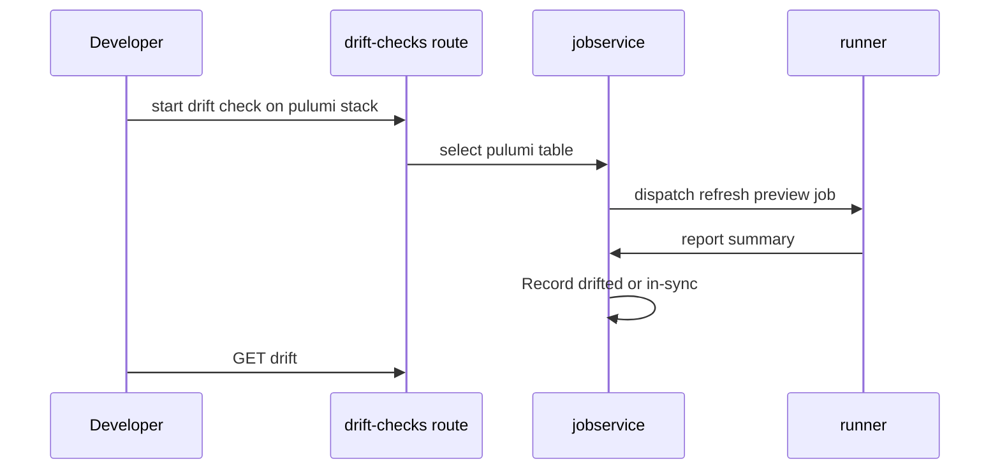
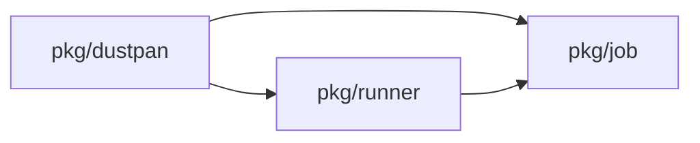
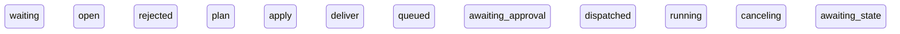
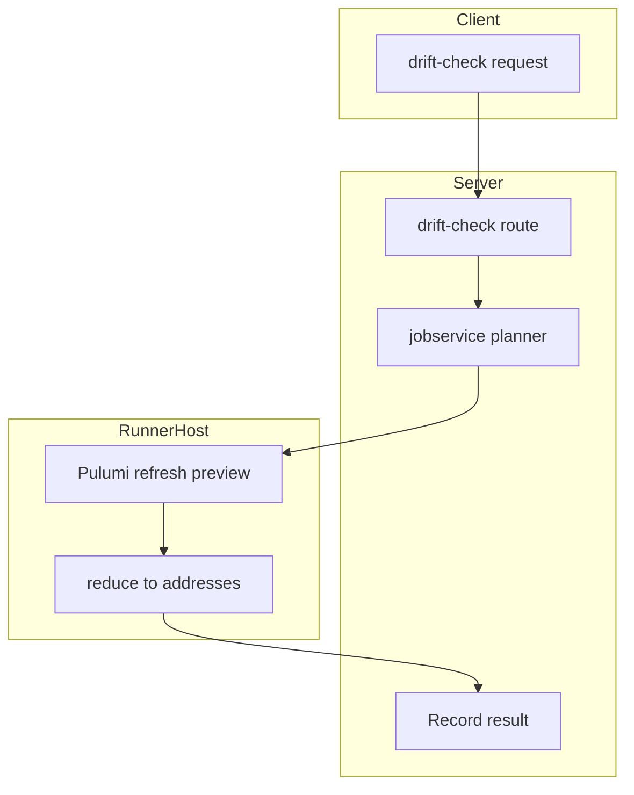

## Context

Slice 1 gave the OpenTofu drift check. Issues 1576 and 2185 show that the per-tool steps live in shared code and that Pulumi jobs start with no e2e step.

## Decisions

1. **Per-tool drift tables in pkg/job with one registry.** Keep one argv table for each tool in per-tool files in pkg/job, with the NEW file pkg/job/drift_pulumi.go. The tables register through the NEW function RegisterDriftSteps. pkg/dustpan selects the tool key. pkg/runner validates against the same registry. A pulumi start is refused with job.unsupported unless the purpose is drift-check.

## Structure

The unexported map driftTables, written only by RegisterDriftSteps(tool, steps), makes two sources of truth impossible: the planner and the runner read the same map.

## Risks

- The preview output form can change with the CLI; the spike pins one machine form.
- Pulumi refresh can run program code; the fixed argv and clean environment contain it.

## Layers (defense in depth)

| Layer | Guard | Hostile test |
| --- | --- | --- |
| boundary check | A fixed argv allowlist per tool, checked by ValidateDriftSteps with the tool name. | Send edited Pulumi argv and show the runner refuses the job. |
| encode or contain | A clean environment with one allowlisted variable set; no shell. | Inject a hook variable and show the launcher refuses it. |
| limit | The reduction keeps addresses and kinds, at most 100 addresses, and no values. | Feed a preview with secret values and show the stored result holds none. |

## Diagrams

After this change:

Modules that the change touches, and their imports on main:

New imports of this change (each one allowed by the module rules):

- `pkg/dustpan` imports `pkg/job`
- `pkg/runner` imports `pkg/job`

States on main in the touched packages:

## Quality attributes

| Attribute | Target | Unit | Scope |
| --- | --- | --- | --- |
| none affected | On-demand check only; no new latency, storage or rate target |  |  |

## Threat model

Data flow and trust boundaries:

| Boundary | STRIDE | Threat | Layer | Guard | Hostile test |
| --- | --- | --- | --- | --- | --- |
| drift-check route to runner preview to result store | T | A hostile argv, hook or result forges drift addresses or runs code outside the check. | boundary check | ValidateDriftSteps checks the fixed Pulumi argv. | Send edited argv and show the runner refuses the job. |
| drift-check route to runner preview to result store | T | A hostile argv, hook or result forges drift addresses or runs code outside the check. | encode or contain | The launcher starts an argument list with no shell and a clean environment. | Send shell metacharacters and a hook variable and show both are refused. |
| drift-check route to runner preview to result store | T | A hostile argv, hook or result forges drift addresses or runs code outside the check. | limit | Fixed step count, 100 address limit and the job token that expires with the job. | Hold the preview past the job timeout and show the job fails. |
| drift-check route to runner preview to result store | T | A hostile argv, hook or result forges drift addresses or runs code outside the check. | authorize at point of use | The route checks unit:run-plan on the unit object. | Start a check with a token that lacks unit:run-plan and show denial. |
| drift-check route to runner preview to result store | T | A hostile argv, hook or result forges drift addresses or runs code outside the check. | fail closed | A parse error or failed check keeps the last result. | Feed a malformed preview and show no result change. |

## Contracts

**job**

- Invariant: A drift check has operation refresh, one plan phase and purpose drift-check.
- `RegisterDriftSteps`: pre: The caller gives a tool key and a fixed argv table.. Post: One table is stored for the tool key..
- `ValidateDriftSteps`: pre: The caller gives the tool and the steps.. Post: The steps pass only when they equal the registered table; otherwise ErrInvalid..
