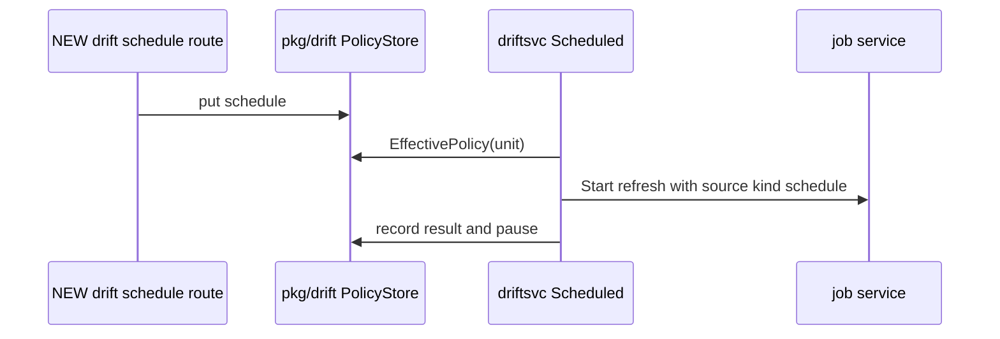
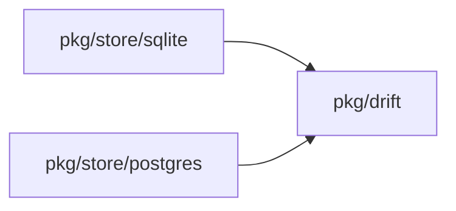
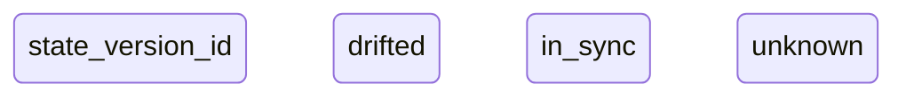
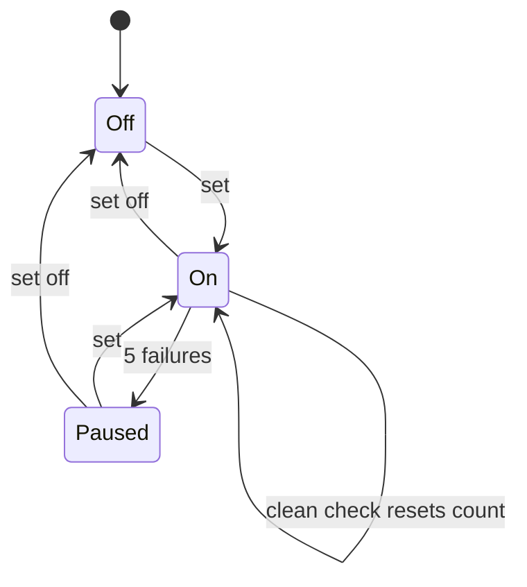
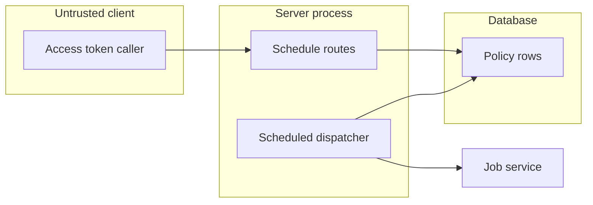

## Context

Opt-in schedule on top of the drift check job and the durable schedule. No new parser, no new tool. The principal of a scheduled start is the namespace service principal, with the delegation of ADR 354.

## Decisions

1. **Setting values.** A setting is on with a preset or a cron text, or off. Off at unit level overrides an on default. Delete falls back to the next level. Rows key on the stable ID of the unit, collection or namespace.
2. **Pause state.** The failure count and the paused flag are in the policy row. A job that ran and failed adds 1. A start refused by a manual lock or freeze adds 0. A clean check resets the count. A set on the unit resumes the schedule. One SQL transaction with a conditional update changes the count.
3. **Pause notification.** The pause writes the notification of type unit.drift-schedule-paused, with severity warning, in the same transaction as the paused flag. The text names the unit and the one command that resumes the schedule.
4. **One start for each slot.** The durable schedule claim fires a slot once. The job idempotency key is the unit and the slot. If a process stops after the claim and before the start, that slot is lost and counts as 0 failures. The next slot runs.
5. **Missing principal.** If the namespace service principal is missing or has no run action, the start is refused, counts as a failed check and writes an audit entry.
6. **Spread and limits.** The offset comes from a hash of the unit ID inside the period. The cron text has at most 256 bytes. One tick starts at most 100 checks for each namespace. The rest start at the next tick.
7. **Storage.** One row for each object in a new table. The baseline migration of each dialect is edited in place.

## Structure

The unexported type schedule has the constructor newSchedule. It checks the preset allowlist, the 5-field UTC cron text, the length and the minimum gap of 1 hour between any two runs. Only the constructor makes a value.

## Risks

- Two server processes start two jobs for one slot.
- A unit with no setting gets a check.
- Many units share one offset.

## Layers (defense in depth)

| Layer | Guard | Hostile test |
| --- | --- | --- |
| boundary check | newSchedule allowlist | TestScheduleRejectsHostileCron |
| authorize at point of use | settings action of the object on each route | TestDriftScheduleRoutesForbidden |

## Diagrams

After this change:

Modules that the change touches, and their imports on main:

States on main in the touched packages:

States and transitions after this change:

## Quality attributes

| Attribute | Target | Unit | Scope |
| --- | --- | --- | --- |
| storage growth | 1 | row for each object with a setting | namespace, collection and unit |
| rate limit | 100 | scheduled starts for each tick | one namespace |

## Threat model

Data flow and trust boundaries:

| Boundary | STRIDE | Threat | Layer | Guard | Hostile test |
| --- | --- | --- | --- | --- | --- |
| Client to schedule routes | T | A hostile cron text or preset changes how often checks start. | boundary check | newSchedule allowlist | TestScheduleRejectsHostileCron |
| Client to schedule routes | T | A hostile cron text or preset changes how often checks start. | encode or contain | SQL placeholders and the stable ID of the object | TestPolicyStoreHostileValues |
| Client to schedule routes | T | A hostile cron text or preset changes how often checks start. | limit | 256-byte cron limit and 100 starts for each tick | TestScheduledTickLimit |
| Client to schedule routes | T | A hostile cron text or preset changes how often checks start. | authorize at point of use | settings action of the object | TestDriftScheduleRoutesForbidden |
| Client to schedule routes | T | A hostile cron text or preset changes how often checks start. | fail closed | a row that fails newSchedule is off and writes an audit entry | TestScheduledBadRowStartsNothing |
| Client to schedule routes | E | A caller sets a schedule on an object it cannot manage. | boundary check | object ID check in the path | TestScheduleRouteBadID |
| Client to schedule routes | E | A caller sets a schedule on an object it cannot manage. | encode or contain | namespace from the path, with the fence | TestScheduleOtherNamespace |
| Client to schedule routes | E | A caller sets a schedule on an object it cannot manage. | limit | one row for each object | TestPolicyOneRowPerObject |
| Client to schedule routes | E | A caller sets a schedule on an object it cannot manage. | authorize at point of use | settings action in the handler and the service | TestScheduleServiceForbidden |
| Client to schedule routes | E | A caller sets a schedule on an object it cannot manage. | fail closed | unknown action denies and writes an audit entry | TestScheduleDenyAudited |

## Contracts

**DriftSchedule**

- Invariant: The effective order is unit, collection, namespace.
- Invariant: With no setting, no scheduled check starts.
- `EffectivePolicy`: pre: The caller holds the fence of the namespace.. Post: Returns the unit value, else the collection value, else the namespace value, else off..
- `Scheduled`: pre: The effective schedule is on and not paused.; The slot is claimed once.. Post: Starts one refresh job with the source kind schedule, or records the pause and the notification after 5 failures..

## Failure modes

| Step | Failure | Retry | State after |
| --- | --- | --- | --- |
| Claim of a slot | A process stops after the claim | The slot is skipped. The next slot runs. | No job for that slot. The count does not change. |
| Start of the job | The job service refuses, or the principal is missing | Counts as a failed check unless a manual lock or freeze refused it. The next slot runs. | The count rises by 1, or stays for a lock refusal. |
| Write of the pause | The transaction fails | The next failed check retries the pause. | Flag and notification are both absent or both present. |
