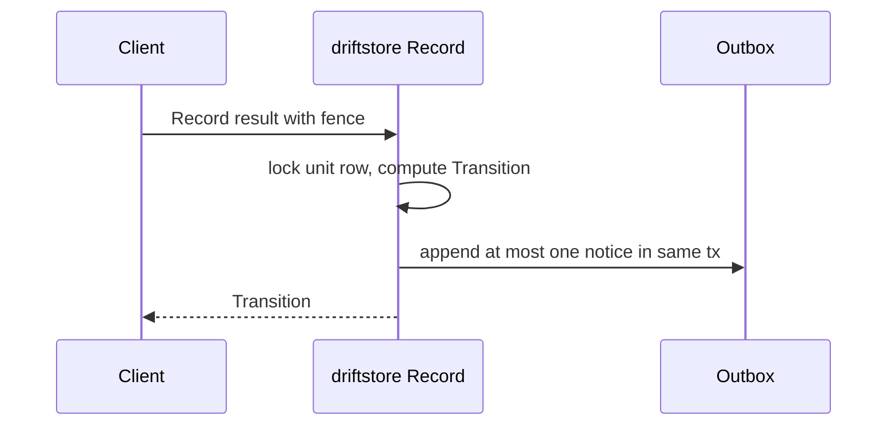
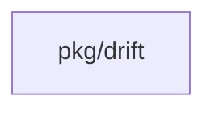
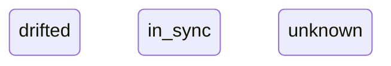

## Context

Record stays the single fenced write of result, projection and notice. The notice path compiles and stores rows only after #1172 lands; until then only result plus states ships. No new tool.

## Decisions

1. **Notice in result transaction with row lock.** Record locks the unit result row, reads the stored prior status, computes the Transition, then appends at most one notice in the same transaction: entry into drifted sends unit.drifted, exit from drifted to in-sync sends unit.drift-cleared. Repeat same-state, first clean, in-sync after unknown, refused, failed and canceled send nothing. Concurrent Records serialize on the row lock so at most one committed transition sends one notice.
2. **Unknown hook with caller fence.** NEW function MarkUnknown in pkg/drift runs inside the state version write transaction of the other job with that same fence and sets the drift state to unknown. It is the only cross-domain hook and carries no notice.

## Structure

Unexported type driftNotice with unexported field transition, built only by NEW constructor newDriftNotice that checks the Transition gate before any append

## Risks

- Delivery is BLOCKED by #1172 until the outbox lands
- States writer is BLOCKED by #1196 until the states slice lands

## Diagrams

After this change:

Modules that the change touches, and their imports on main:

States on main in the touched packages:

## Quality attributes

| Attribute | Target | Unit | Scope |
| --- | --- | --- | --- |
| none affected | notice piggybacks on the result transaction |  |  |

## Contracts

**drift.Result**

- Invariant: One latest result per unit
- Invariant: At most one notice per committed transition
- `Record`: pre: Result passes Validate; Caller holds the namespace fence. Post: Returns the Transition From and To; Appends at most one notice on entry into drifted or exit to in-sync.
- `MarkUnknown`: pre: Caller holds the fence of the state version write. Post: Drift state is unknown in the same fenced transaction.

## Failure modes

| Step | Failure | Retry | State after |
| --- | --- | --- | --- |
| Record appends the notice | stale fence or transaction error | caller retries the check with the same dedupe key of unit and job | no result, no state, no notice |
| MarkUnknown in state write | stale fence | caller retries the state version write | state write rolled back, drift state unchanged |
| Two Records for one unit | row lock conflict | the second waits and reads the new stored prior | at most one notice per committed transition |

## Change impact (computed from main)

Tests:

- `e2e/passkeysignin_test.go` names `notify.Notification`
- `pkg/store/internal/notifystore/notifystore_test.go` names `notify.Notification`
- `pkg/notify/notify_test.go` names `notify.Notification`

Docs pages:

- `README.md:413` names `notify.Notification`
- `docs/reference/notification-destinations-api.md:1` names `notify.Notification`
- `docs/reference/notification-destinations-api.md:176` names `notify.Notification`

ADRs:

- `docs/adr/0298-postgresql-failover-readiness.md` names `notify.Notification`
- `docs/adr/0145-one-event-model-and-sinks.md` names `notify.Notification`
- `docs/adr/0165-unmanaged-resource-findings-and-actions.md` names `notify.Notification`
