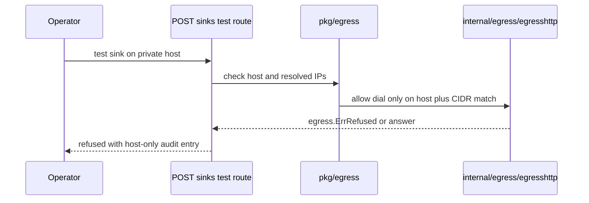
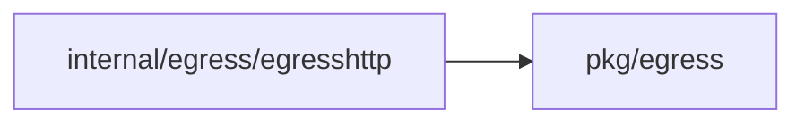
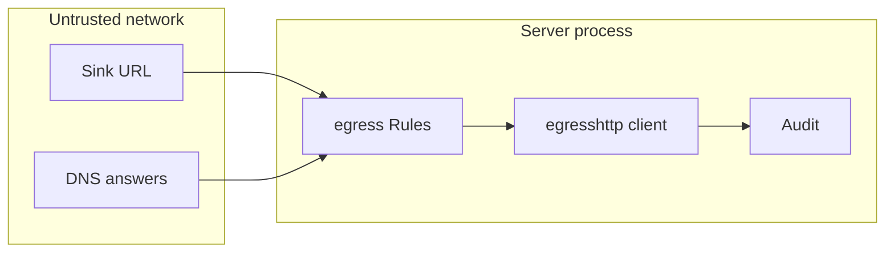

## Context

Operator allowlist for private chat and webhook sink hosts in pkg/egress, checked on each dial and redirect by internal/egress/egresshttp. Scope is the sink paths only.

## Decisions

1. **Operator-only allowlist shape.** Allowlist entry is exact lower-cased host plus required CIDR list, set by operator flag, env and Helm only. Empty by default. Bad config refuses startup. Startup logs hosts without URLs.
2. **Single-IP dial and redirect recheck.** Dial connects only to the checked IP with no second resolve. Redirect re-checks the new host and IP. TLS uses the host name for SNI and verification. The sink client ignores proxy environment variables. Credentials stay on the first host.

## Structure

Unexported allowEntry type with host and parsed CIDRs, built only by NewRules, which checks the invariants so no bad value can be made.

## Risks

- Allowlisted range too wide exposes a private network; mitigation is exact host plus CIDR and startup log.
- Stale DNS can move a host between ranges; mitigation is a check on each connection and after each redirect.

## Layers (defense in depth)

| Layer | Guard | Hostile test |
| --- | --- | --- |
| boundary check | Rules refuse a private address without an allowlist match | Dial a wildcard-DNS name that resolves to 10.0.0.5 and to 169.254.169.254; both fail with egress.ErrRefused |
| encode or contain | HTTPS-only client with NoRedirect; credentials only to the first host | Redirect a sink to a second host and confirm no credential header leaves the first host |
| limit | 10 second context deadline and MaxBodyBytes cap on sink answers | Slow and large-body webhook answers time out and truncate |
| authorize at point of use | Namespace grant check on sink create and test at the existing sink routes | Non-member POST /api/dustpan/v1/namespaces/{}/sinks/{}/test with an access token is denied |
| fail closed | Any check error or unknown range denies and writes an audit entry with host only | Unparsable address and refused private host both deny and audit host only |

## Diagrams

After this change:

Modules that the change touches, and their imports on main:

## Quality attributes

| Attribute | Target | Unit | Scope |
| --- | --- | --- | --- |
| latency | p99 under 12 | seconds | sink test to an allowlisted private host, with the 10 second sink deadline |
| storage growth | under 256 | bytes | audit entry for one allowlisted sink test, host field only |

## Threat model

Data flow and trust boundaries:

| Boundary | STRIDE | Threat | Layer | Guard | Hostile test |
| --- | --- | --- | --- | --- | --- |
| Untrusted sink URL and DNS answer | I | An attacker sink URL or DNS answer points a sink at a private, loopback or metadata address to read the private network or keys. | boundary check | Allowlist of exact host plus CIDR, empty by default; strict ChatHost parse | Post a hidden Unicode host and a numeric-IP host; both are refused before dial. |
| Untrusted sink URL and DNS answer | I | An attacker sink URL or DNS answer points a sink at a private, loopback or metadata address to read the private network or keys. | encode or contain | HTTPS-only, NoRedirect, resolved-IP check after each redirect | Redirect to a second host; credentials stay on the first host and the second dial is rechecked. |
| Untrusted sink URL and DNS answer | I | An attacker sink URL or DNS answer points a sink at a private, loopback or metadata address to read the private network or keys. | limit | 10 second deadline and MaxBodyBytes cap | A slow answer and a 20 MB answer time out and truncate without use. |
| Untrusted sink URL and DNS answer | I | An attacker sink URL or DNS answer points a sink at a private, loopback or metadata address to read the private network or keys. | authorize at point of use | Sink create and test need a namespace grant on the existing sink routes; the allowlist is set by flag, env and Helm only | Non-member POST /api/dustpan/v1/namespaces/{}/sinks/{}/test with an access token is denied. |
| Untrusted sink URL and DNS answer | I | An attacker sink URL or DNS answer points a sink at a private, loopback or metadata address to read the private network or keys. | fail closed | Refuse with egress.ErrRefused and a host-only audit entry, never the URL | Unparsable and refused private hosts both deny and audit host only. |

## Contracts

**egress Rules**

- Invariant: Empty allowlist refuses every private, loopback, link-local and unspecified address
- Invariant: An allowlisted host passes only when the resolved IP is in its CIDRs
- `Private host allowlist match`: pre: Host is lower-cased and the resolved IPs are known. Post: If the address is private and allowlisted the check passes, else it returns egress.ErrRefused.
