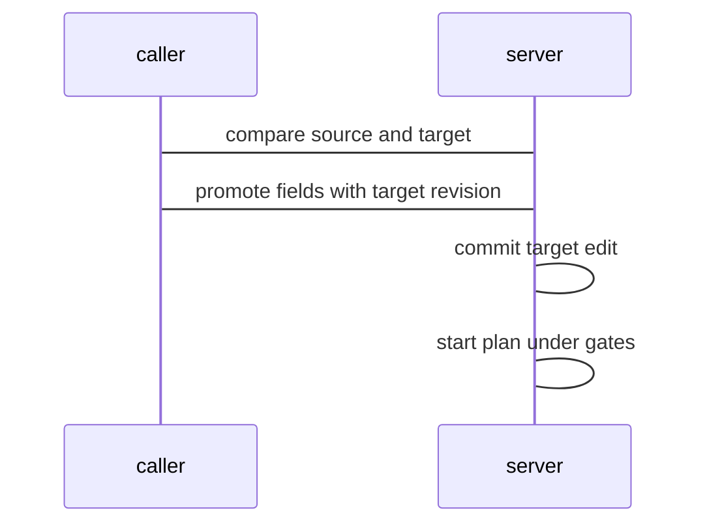

## Context

Two units from one blueprint hold different config values. The team needs a read of the difference and a controlled copy from one unit to the other with history, gates, and a write-back commit. RFC 55 is a draft design for this step; this change follows its draft semantics of copy as an edit with a write-back commit and a plan under milestone 5 gates, and the step proves that behavior. Decisions below are provisional until the owner accepts RFC 55.

## Decisions

1. **Comparison is a read of effective values.** Comparison reads effective values of the two units and returns per-field source, target, and equality state with secret values masked and equality without plain text.
2. **Promotion is an edit plus a plan.** Promotion is an edit of the target unit settings that copies selected config fields, then starts a plan job under milestone 5 gates with unit:read on source and unit:manage on target.
3. **Stable ID references.** Units are referenced by stable ID in comparison and promotion; names resolve once to IDs, a rename still resolves, and a remove makes the ID resolve to no live unit.
4. **Committed edit with decision record.** Promotion commits the target edit first and returns 201 with the committed edit and the decision record when a gate refuses the plan; a refused plan never returns 403, and only a new edit undoes the commit.
5. **Revision guard and crash recovery.** Promotion carries the compared target revision in the request and the server checks it atomically against a concurrent edit. The server makes a promotion ID and stores the Idempotency-Key with it for 24 hours per namespace. A retry with the same key inside 24 hours returns the one promotion record. The server starts at most 1 plan per promotion ID. A crash between commit and plan start leaves a committed edit that a retry reuses with a new plan and an audit entry.

## Structure

Promotion runs inside unitsettings edit path with unexported promotionEdit built only by promoteUnits constructor that checks same tool, same namespace, and field allowlist, so an incompatible copy cannot be built.

## Risks

- Copy of a secret value leaks plain text in comparison output or in git history
- Concurrent edit of target unit loses an update
- Promotion across tools or blueprints copies an incompatible shape
- Crash between commit and plan leaves an edit with no plan

## Diagrams

After this change:



States and transitions after this change:

```mermaid
stateDiagram-v2
compared --> edit-committed
edit-committed --> plan-started
plan-started --> plan-ready
plan-started --> plan-refused
```

## Quality attributes

| Attribute | Target | Unit | Scope |
| --- | --- | --- | --- |
| latency | 500 | ms | GET units compare route |
| latency | 2000 | ms | POST promotions route commit path |

## Threat model

Data flow and trust boundaries:

```mermaid
Caller -> compare and promote API -> unitsettings service -> store and write-back; secrets masked in compare and sealed in commits
```

| Boundary | STRIDE | Threat | Layer | Guard | Hostile test |
| --- | --- | --- | --- | --- | --- |
| API boundary between caller and compare route | I | Caller reads secret plain text through comparison output | boundary check | Reject cross-tool and cross-blueprint pairs and fields outside allowlist | Send cross-tool IDs and identity fields and check refusal |
| API boundary between caller and compare route | I | Caller reads secret plain text through comparison output | authorize at point of use | Require unit:read on source and on target for compare | Call compare without target read and check 403 |
| API boundary between caller and promotions route | T | Caller copies a secret or overwrites a concurrent edit | fail closed | Atomically check target revision and commit no edit on stale revision | Send stale target revision and check 409 with no edit |
| API boundary between caller and promotions route | T | Caller copies a secret or overwrites a concurrent edit | encode or contain | Require explicit secret flag and store sealed reference only | Send secret field without flag and with flag and check refusal and sealed commit |

## Contracts

**promotion**

- Invariant: Source unit and target unit are in one namespace and use one tool
- Invariant: Target edit holds only effective config fields from the allowlist
- Invariant: Secret values stay sealed with no plain text in commits
- `compareUnits`: pre: Caller holds unit:read on source unit and on target unit. Post: Returns per-field source value, target value, and equality state.
- `promoteUnits`: pre: Caller holds unit:read on source unit and unit:manage on target unit; Target revision equals current target revision. Post: Writes one edit of the target unit and starts one plan job.

## Failure modes

| Step | Failure | Retry | State after |
| --- | --- | --- | --- |
| Promote with stale target revision | Target unit edited after comparison | Read the comparison again and send the new target revision | No edit committed, 409 unit.conflict |
| Start plan under milestone 5 gates | Gate refuses the promotion plan | Read the decision record and send a new edit if needed | Target edit stays committed with write-back commit |
| Commit edit then start plan | Server restarts between commit and plan start | Retry promotion with same Idempotency-Key to reuse committed edit by promotion ID | Committed edit without plan plus audit entry |
| Concurrent retry of one promotion | Two retries run at the same time | Retry with same Idempotency-Key and read the one promotion record | One committed edit and at most 1 plan |
