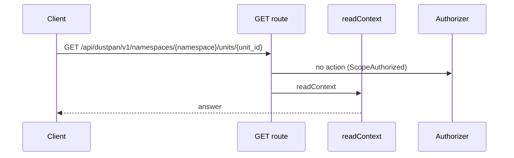
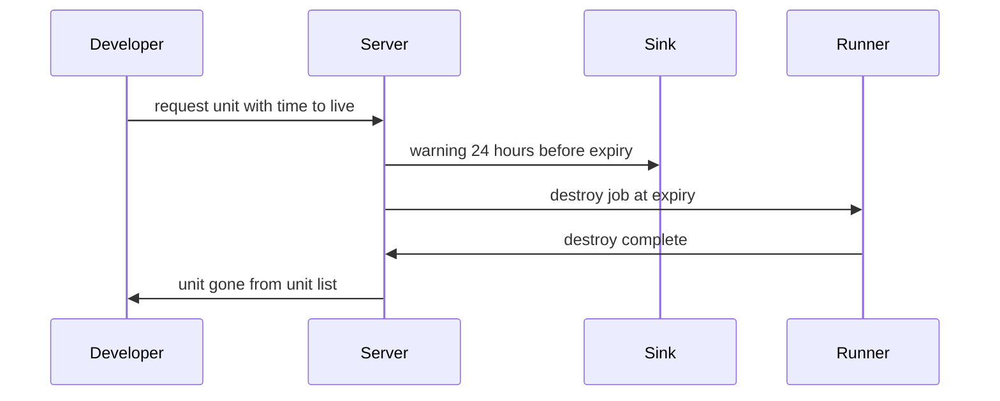
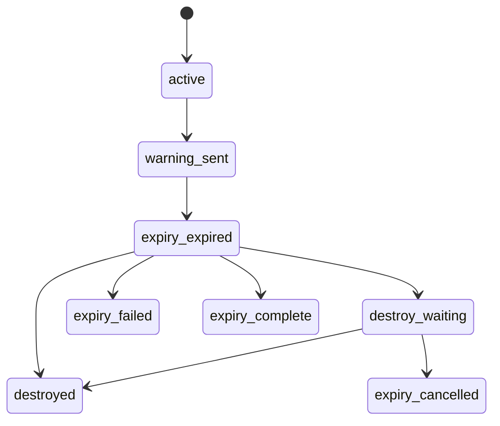
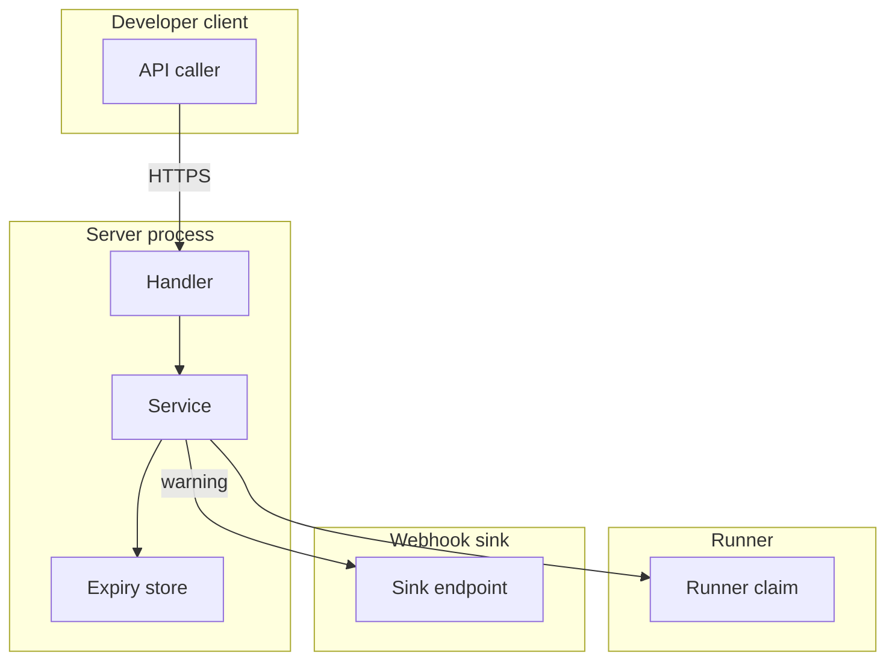

## Context

A unit made from a blueprint carries a time to live. The server warns once before expiry, then creates a destroy job on a runner in the same transaction as the expiry state change. A unit with an approval rule waits on its review request before the destroy job is created. RFC 43 is a draft, so this step proves the behavior that this design gives.

## Decisions

1. **Expiry as checked value.** Store expiry as unexported expiresAt plus warned flag plus extension count behind constructor NewLifetime. The constructor rejects missing time, zero time, negative duration, past time, and time past 30 days from create plus one 7 day extension, and normalizes to Unix milliseconds. Stored references use the stable ID of the unit and the stable ID of the job.
2. **Destroy as a normal job.** Run the destroy through the existing job path with the same tool, executor, pool, and gates as any other destroy, under the namespace service principal with an audit entry that names actor expiry, job ID, and reason. Expiry tick locks the unit row, then expiry tick and job create commit atomically. Extend is allowed in active and in approval wait before job create; extend after job create is refused with 409 destroy in progress.
3. **Warning sent once with key.** Send the warning with a per-unit idempotency key of unit ID plus expiry time. BuildWarning makes the payload with unit ID, expiry time, extend next step and review request next step. Persist the warned flag after a successful sink accept only. On extend the warned flag clears and the key changes, so one new warning goes for the new expiry.

## Structure

Type lifetime with unexported expiresAt, warned flag and extension count, and constructor NewLifetime. The maximum is 30 days (2592000000 milliseconds) per unit from create, plus at most 1 extension of 7 days (604800000 milliseconds) per unit. Destroy retry is at most 5 attempts per expiry. Only the constructor makes a value, and it checks that the time is in the future and inside the maximum. Stored references use the stable ID of the unit and the stable ID of the job.

## Risks

- A destroy runs without approval on a unit that needs approval.
- A unit stays past expiry when no runner claims the destroy job.
- A warning never arrives before the destroy or arrives twice.

## Diagrams

Today: `GET /api/dustpan/v1/namespaces/{namespace}/units/{unit}` on main (from the route table and the handler body, route row internal/api/objectcontext/routes.go:88, handler internal/api/objectcontext/serve.go:39).

After this change:

States and transitions after this change:

## Quality attributes

| Attribute | Target | Unit | Scope |
| --- | --- | --- | --- |
| timeliness | 24 hours before expiry within 5 minutes | hours | per ephemeral unit |
| timeliness | destroy job starts within 5 minutes after expiry | minutes | per expired unit |

## Threat model

Data flow and trust boundaries:

| Boundary | STRIDE | Threat | Layer | Guard | Hostile test |
| --- | --- | --- | --- | --- | --- |
| Developer client to server handler | S | A caller forges expiry or approval to keep a unit or to destroy a unit without grant. | boundary check | Allowlist time-to-live shape and reject missing, zero, or past time with 422. | Send missing and negative TTL directly to the handler; handler returns 422 and fails if guard removed. |
| Developer client to server handler | S | A caller forges expiry or approval to keep a unit or to destroy a unit without grant. | encode or contain | Encode expiry as Unix milliseconds with stable ID of the unit in storage. | Send hostile expiry string; stored value stays numeric and test fails if encode removed. |
| Developer client to server handler | S | A caller forges expiry or approval to keep a unit or to destroy a unit without grant. | limit | Limit time to live to 30 days plus one 7 day extension and limit extend to one. | Request 90 day TTL; service refuses and test fails if limit removed. |
| Developer client to server handler | S | A caller forges expiry or approval to keep a unit or to destroy a unit without grant. | authorize at point of use | Check create on collection and manage or approve on unit at point of use. | Call extend without manage grant directly on handler; handler returns 403 and fails if guard removed. |
| Developer client to server handler | S | A caller forges expiry or approval to keep a unit or to destroy a unit without grant. | fail closed | Deny on unknown value and write denial to audit log. | Send unknown expiry shape; handler denies with 422 and fails if guard removed. |
| Server to webhook sink | T | A warning is lost or doubled so the Developer misses the extend step. | boundary check | Check warning payload shape at sink boundary and reject unknown fields. | Send malformed warning payload to sink client; client rejects and test fails if guard removed. |
| Server to webhook sink | T | A warning is lost or doubled so the Developer misses the extend step. | encode or contain | Idempotency key of unit ID plus expiry on each warning. | Replay warning send twice; sink keeps one entry and test fails if key removed. |
| Server to webhook sink | T | A warning is lost or doubled so the Developer misses the extend step. | limit | Retry warning until sink accept with warn window of 24 hours. | Drop first sink accept; service retries and test fails if retry removed. |
| Server to webhook sink | T | A warning is lost or doubled so the Developer misses the extend step. | authorize at point of use | Check sink allowlist for the namespace before send. | Send warning to unlisted sink host; service denies and test fails if guard removed. |
| Server to webhook sink | T | A warning is lost or doubled so the Developer misses the extend step. | fail closed | Persist warned flag only after sink accept. | Crash before accept; warned stays false and test fails if guard removed. |
| Server to runner | E | A destroy runs without approval or runs twice for one expiry. | boundary check | Validate destroy job fields at claim boundary and reject tool mismatch. | Claim destroy with wrong tool directly on runner handler; handler rejects and test fails if guard removed. |
| Server to runner | E | A destroy runs without approval or runs twice for one expiry. | encode or contain | Bind destroy job to stable ID of the unit and ID of the expiry. | Replay destroy job create twice; store holds one job and test fails if binding removed. |
| Server to runner | E | A destroy runs without approval or runs twice for one expiry. | limit | Bound destroy retry to 5 attempts with exponential backoff then expiry-failed. | Fail destroy 6 times; no sixth job is created and test fails if bound removed. |
| Server to runner | E | A destroy runs without approval or runs twice for one expiry. | authorize at point of use | Hold destroy in approval wait until review request approval by a principal other than the requester. | Release destroy with self approval; service denies and test fails if guard removed. |
| Server to runner | E | A destroy runs without approval or runs twice for one expiry. | fail closed | Create destroy job in the same transaction as expiry state change. | Crash between tick and job create; no orphan state and test fails if atomicity removed. |

## Contracts

**ephemeral lifetime**

- Invariant: Expiry is set at create and normalized to Unix milliseconds.
- Invariant: Warned flag sets only after sink accept.
- Invariant: Extension count is at most one.
- `NewLifetime`: pre: Expiry time is present and in the future.. Post: Value holds expiresAt in Unix milliseconds inside 30 days from create plus one 7 day extension..
- `MarkWarned`: pre: Sink accepted the warning.. Post: Warned flag is true..

**expiry warning**

- Invariant: Warning carries unit ID, expiry time, extend next step, and review request next step.
- `BuildWarning`: pre: Unit has expiry time.. Post: Value holds unit ID plus expiry plus next steps..

## Failure modes

| Step | Failure | Retry | State after |
| --- | --- | --- | --- |
| Warning before expiry | Webhook sink is down at warning time. | Retry warning with the same idempotency key until sink accept. | Unit stays active with warned false until accept. |
| Destroy at expiry | No runner claims the destroy job or the destroy fails. | Retry at most 5 times with exponential backoff, then mark expiry-failed and alert. | Unit stays in expiry-expired with the failed job visible, then expiry-failed after 5 failures. |
| Destroy at expiry | Server restarts mid-destroy. | Resume the stored destroy job with no second job. | Destroy continues from stored state. |
| Expiry tick | Two replicas tick expiry at the same time. | Row lock makes one winner; the loser reads the new state and skips job create. | One destroy job exists for the expiry. |
