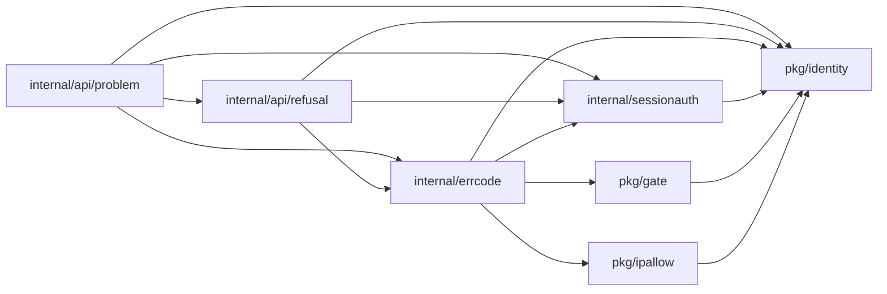

## Context

The error-code catalog builds Forbidden answers from domain errors. The catalog takes plain fields only, with the domain mapping on the adapter side.

## Decisions

1. **Adapter-side Forbidden mapping.** Move Forbidden domain-error inspection out of internal/errcode into internal/api/problem and internal/api/refusal. internal/errcode keeps func New with plain code and values only and imports no pkg domain package and no internal/sessionauth.
2. **Identical answers, match order, and fallback.** Keep answers byte-identical. The adapter matches each domain cause with errors.As in the order gate, identity, ipallow, sessionauth; first match wins. A domain error with no match falls back to the existing generic Forbidden answer with no input text. Goldens are unchanged.
3. **Single import guard test.** Add one NEW import guard test in internal/errcode that denies imports of pkg/gate, pkg/identity, pkg/ipallow and internal/sessionauth from internal/errcode. No structure removes the need because the catalog and the adapters are separate packages and an import edge is a dependency rule.

## Structure

Keep the catalog table in internal/errcode with constructor func New in internal/errcode/answer.go; the constructor checks plain code and values and imports no domain package.

## Risks

- A caller that used a removed errcode helper fails to compile; the build finds it.

## Diagrams

Modules that the change touches, and their imports on main:

## Quality attributes

| Attribute | Target | Unit | Scope |
| --- | --- | --- | --- |
| none affected | Internal import cleanup with unchanged answers |  |  |
