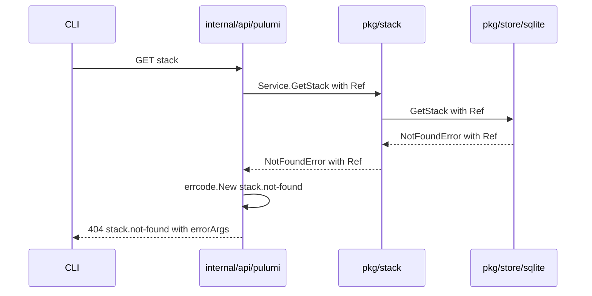
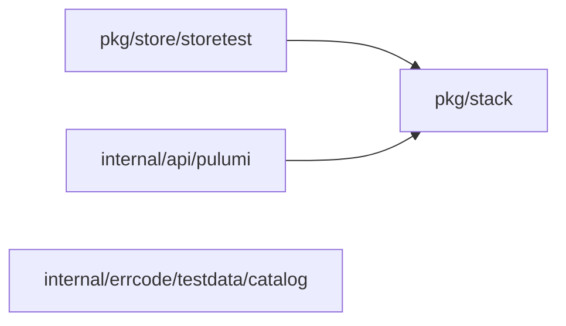

## Context

The adapter holds the values only inside the error text. Typed domain errors give them as fields.

## Decisions

1. **Typed errors carry the named values.** Add typed errors in pkg/stack with Ref, ID, status, time, size and limit fields. Each keeps its sentinel through Is or Unwrap. The adapter reads the fields and passes them to errcode.New. The store checks Active as an identifier before it builds the error. When errors nest, the innermost typed error wins. update.too-large carries bound, size and limit, with bound batch for a journal batch. The reveal path carries path. The URN read path carries the URN as path when it passes the identifier check, else server.internal. The delta preview refusal carries the state preview.

## Structure

Unexported fields in the typed errors of pkg/stack and one constructor for each type. The constructor checks the Ref, ID and status, so an adapter cannot build an answer without its arguments.

## Risks

- The delete refusal path returns no ID until it returns UpdateConflictError.
- A bad Active row value turns the answer into server.internal unless the store checks it.

## Diagrams

After this change:

Modules that the change touches, and their imports on main:

States on main in the touched packages:

## Quality attributes

| Attribute | Target | Unit | Scope |
| --- | --- | --- | --- |
| none affected | Error text and HTTP status stay the same; only errorArgs is added. |  |  |

## Contracts

**Stack**

- Invariant: A stored reference uses the stable names of namespace, project and stack.
- `Service.GetStack`: pre: The Ref holds namespace, project and stack.. Post: An unknown stack returns NotFoundError with the requested Ref..
- `Updates.ExportAt`: pre: The Ref holds namespace, project and stack.. Post: A missing state returns NoStateError or NoStateAtError with the requested Ref..
