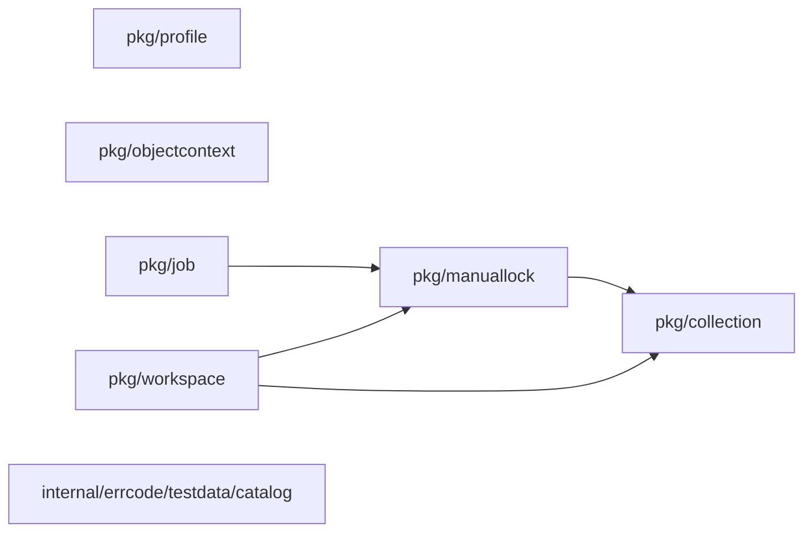
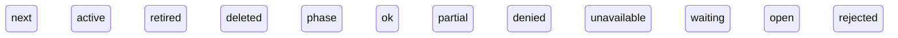

## Context

Typed domain errors carry only text today, so the adapters cannot read the values as fields.

## Decisions

1. **Typed errors carry the values.** Each NEW typed error holds the value as a field, has Is and Unwrap to the existing sentinel, and the classify function reads it with errors.AsType. The catalog declares the arguments.
2. **One unit per code.** Count breaches carry limit. Byte breaches carry limitBytes. profile.limit keeps count breaches. Byte breaches of a profile move to the NEW code profile.too-large.

## Structure

The NEW error types have unexported fields and a constructor, so a value cannot exist without its number.

## Risks

- An old client ignores a new argument; the NEW codes need catalog review.

## Diagrams

Modules that the change touches, and their imports on main:

States on main in the touched packages:

## Quality attributes

| Attribute | Target | Unit | Scope |
| --- | --- | --- | --- |
| none affected | Adds only errorArgs to existing error answers; no latency or storage target changes. |  |  |

## Contracts

**profile document checks**

- Invariant: A limit refusal reports the bound of the failed check.
- `Count limit argument`: pre: A profile count bound is exceeded.. Post: A count breach carries the limit..
- `Byte limit argument`: pre: A profile document exceeds its byte bound.. Post: A byte breach carries the byte limit..
- `Schema version argument`: pre: A document has a schemaVersion above the maximum.. Post: The answer carries the read maximum..
- `Revision conflict`: pre: A publish names a stale revision.. Post: A stale publish carries the newest revision..
- `Revision not found`: pre: A read names a missing revision.. Post: A missing revision read carries the revision number..

**registry publish**

- Invariant: A publish refusal reports the bound of the failed check.
- `Size limit argument`: pre: A release exceeds its byte limit.. Post: A large release carries the byte limit..
- `Too many files`: pre: A publish exceeds its file count bound.. Post: A file count breach carries the file limit..
- `Protocol limit`: pre: A publish exceeds its protocol version bound.. Post: A protocol count breach carries the protocol limit..

**collection and manual lock refusals**

- Invariant: A refusal reports the reference that the text names.
- `Collection reference`: pre: A collection operation fails on a named collection.. Post: A collection refusal carries the collection reference..
- `Collection unit reference`: pre: A collection change names a unit.. Post: A unit edge refusal carries the unit reference..
- `Lock target`: pre: A lock operation fails on a named target.. Post: A lock refusal carries the target and its kind..
- `Lock holder and time`: pre: A lock is held by another holder.. Post: A lock conflict carries the holder and the start time..
- `Context field and limit`: pre: A context write breaks a field rule.. Post: A field rule breach carries the field and its bound..

**job and state version refusals**

- Invariant: A refusal reports the bound or identity that the text names.
- `Job limit`: pre: Open job count reaches the bound.. Post: A job limit refusal carries the limit and the target..
- `Job frozen`: pre: A job start meets a freeze.. Post: A freeze refusal carries the freeze identifier..
- `Job tool unsupported`: pre: A job start names a tool with no steps.. Post: A tool refusal carries the tool..
- `Job executor missing`: pre: A job start names an executor kind that is not installed.. Post: An executor refusal carries the executor kind..
- `Workspace lock holder`: pre: A workspace write meets a lock held by another holder.. Post: A lock conflict carries workspace and holder..
- `Workspace pending bound`: pre: Pending state versions reach the bound.. Post: A pending bound refusal carries pending and limit..
- `State version bound`: pre: A state write exceeds a bound.. Post: A state write refusal carries the bound..

## Failure modes

| Step | Failure | Retry | State after |
| --- | --- | --- | --- |
| Classify typed refusal into coded answer | Classify function misses the typed error and answers a generic code without arguments. | Fix the errors.AsType branch and rerun the handler test; no data change. | Request stays refused with the same HTTP status; no lock, job, or stored state changes. |
| Publish profile revision | Two writers race on a profile revision; loser gets revision-conflict. | Read the newest revision and publish again with that revision. | No write applied; stored revision stays at the newest revision. |
| Acquire manual lock | Manual lock request meets a held lock and answers lock.already-locked. | Wait until since plus hold time passes or ask the holder to unlock, then lock again. | Lock stays held by the same holder; no state change. |
| Start job or drift check | Job start meets open-job bound or freeze and answers job.limit or job.frozen. | Wait for an open job to finish or for the freeze to lift, then start again. | No job started; open job count and freeze unchanged. |
