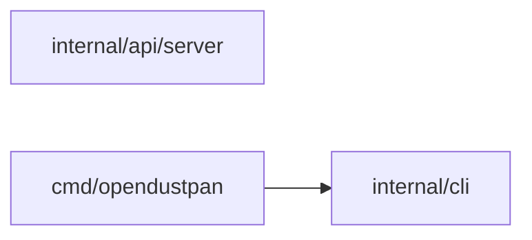

## Context

Four errors omit the missing setting or flag. The fix edits each error where main already returns it.

## Decisions

1. **Fix at the source.** Edit the error text at the existing command, handler, and parse function. Omit the stack URL when no console is configured. Keep the passkey 404 status and name the flag in the body. Add no new route, no new flag, and no new error code.

## Structure

No new type. Each fix edits the error string of the existing command, handler, or parse function.

## Risks

- Error text change breaks a test that matches the old text; the renamed tests and make check find it.

## Diagrams

Modules that the change touches, and their imports on main:

## Quality attributes

| Attribute | Target | Unit | Scope |
| --- | --- | --- | --- |
| none affected | Error text change only with no latency or storage change |  |  |
